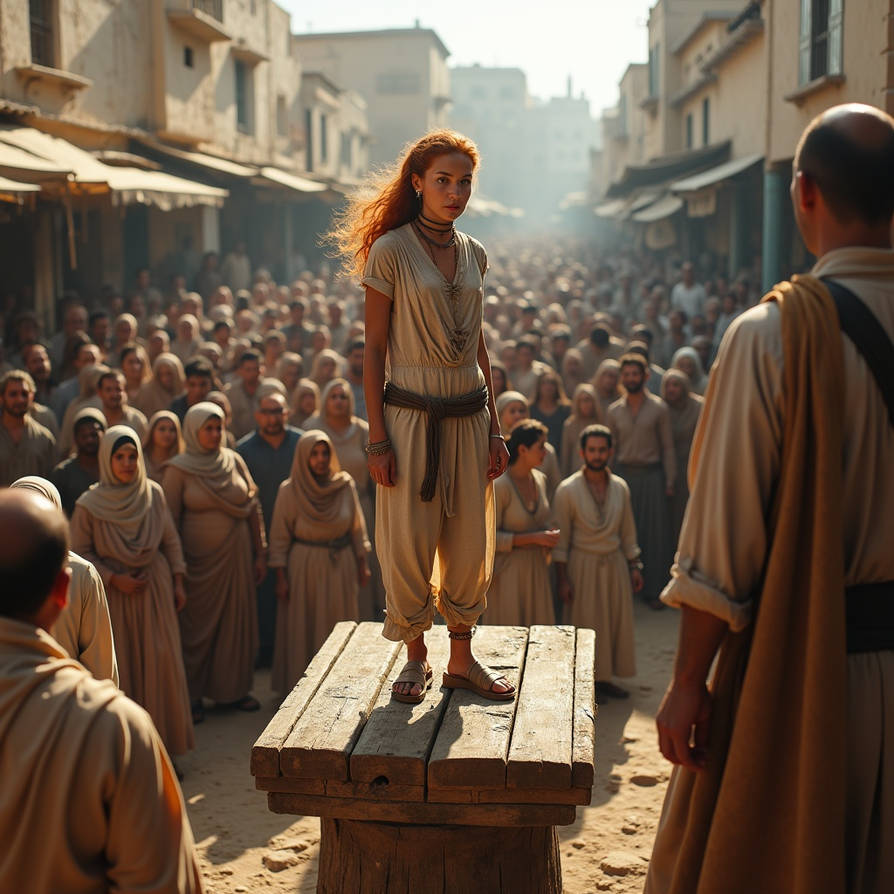
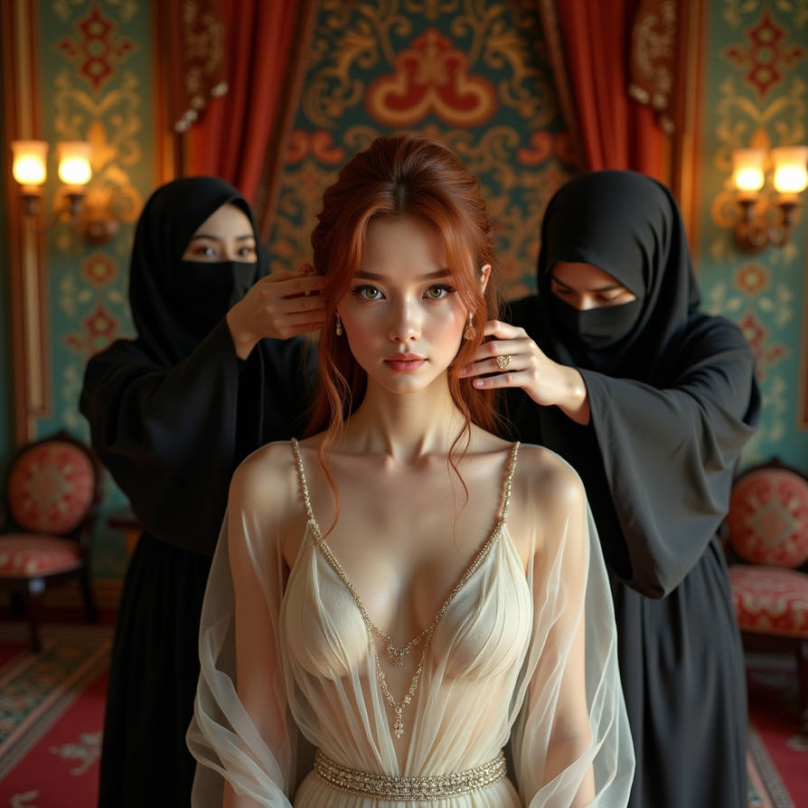

{}
noncon, mc, hypnokink, slavery, ff, mf, md, fd, bodymod,
piercing, anal, oral, hum, bdsm, training, harem, exotic, transformation.
{}

{}

*Angelique, a young influencer and content creator,
joins her friends on a sailing cruise across the Mediterranean, dreaming of sunlit waters and carefree days.
But when their ship is overtaken by modern slavers off the Moroccan coast,
she is torn from her world and sold into a powerful man’s harem.
Under the watchful eyes of her owner and his women, Angelique—renamed Wardah—is drawn into a life of discipline,
luxury, and unrelenting training where obedience becomes desire.
What begins as captivity slowly reshapes her body and soul, binding her to a destiny she never could have imagined.*

{}

# EPUB

Read below, or click on the image for the EPUB download:

# Angelique

## Chapter 1: A Dinner in Ibiza

Angelique checked into the Nobu Hotel Ibiza Bay, a short drive from the marina.
In her suite, she paused at the ocean view and let the weariness of the flight subside.
Eager to make the right impression, she chose a tailored, off-the-shoulder navy dress
that hugged her frame, and heels high enough to make her stand a little straighter.
She added her signature red lipstick
and a few gold bracelets that caught the light as she moved.
It was her way of blending business with just enough flirtation to keep things interesting.

Downstairs in the hotel’s restaurant, she spotted Olivier at a table near the terrace.
He sat quietly in a black blazer, as reserved as ever,
but looked up in surprise as she approached.
Seated beside him was a tall, tanned man with sandy blonde hair,
who sat as loosely as if he were still on deck.
Opposite them was a woman with dark, glossy hair and a piercing gaze, already deep in conversation with Olivier.

Olivier stood and offered his hand.
“Angelique, welcome to Ibiza.
I’d like you to meet my friends.
This is Marc Delacroix, the man behind our little gadget venture,”
he nodded toward the blonde man, who gave her an easy smile.
“And Elise Dubois,” Olivier continued, “she’s writing a feature on Marc’s VC business for The Economist.”

“Pleasure to meet you,” Angelique said,
glancing at Elise, who greeted her warmly.

Over dinner and wine, they began to talk.
Marc leaned forward,
eyes twinkling as he explained the gadget: a rugged, solar-powered satellite hotspot designed for sailors,
climbers, and travelers who needed to stay connected off the grid.
“It’s called the WaveLink,” Marc said, with a faint trace of pride.
“Gives you a lifeline anywhere on earth, or at least anywhere with a view of the sky.
Angelique, it’s the kind of tech that would do well on your channel.”

Elise laughed. “Well, Marc here would know.
He’s had his fair share of off-grid adventures—though not all of them went smoothly.
Tell her about your trip to Madagascar, Marc.”

Marc grinned.
“Ah, that one.”
He chuckled, leaning back in his chair.
“It was a year ago.
I decided to explore the northern coast with a local fishing crew,
no fancy tech, no back-up plans, just good old-fashioned seafaring.”
He paused, glancing at Olivier with a playful glint.
“Let’s just say the boat wasn’t exactly seaworthy.
We ended up stranded on a sandbank for two days.
No radio, no cell signal.
When we finally got rescued, I promised myself I’d never sail without the right tech again.”

Everyone laughed. Across the table, Elise was still smiling.
Then Elise told them about an encounter while reporting in Beirut.

“It was a tense week,” Elise began, eyes darkening.
“I was doing a series on young activists.
Just when I thought I was safe, the local police decided otherwise.”
She paused, flashing a self-deprecating smile.
“They dragged me to the station for ‘questioning,’ convinced I was stirring up trouble.
A colleague managed to get the French embassy on the line, but those were some of the longest hours of my life.
After that, I learned to tread more carefully.”

Angelique tried to picture Elise in that police station, keeping her nerve.
“You’re braver than I am,” she murmured, catching Elise’s eye.
Elise shrugged, a playful smile returning to her lips.

“And you’re smarter than me, building an entire brand on your own,” Elise replied, tilting her head thoughtfully.
“You’ll make this WaveLink look amazing, I can already tell.”

Over a final glass of wine, Marc leaned forward.

“You know,” he said,
swirling his glass thoughtfully, “the Mediterranean is stunning this time of year, especially on a good boat.
Why don’t we take Epicurean out for a sail?
Chart a course to Málaga, make a week of it.
The weather’s ideal; still warm, but not scorching.
And the water is perfect for a swim or two.”

Elise’s eyes lit up.
“That sounds incredible,” she agreed, leaning back in her chair with a smile.
“I could use a week away from deadlines.”

Angelique’s gaze flicked to Olivier, curious to see his reaction.
He held her glance, then nodded to Marc.
“Not a bad idea,” he agreed, then turned back to Angelique with a subtle grin.
“And I think Angelique would make an excellent addition to our crew.
What do you say?”

Her lips curled into a teasing smile.
“Well, I can’t say I’ve spent much time sailing, but I’m not one to turn down an adventure.
Besides,” she added, arching an eyebrow at Marc, “someone needs to make sure you don’t strand us on a sandbank again.”

Marc let out a hearty laugh, raising his glass to her.
“Touché.
I promise, this time I’ll have the tech covered.
Epicurean has everything we need—navigation equipment, comfortable cabins, and all the essentials.
Plus, we’ll stop along the way.
Good food, good company.”
He grinned, raising his glass to them.
“To our journey.”

They clinked glasses.
As the evening wore on, Angelique felt Olivier’s gaze linger on her now and then,
though he made no move to draw her aside.
Soon they would be aboard the Epicurean together.

Back in her room, Angelique pictured the gentle rocking of the boat,
the sparkle of sunlight on the water, the nights spent under starlit skies.
And then, the thrill of knowing she’d be in close quarters with Olivier for a week.

## Chapter 2: A Departure from Ibiza

The next morning, Angelique arrived at Marina Ibiza,
and grinned at the sight of the Epicurean at her mooring.
Marc was already there, overseeing the final checks and talking to a marina attendant.
Elise arrived just behind Angelique, her expression as eager as Angelique’s, and Olivier soon joined,
smiling at her as he approached.

Once they were all on board, Marc handled the lease paperwork,
then turned to his makeshift crew with a grin.
“Alright, welcome aboard the Epicurean,” he announced, spreading his arms as if to present the boat in all its glory.
“She’s a Beneteau Oceanis 55,
a beauty with enough room for us to be comfortable and plenty of power to get us to Málaga.
Now, quick orientation so you don’t lose your way in the first hour.”

He led them through the deck and interior,
showing them the cockpit, the galley, and the seating area, then down to the cabins.
“Two cabins in the back,” he gestured toward the stern,
where Elise and he would be staying, “and the two forward cabins for Olivier and Angelique.”

Her cabin was roomy for a boat, though smaller than any hotel suite she had stayed in.
She liked its snugness, the way everything fitted within reach.
She shared a knowing glance with Olivier, who seemed equally intrigued.

Before they could settle in, Marc’s voice called them back to the deck.
“All right, team, we’ve got supplies here for two weeks—plenty of water,
food, and, of course, a respectable stash of wine.”
They chuckled as a marina crew began unloading crates and boxes.
They formed a line and passed the supplies down to the galley and storage lockers.

When they had stowed the last crate, Marc gathered them for a safety briefing.
His usual easygoing manner had sharpened with purpose.
“Listen up.
Everyone’s a captain in fair weather,” he said, his tone steady but serious,
“but here’s what you need to know to make sure we’re all safe if things get rough.”

He showed them how to use the life jackets and emergency radio,
and stressed the need to keep calm.
“If anything happens,” he said, looking each of them in the eye, “we’ll handle it together.
But everyone needs to know the basics.”

Angelique listened closely.
She had not expected danger, but Marc spoke as though these were things she might need to know.
A few minutes later, he gave her shoulder a reassuring pat, as if sensing her thoughts.

By two in the afternoon, they were ready to set off.
As they cast off and Marc guided the boat out of the marina,
the sea stretched out before them, wide and welcoming.
The October sun cast a soft glow on the waves, and the Epicurean moved forward smoothly,
leaving the marina behind.

With a steady, moderate wind pushing them forward,
Marc calculated that the journey to Cartagena could take about two days if they kept a relaxed pace,
aiming to cover roughly 80 nautical miles each day.
At this rate, they'd arrive late on the second day or early the next morning,
giving everyone time to settle into the rhythm of sailing.

After clearing the marina, Marc turned to the crew.
“Alright, let’s get the sails up.
I’ll keep the engine running at low speed for rudder control, but I want everyone to get a feel for the process.
Ready?”

They took their places, then lost track of one another.
Lines tangled, hands slipped, and the mainsail caught awkwardly.
Marc shook his head with a wry grin, signaling them to bring everything down.
“Again,” he called.

On the second attempt, they timed their movements better.
The sails caught the wind gracefully, the mainsail filling and the foresail billowing.
Satisfied, Marc nodded, though he wasn’t quite finished yet.

“Now, let’s try putting in a couple of reefs on the foresail,” he said,
demonstrating how they’d reduce sail in stronger winds.
He took them through the steps with patience,
showing them where to handle the sheets and where to keep clear of the boom.

He then had them practice maneuvers,
tacking and jibing to get them accustomed to the motion of the boat and the swing of the boom.
“Remember,” he said, pointing to the mainsail boom, “keep your heads down and be aware of where it’s headed.
This thing doesn’t care if you’re watching.”

Finally, with everyone looking a little more confident, Marc adjusted their heading to Cartagena.
The sails filled just right, and he cut the engine, letting the wind take over.
The quiet hum of the boat against the waves settled in, a calming rhythm.

“Since we’ll be sailing through the night,” Marc began,
glancing between Olivier and Angelique, “Elise and I will take the helm until one.
Then you two are up.
Olivier, if anything feels off—anything—wake me.
I don’t expect trouble, but it’s better to be sure.”

Olivier nodded, and Angelique looked at him, suddenly uncertain.
She had never stood a night watch,
but the prospect of taking the helm under the stars sent a thrill through her.
Elise squeezed her arm reassuringly.
“You’ll get the hang of it,” she said with a warm smile.

As the afternoon stretched on, the Epicurean glided smoothly,
the sun lowering over the horizon and the Mediterranean sparkling around them.

Angelique began to learn the rhythm of life at sea.
Whenever Marc called for a maneuver, everyone snapped into action, abandoning books, tablets, and earbuds,
letting them clatter down the stairs to the main cabin before hurrying to their posts.
At Marc’s commands, they shifted ropes, adjusted the sails, and double-checked their positions,
moving in a practiced chaos that ended as quickly as it began.

Between maneuvers came long stretches of calm—time for reading, sunbathing,
and letting the warm Mediterranean breeze wash over them.
Angelique made herself comfortable on the foredeck, sprawled out under the sun, knowing Olivier had a front-row view.
She shifted, letting her dress catch the light and give him a hint of the bare skin along her back and shoulders.
From behind his book, Olivier tried his best to keep a neutral expression,
though she noticed how he shifted, repositioning the book a little higher.

Just as she opened her mouth to ask him to handle the sunscreen on her back, Marc’s voice rang out,
cutting through the lazy quiet of the afternoon.

“Maneuver up!
Large tanker coming up behind us, so let’s give her a wide berth.”
He gestured to a massive commercial ship in the distance, moving fast and growing larger by the second.

Angelique sighed, rolling to her feet, but there was an undeniable thrill in the sudden switch to action.
Marc guided them to shift course, everyone taking their places,
Elise moving quickly to secure a line while Olivier tightened a sheet.
They held position,
watching the tanker surge past with a low rumble, a stark reminder of how small they were on the open water.

Once the tanker was safely past, Marc gave the all-clear,
and Angelique made her way back to the foredeck, a teasing smile on her face as she looked over her shoulder at Olivier.

“Now, where were we?” she said, tossing him the bottle of sunscreen.

He hesitated for a moment, then pushed himself up and joined her,
letting his hands gently spread the lotion along her shoulders, careful and deliberate as he worked his way down.
She glanced back at him, arching an eyebrow, a slight smirk on her lips.

As Olivier's hands slid over her back, Angelique tilted her body just enough to brush against him,
a slight, intentional wiggle that sent a clear message.
His hands tensed, his fingers pressing a little harder into her skin,
but he kept his composure, moving slowly, methodically—almost torturously so.
She let out a faint sigh, expecting him to finally lean in and close the distance,
but he remained infuriatingly controlled.
Just as she started to wonder what was holding him back,
he let out a low, possessive growl and firmly grasped her waist,
pulling her close.
His voice, rough and teasing, made her pulse quicken.

“Careful what you wake here,” he muttered, his hand slipping lower. “You may have to feed it when it awakes.”

The thrill of his words sent a shiver through her, but just then, Elise’s voice rang out from below decks.
“Dinner’s ready!”

## Chapter 3: A spicy Dinner

Olivier’s eyes darkened, lingering on hers for a moment longer before he released her with a reluctant grin.
She smoothed her dress, and they made their way below,
catching Marc’s approving nod as they sat around the compact table.
Marc and Elise had made a simple meal fragrant with fresh herbs.
Elise told stories of her travels, and Marc answered with his own from the sea,
pausing now and then to check the radar.

As they finished, Marc reminded Olivier and Angelique of their shift in the early hours.
“We’ll hold the fort until one,” he said, shooting a quick look at Olivier.
“Get some rest.
You’ll need it.”

After helping clear the table, Olivier followed Angelique down the narrow corridor.
As they stopped before their respective cabin doors,
the air between them was thick with the tension left unresolved from earlier.
Without a word, Olivier closed the gap,
pressing her back against the cabin door and capturing her mouth in a heated kiss.
Angelique’s heart raced as she felt the full intensity of what she’d awakened earlier.
His hands explored with rough confidence, and she responded in kind, matching his urgency.

Whatever restraint he’d held onto earlier was gone, and she felt the promise in his touch—this was only the beginning.
As his hand slid over her hip, she finally understood his warning.
Breathless, she whispered against his lips, “I’m ready to feed it.”

As Olivier pushed Angelique into the cabin,
closing the door with a kick, his hands were slipping her dress down over her shoulders,
letting it pool at her feet.
His fingers traced over her skin,
sliding under the straps of her swimsuit and tugging it down, revealing her inch by inch.
The intensity in his gaze made her shiver, the hunger and the purpose that sent a thrill through her.

She reached for him, fingers sliding under his polo,
but before she could lift it over his head, he grabbed her waist with a firm, steady grip and lifted her effortlessly,
laying her down on the bed.
She felt the solid strength beneath his lean frame as he held her down,
a quiet promise that he wouldn’t be gentle tonight.
Though Olivier was no towering figure,
there was something in the way he held her that made her feel utterly at his mercy.

He took his time, exploring her with hands and mouth.
He took his time, which taunted and thrilled her.
Whenever she tried to pull him closer to take some control,
he thwarted her with a gentle but unyielding pressure.
His lips and fingers found her sensitive spots and left her breathless.
The more she tried, the more he seemed to revel in keeping her pinned beneath his touch,
guiding her to surrender completely.

Her breaths came faster as he worked his way across her skin,
touching and teasing her in ways that left her powerless.
She’d thought she was the one tempting him, yet here she was, helpless under his gaze and his touch,
feeling herself unraveling as he took her further than she’d anticipated.

Olivier held Angelique’s gaze, his smirk dangerously playful as he leaned closer.
His voice dropped to a low growl and he deadpanned:
"Would you offer your throat to the wolf with the red roses?"

A shiver rolled down her spine, looking into his intense eyes.
If she nodded, he’d make her his, right here, right now, and there would be no holding back.
Breaking the mood, she asked:
“Do you have a condom?”

He nodded, and grinned, pulling one from his pocket,  and she answered with a simple nod of her own.
That was all it took—Olivier growled softly,
and the tension was back as he moved to claim her.

Meanwhile, above deck, Elise sat nestled in Marc’s arm in the warm evening air.
She’d brought along a novel, one that she knew would make Marc’s interest peak—
*The Siren*, a particularly spicy romance.
Her voice was low and soft as she read aloud with the quiet rhythm of the waves against the hull.

Marc’s fingers traced small circles along her hip,
occasionally drifting up to playfully tease her through the thin material of her swimsuit.
Every now and then, Elise’s voice would falter, breath catching as Marc’s touch grew bolder.
She pressed closer into his side, a flushed as he continued to explore her in a slow, leisurely rhythm.

“You’re not making this easy,” she whispered, her voice barely audible as his fingers lingered over her,
but Marc only chuckled and pulled her closer.

“Patience,” he murmured in a teasing rumble.
He knew they’d have to wait until the watch change, but for now, he was content to keep her on edge,
drawing soft gasps and quiet moans that no one but him could hear.
Elise knew that she wouldn’t find release until Angelique and Olivier took over at 1 a.m.,
but that only seemed to add to the thrill.

Distant lights of passing ships glided by, leaving a low engine hum in the night.
Elise did her best to focus on reading *The Siren* aloud to Marc.
She’d been determined to keep going despite his distractions,
but his touch intensified as the story’s spice level climbed.
Her swimsuit was clinging damply to her body, made her predicament worse, leaving her flushed and aching.

Each time her breath caught mid-sentence or her voice wavered,
he smirked, a look that held just the right amount of satisfaction.
He was fully aware of the effect he had on her,
and while the night air kept a slight chill, the heat between them had Elise biting her lip.
It would take all her willpower to hold back until the watch change at one.

Sometime after midnight, Marc closed her book, leaving her in suspense as he gently nudged her shoulder.
“Go freshen up,” he said, his voice low and suggestive.
“We still have a bit of time.”

Elise returned to the cabin and showered to cool her skin and rinse away the evidence of Marc’s teasing.
When she reemerged on deck, her long hair hung loose,
and she wore a short, light sundress that fluttered against her bare skin.
There was no mistaking that she’d left her swimsuit behind,
and Marc’s appreciative glance confirmed she’d hit her mark.

He let his gaze wander slowly down her body, taking in every detail,
then looked back up with a smile of approval, his eyes darkening as they lingered on the curves beneath the dress.
With a slight raise of his brow, he made a show of glancing at his watch,
the corners of his mouth twitching as he checked the time.

“Just a few more minutes,” he murmured, stepping closer.
He trailed a finger along her shoulder, down to her wrist, leaving her practically vibrating with anticipation.
The minutes ticked by slowly, each second making her long for the relief.

As the clock finally neared one,
the distant sound of Angelique and Olivier stirring below decks signaled the end of their watch.
Marc’s hand slipped to the small of her back, guiding her toward the cabin door with a quiet laugh.
“Come on,” he whispered, his voice thick with promise, “you’ve waited long enough.”

The handover was smooth and uneventful.
Marc briefed Olivier on their course, a steady line on the GPS, and went over the watch routine once more,
pointing out the tanker lights they might see through the early hours and reminding him, yet again,
to wake him if anything seemed amiss.
Satisfied that everything was in order, Marc gave Olivier a reassuring pat on the shoulder and headed below deck.

When he reached his cabin, he found Elise waiting, her sundress discarded.
Her skin was warm and flushed from the long hours of anticipation.
She met his gaze with a look that left no question of how ready she was,
her body responding eagerly to every touch after the night's build-up.
They lost themselves in each other,
finally indulging in the release they’d been holding off on.

By the time they stirred, the sun was already high.
They dressed and went up on deck.
Angelique and Olivier sat at the small table over croissants, fruit, and coffee.
Angelique looked up with a wry smile.

“Good morning, sleepyheads,” she teased, passing Elise a plate of strawberries.
Elise smirked. Over his coffee, Olivier gave Marc a knowing look.

Marc shrugged and helped himself to a croissant.
“Long night,” he said, and Elise stifled a laugh.
They settled around the table in the warm air, the sea calm and clear before them.

In Cartagena, Marc suggested a walk through the old city
to stretch their legs after two days on the water.
They began with a guided tour of the Roman Theater.
Angelique posed against the ancient stone walls and took photos with Elise for her social media.
Elise lingered over the city's history; Olivier studied the architecture.
Marc told them stories about the old port.

By midday, they had reached a crowded market.
Angelique and Elise browsed handmade jewelry, crafts, and bright textiles,
while Olivier bought a few bottles of local wine.
Marc insisted they try the food: fresh anchovies, spicy meatballs, and other tapas.

That afternoon, they drove the short distance from the marina to Cala Cortina.
Angelique read on the sand while Elise went swimming and invited Olivier to join her.
Marc put on a diving mask and explored the rocks offshore, looking for fish.

Back aboard, they washed and changed for dinner.
At sunset, they walked to a seafood restaurant by the marina
and ate grilled dorada and calamari with a crisp local white wine.
They traded stories and laughed across the table.

They walked back to the Epicurean in the cool night air,
rested and ready to sail again.

## Chapter 4: A Storm

The morning they set out from Cartagena, the skies were clear,
but Marc kept an eye on the weather reports,
which warned of a powerful gota fría storm over Valencia.
The wind had picked up faster than expected,
blowing at a steady 6 on the Beaufort scale, with gusts reaching 9.
By mid-morning, Marc was considering a course farther south to avoid the worst of it.

Marc kept only the foresail up to give them better control.
After a while, even that seemed too much, and he called for a reef, then a second,
showing the crew how to pull in the sail to reduce its surface area.
Angelique, Elise, and Olivier moved with more confidence than on their first day,
but Marc kept checking their safety gear.

“Life jackets on, always,” he instructed firmly, his voice rising over the wind.
He pointed to the harness lines he’d secured around the cockpit.
“And make sure you’re clipped in at all times.
We’re deep into the open water now, and in these gusts, one misstep can be dangerous.”

Angelique tightened her life jacket and clipped herself to the line, trying to steady her hands.
Elise, too, buckled her harness, casting a quick, reassuring look at Marc as he came around to check the clips.
“Always remember,” he said, raising his voice again over the rush of the wind, “one hand for the man—”
he caught Elise’s eye with a half-smile, “or woman—and one hand for the ship.”

The boat leaned heavily into each gust, the sails pulling them southward.
By midday, their course was well below Almería, heading them closer to the coast of North Africa.
Marc checked their position: they were approaching Nador.
Angelique wondered if he meant to put in there.

The sea swelled around them, each wave seeming to rise higher than the last.
Olivier took his turn at the helm,
his hands gripping tightly as Marc instructed him on maintaining the angle to the waves.
Spray struck their faces, but they no longer needed Marc to direct every movement.

As evening fell, Marc gathered them in the cockpit.
“We’re a good bit off course now.
I want everyone to be prepared.
If the wind keeps up, we may need to pull into Nador for the night.”

Angelique nodded, her eyes wide.
Elise moved to sit beside her, offering a steadying hand.
Olivier kept his gaze on Marc, nodding in agreement.

The boat rocked and surged beneath them.
Angelique watched Marc at the helm, waiting for his next instruction.

Marc guided the Epicurean into Nador’s harbor under motor, his hands steady on the wheel.
With all sails hauled in, they faced the force of the wind and waves directly from the starboard side.
Every few moments, a towering wave crashed against the hull, sending a cascade of seawater across the forecastle.
Angelique and Elise clung to the railings, their hair plastered to their faces,
dripping with salt and spray as they braced against each lurch of the boat.

They passed the breakwater, and the boat steadied in the shelter of Nador’s inner harbor.
Grey clouds churned above,
casting a shifting light over the docks and rundown buildings along the shore.
The air smelled of diesel and salt. Grime coated the docks.

They pulled alongside a worn, rust-streaked dock,
the cement chipped and covered with patches of algae and old fishing nets.
Marc kept a careful eye on their approach, calling out instructions to Olivier, who quickly secured the lines.
As the boat settled, Angelique looked around, catching sight of a few men lingering near the edge of the quay,
watching them long after Marc had secured the boat.

One of the men, tall and gaunt with a cigarette dangling from his lips,
nudged his companion and muttered something in a language she couldn’t make out.
His eyes lingered on her and Elise, the two of them dripping wet, their clothes clinging to every curve.
Angelique folded her arms across her wet clothes.
Elise watched the men, then gave Marc a slight nod.

Scraps of rope, discarded nets, and empty bottles littered the dock,
and the handful of boats moored nearby were a mix of fishing vessels and smaller, questionable-looking craft.
A few weathered men sat huddled against a nearby wall,
eyeing the Epicurean. Angelique saw no welcome in their faces.

Marc stepped onto the dock,
his expression steely as he secured the last line and gave a polite but firm nod to the men nearby,
acknowledging them without inviting any closer approach.
One of them, a burly man with a weathered face and a cigarette-stained beard,
stared at him, giving a slow nod of acknowledgment but not moving from his spot.

“Let’s get below,” Marc said quietly to the others, his voice calm but with a note of urgency.
“We’ll keep to the boat tonight.”

As they made their way down into the cabin,
Angelique still felt watched.
Outside, the wind howled through the port.

## Chapter 5: A rough night and an early departure

As the storm battered Nador’s harbor,
Marc and Olivier quietly agreed to split the night watch.
The men near the dock had kept their distance,
but the Marc and Oliver knew better than to leave the Epicurean unattended.
Olivier took the first watch near the cockpit, where he could see the pier.
Passing headlights swept over the men huddled nearby,
but the strangers stayed out of the boat’s reach, their eyes darting only now and then toward the Epicurean.

Meanwhile, below deck, Angelique and Elise were grateful for the warmth and privacy of the cabin.
They took turns in the tiny shower,
letting the hot water wash away the salt and warm their chilled skin.
Once warm and dry, they slipped into their bunks,
and slept without dreams as the boat rocked in the sheltered harbor.

Around one in the morning, Olivier gently tapped Marc’s shoulder, signaling his turn for watch.
Marc nodded, stretching his tired limbs as he moved up to take Olivier’s place on deck.
The storm raged on, but the rain had eased to light drizzle,
and the wind had steadied.
Marc wrapped his jacket tighter around himself, scanning the quiet, dimly lit harbor.
The men from earlier were gone, and apart from a few cats slinking around the piles of fishing gear, all was silent.

At dawn, a slate-grey sky hung over water that had settled to a soft roll.
Marc decided it was time to leave.
He went below deck to rouse the others, finding Olivier already awake, sipping coffee in the galley.

Angelique and Elise joined them,
still bleary-eyed from sleep but grateful for the promise of an escape from Nador’s uneasy harbor.
They dressed quickly and joined Marc and Olivier on deck, where they helped with the lines.
Angelique glanced back at the men along the quay,
their expressions unreadable but their eyes locked on the departing boat.
The men didn’t wave or shout,
merely stood, cigarettes smoldering,
watching the Epicurean motor out into open water.

Out at sea, the boat rocked gently as the remnants of the storm tugged at it,
the wind still strong but steadying, the sky gradually brightening to reveal patches of lighter clouds.
Angelique and Elise,
emerging from below deck, looked out to see the harbor fading behind them,
and Angelique breathed more easily as the quay receded.
Olivier joined them,
offering a reassuring smile as he handed Angelique a coffee, the warmth a comfort in the lingering chill.

Marc scanned the sky, observing the wind shifting from north to west.
It was far from ideal for sailing,
but after a night spent on edge, he wasn’t keen to test his luck with an inexperienced crew in unpredictable conditions.
The fuel gauge showed enough diesel for the next leg.

“We’ll stick to the motor for now,” he called over the hum of the engine.
“With this wind, we’d be fighting more than we’d be sailing, and I’d rather save you all the hassle.”
He gave them a reassuring grin, though his eyes were serious, keeping watch on the horizon.

Farther from shore, sunlight broke through the clouds.
Angelique leaned against the rail, the wind sweeping her hair back, her gaze lingering on the open sea ahead.
Elise joined her, both of them breathing easier now, feeling the tension of the night in Nador slipping away.

By mid-morning, the sea had settled into a steady rhythm,
and while the sky remained overcast, the worst of the storm had passed.
Marc kept his eye on the course, his mind focused on reaching Almería without further detours.
They made little headway against the wind and waves, but the day passed without incident.
Olivier held the helm as the Epicurean rolled through the night.
The motor drowned out the engines of two aluminum RIBs approaching in the dark,
each carrying six armed men.

The attack came swiftly.
Olivier didn’t hear them approach until he heard boots on the deck.
He barely had time to turn, shock on his face,
before two sharp cracks echoed across the boat, and he slumped to the floor.

The shots woke Marc below.
Two men burst into his cabin with their weapons raised.
They shot him twice before he could move.

Angelique woke to footsteps outside her cabin.
The door crashed open.
Hands pinned her down, bound her wrists, and covered her mouth.
Men shouted in a language she did not understand.
Through the noise, she heard them forcing Elise’s door.
The attackers searched the cabins, taking cash, jewelry, and electronics.

They dragged Angelique onto the deck.
She looked for Elise and saw her struggling in the men’s grip.
They forced Elise toward one of the RIBs and hauled Angelique into the other.
She could neither call out nor reach her.

The men left explosives aboard the Epicurean.
As the RIBs sped away, Angelique heard a muffled thud and twisted around.
Water and debris rose where the yacht had been.
Then the wreckage sank into the the deep, unforgiving Alboran Sea.

Ripples spread across the place where the Epicurean had gone down.

## Chapter 6: A Trip through the Desert

The RIB’s twin engines drove it across the waves.
Angelique lay on the aluminum floor, each impact jarring her bruised ribs,
the ropes rubbing her wrists raw.
Saltwater splashed over her, stinging the scrapes and bruises that covered her legs and arms,
and a dull ache throbbed where the rough metal had bitten into her flesh.

At last, the RIB veered toward a rocky, desolate stretch of coast,
mountains rising above it in the dim light.
The shore was harsh and unwelcoming, littered with sharp rocks and dark, jagged slopes that rose steeply from the water.
They had come to a place where the wild terrain met the coast in sheer cliffs,
broken only by the occasional dry riverbed—the narrow wadis that offered a way up into the mountains,
dangerous even in fair weather, treacherous in the rain.

Waiting in the shadows along the shore were more men, bundled against the storm with mules at their side.
Angelique barely had a chance to register her surroundings before rough hands yanked her off the RIB,
cutting her bonds only to bind her arms behind her back with heavy padded leather cuffs.
She gasped as they hoisted her onto a mule,
forcing her to lie face down, her body pressed painfully against the animal’s back,
each step jarring her bruised ribs and aching limbs.
The men showed no mercy, pushing on without a word,
ignoring her muffled cries as the mule began its slow, unsteady climb up the steep trail.

Higher up, icy rain soaked her clothes.
The cold bit into her skin, each droplet a fresh sting,
and she shivered uncontrollably as the rain mixed with the blood and salt on her raw skin.
The trail was slippery, treacherous, and every lurch of the mule sent a fresh wave of pain through her.
The men guided the mules up the twisting mountain path,
their voices barely audible over the storm.

At last they reached a narrow plateau where an SUV’s headlights lit the mud.
Angelique was too weak to resist as they pulled her from the mule and dragged her toward the vehicle.
They left her slumped on the cold leather seat.
She drifted in and out of sleep,
each bounce of the SUV jarring her awake.
The padded leather restraints held her wrists behind her,
fastened to a thick belt around her waist,
ensuring she couldn’t move her arms more than an inch or two.
Her ankles were similarly secured,
and she could feel a padded collar snug around her neck,
limiting her ability to shift or lift her head.

The acrid scent of antiseptic hung in the air.
The raw spots from the night’s rough treatment were now covered,
and her skin prickled from what felt like a numbing cream.
She could not mistake it for kindness: the restraints were still fastened.

Her eyes darted around, taking in the shadowed confines of the SUV.
Darkened windows obscured the outside, leaving her with only her captors for company.
The man next to her sat calmly,
silent and imposing in a traditional jellaba with its hood raised, his expression hidden.
His hands rested on his lap. Combat boots showed beneath the robe.

Angelique’s throat was parched, and instinctively, she tried to speak,
managing only a rough croak before a sharp, stinging slap cut her off.
The force of it left her cheek burning, and she recoiled, tasting the metallic tang of blood where her lip had split.
She closed her mouth.

Gritting her teeth, she forced herself to stay silent,
blinking back tears of frustration as she glanced to the front of the vehicle.
Two more men sat in the driver’s and passenger’s seats, their faces partially hidden beneath hoods,
their figures just vague shadows under the dim interior light.
Occasionally, she caught the glint of a watch or the reflection of an eye as they glanced back,
keeping a cold, wary eye on her.

Every so often, another vehicle appeared in the distance, loosely keeping pace with them.
It was impossible to see who was inside, but she clung to the faint hope that Elise might be in that second car,
that her friend was still alive and enduring this same nightmare, somewhere close by.

The SUV jolted along a broken road.
Angelique fought against the panic rising in her chest,
trying to maintain control, to think through the haze of fear and pain.
She didn’t know where they were taking her, or what awaited her and Elise at the end of this road,
but the burning in her cheek kept her from trying to speak again.

The journey blurred into an agonizing stretch of hours—or perhaps days—for Angelique.
Every so often, the SUV would halt, and she’d be dragged out,
her legs shaky as they unfastened her ankle restraints just long enough to shove her down onto the rough earth,
her trousers tugged unceremoniously to her knees.
Each time,
she felt a fresh wave of humiliation as she was forced to relieve herself under the unfeeling gaze of her captors.
She kept her eyes trained on the ground, cheeks burning,
a sense of helplessness clawing at her as she gritted her teeth and waited for each degrading moment to pass.

Afterward, they pulled her upright, handed her a bottle of water, and ordered her to drink.
Parched from the heat, she drank deeply.
Then her thoughts began to blur.
Fear and anger receded, and she seemed to watch herself from a distance:
someone else bound in the back of the SUV.

Sometimes the man beside her held an energy bar to her mouth and told her to eat.
She chewed, hungry but barely tasting it.
She recognized some English words without quite grasping what they meant.

Hours passed. Or minutes.
She knew the jolting of the road and the slap against her cheek whenever she sank too far into sleep.
Beyond the windows might have been the Sahara or Mars.
She could not hold a thought long enough to decide.
Even the pain seemed distant.

At last the SUV stopped. The engine cut out.
Angelique blinked at a few low, clay-colored buildings beneath rocky cliffs.
Dust dulled the walls and the sparse vegetation.
A village in the foothills. She had no idea which one.

The buildings were worn by sun and wind, some crumbling at the edges.
Thin animals wandered the dirt paths between them.
A few residents watched the SUV warily.

The men pulled Angelique out in the center of the village.
Her stiff limbs ached as she tried to stand.
Still dazed by the sedative, she stumbled between them as they dragged her into a building.

## Chapter 7: An Inspection and an Auction

Angelique stumbled, still affected by the sedative, as the men dragged her into a dimly lit room.
Rough hands shoved her forward, and her shirt and pants were cut off with a knife..
She shivered in the cool air, and fear broke through the drug’s dulling haze.

They forced her onto a large, cold chair,
locking wrists and ankles into place with straps that bit into her skin.
She was secured in a spread, vulnerable position,
and recognized the contraption as a modified gynecologist's chair.
The lay bound and in fear, with her legs forced apart.

A man with the demanor of a doctor, better dressed than the natives of the village,
inspected her body with detached efficiency.
He did not even look at her eyes, nor did he speak to her:
To him, she was just a body to examine, not a person.
Two men in local dress stood guard behind him, watching her.

She tried to speak, but a slap caught her across the face, the pain cutting through her drugged haze.
She flinched, but the doctor's only reaction was a command to her guards.
"Don't mark her," he muttered, then repeated it in a language she guessed was Arabic.
The words were unfamiliar, but she caught something like "ma tkhalliwsh fiha l'atar."

Her ears rang as the doctor examined her without a word.
He pressed a cold stethoscope against her chest and back.
She winced as her heart pounded.
He measured her blood pressure, then held her wrist and counted her pulse aloud.
She could barely hear him over her breathing.

He forced her mouth open and checked her teeth, then shone a light into her eyes.
He worked slowly, his face blank.
Whenever she resisted, he slapped her.
Her cheeks burned, and she grew too frightened to fight back.

Then he moved down to inspect her intimately, and she was helpless to resist.
His touch was impersonal in the manner of a doctor examing livestock rather than a person.
She felt humiliated, tears gathering, but she forced herself not to cry, determined not to give them the satisfaction.
Their clinical detachment made it clear that they didn't see her as a person, just a possession.

They dressed Angelique in scratchy overalls, the legs pooling around her ankles,
and pushed loose, worn slippers onto her feet.
She stumbled as they dragged her outside and onto a weathered wooden platform.
An auction block.
Hands held her upright before the crowd.

Villagers watched from the shadows.
On the other side of the platform, men in tailored suits studied the doctor’s report.
Their assistants checked documents and whispered into phones.

The auctioneer wore flowing robes and an elaborate headscarf,
a costume that made the scene seem staged.
Then he began to speak: rapid Arabic, accented French, scraps of English.
“High-quality.”
“Well-kept.”
“Rare find.”

The bids rose.
Angelique caught numbers but could not tell whether they meant dollars or dirhams.
With each increase, her stomach tightened.

At last came a final bid.
Assistants shifted places. A murmur passed through the crowd.
The auctioneer gestured, and the sale was over.

Men pulled her arms behind her and fastened the padded leather restraints.
They covered her head with a sack and tightened the drawstring at her neck.
Coarse fabric pressed against her face. Hands gripped her arms.
She smelled leather and sweat.

They lifted her into another SUV.
Cool air touched her skin, and the leather smelled cleaner than in the last vehicle.
The engine started.
Beneath the hood, she heard her own breathing.
Someone had bought her. Now they were taking her to him.

She tried to think of Elise.
No one had told her anything since the boats separated.
Had they sold her too? Was she still alive?
Angelique could not make herself stop asking.
But she needed to listen, to stay alert.
She knew nothing about where they were taking her.

The hours passed as the luxury SUV carried her along unseen roads. Her body ached from sitting still, her throat was dry, and her bladder was full. At last, she found the courage to speak.

"Excuse me... please... I need to relieve myself."

No one answered. Then the SUV slowed and stopped. Rough hands gripped her shoulders and pulled her out. The heat outside made her dizzy after the cool air inside.

She stood still as a knife pressed against her. Fear gripped her. She held her breath as the cold blade grazed the skin of her lower body.

She felt the blade cut through the fabric of the overall between her legs, exposing her.
She heard a calm, almost disinterested voice, speaking in plain, accent-free English.

“Kneel.”

She obeyed, kneeling down in fear as good as she could manage this in her bonds.
It was humiliating, but she knew by now that resistance would bring just more pain.
Finally she knelt, sigtless and hooded, deeply ashamed.

“Pee,” the voice commanded.

Swallowing her pride, she did as she was told.

When she finished, they pulled her to her feet and shoved her back into the SUV, leaving her clothes torn. No one spoke. She closed her eyes beneath the hood, ashamed and afraid of what they would do to her next.

## Chapter 8: A Palace

Angelique stumbled forward beneath the hood.
She heard voices around her, some speaking Arabic, others French.
Water trickled nearby, and birds sang in the distance.
Her captors stopped.
Keys rattled, and the men exchanged a few words in Arabic.
Their hands released her, and their heavy footsteps faded.

She stood still, her heart pounding.
A woman touched her shoulder and gently guided her into a seat.
"You are safe now," the woman said in soft, accented English.
"Breathe.
We will take care of you."

Her restraints clicked open. She eased her sore wrists apart, afraid to move farther.
At last, the hood was lifted from her head, and the blinding sunlight made her squint,
her eyes watering as they adjusted to the brightness.
Slowly, her surroundings came into view.

Angelique sat in a courtyard filled with plants and flowers.
Fountains sprayed water over white marble, where it glittered in the sunlight.
After the darkness of the hood and the cramped SUV, the brightness hurt her eyes.

Smooth concrete walls rose five meters around the garden, without a single window.
The only exit was a pair of carved Moroccan doors.
Traditional patterns decorated the modern walls.

The garden reminded her of a harem, built for pleasure and confinement alike.
She looked again at the doors.

A woman sat beside her, dressed in sheer veils that revealed her naked body.
A small gold shield covered her mons, held in place by a thin post through her pierced outer labia.
Gold cups covered her breasts, each fastened through a pierced nipple.
A translucent veil covered her face, showing dark eyes framed by careful makeup.
Her glossy black hair hung in long braids, threaded with fine gold chains and ornaments.

The woman stroked Angelique’s arm as she spoke.

"You will be fine," she said.
"They are strict, but you are safe here.
Follow the rules, and they will take care of you."

Her eyes met Angelique’s.
She seemed to know what Angelique was going through.
Angelique wanted to trust her, but she was still a prisoner.
The woman's kindness offered some comfort.

"My name is Samira," the woman said.
She rose and led Angelique through an archway into a bathroom.
Sunlight entered through skylights above two basins set into the marble floor.
Steam rose from one, while the other held cold water.
The room smelled of jasmine and sandalwood.

Samira removed her veils and pinned up her braids. She led Angelique toward the warm basin.
"Slowly," she said. "The water is hot."
Her voice held a soothing, almost hypnotic quality.

Angelique eased into the hot water.
The heat soothed her aching muscles.
She wanted to refuse Samira’s help, but she remembered the slaps she had received for resisting.
Her skin was sore, and she was too tired to argue.
She let Samira care for her.

Samira stepped into the bath beside her, dipped a cloth into the water, and began washing her.
She was gentle and sensual, each movement almost reverent.
Angelique tensed and blushed as Samira moved the cloth over her body.
Samira watched her with kind eyes, and Angelique let her continue.

Samira washed her hair with scented oil, rubbed her scalp, and rinsed it twice.
Angelique closed her eyes and tried to enjoy the attention.
Yet she knew why she was here.
Someone had bought her, and Samira was preparing her for a purpose she did not know.

When she finished, Samira helped Angelique out of the bath and dried her with a soft towel.
She pointed to a padded massage table with a face cradle.
Angelique obeyed. She lay face down, resting her face in the opening, naked and exposed.

Samira kneaded the tight muscles in Angelique's back, working from her shoulders down to her hips.
She rubbed scented oil into her skin with slow, firm strokes.
The massage was thorough, almost intimate, and Angelique eventually relaxed under her hands, though her stomach remained tense.

None of this was for her comfort.
The oils, the scrubbing, the patient hands were readying her for display.
She remembered the slaps she’d received for speaking up, so she did not try to resist.

Samira kept working, murmuring reassurances as she went.
Angelique lay still, unable to resist the relief as the tension left her muscles.
At last, she fell asleep.

Angelique woke with the warmth of massage oil still on her skin and the faint scent of jasmine around her.
She remembered Samira's gentle hands and the dread she had felt before falling asleep.
She opened her eyes.

Samira knelt beside her, dressed again in her sheer veils, her lips curved in a faint smile.

At Samira's signal, two women entered.
Both wore black abayas and niqabs that hid their faces.
They approached without a word.
Angelique grew tense as they stopped beside her, black faceless figures contrasting sharply with her own pale, uncovered form.

They helped her to her feet and dressed her in veils like Samira's.
The thin fabric covered little of her pale skin.
They loosely braided her red hair, leaving some of it free.
Her only jewelry was a pair of pearl drop earrings.

The women applied her makeup, drawing attention to her green eyes and adding color to her cheeks.
Angelique watched their hands, remembering the slaps she had received earlier.

She turned to Samira, choosing her words carefully.

"Thank you for all of this, Samira," she said quietly. "May I ask what's going to happen? Why am I being prepared like this?"

Samira’s met her gaze.
"You’re going to meet your owner," she replied in lilting singsong English.
"His Excellency will see you today, and he must be pleased.
He is… powerful, and wealthy beyond imagining.
Impressing him is your chance to secure a good place here, to earn privileges in the harem.
From now on, his will is your world, and pleasing him should be your first thought."

Samira's words confirmed Angelique's fears.
She spoke calmly, as though his control over them were an ordinary fact of life.
The shields locked over her body showed that she, too, belonged to him.

Angelique understood why she had been washed, oiled, and dressed. She was being presented to him as a possession, prepared for his pleasure.
She had known she was a captive.
Hearing Samira say it so plainly still shook her.
Open defiance would bring punishment.
Yet she could not bear to give in without a fight.

She needed a plan.
Given time, she might learn enough about her captor to find a weakness.
Until then, she would have to play her part.
Samira watched her.

“Be calm,” Samira said, her voice pitched low, adjusting a lock of Angelique’s hair.
“Strength here is in learning when to submit, and when to bide your time.”

Angelique searched Samira’s eyes.
Was that a warning? Could it be solidarity?

Angelique was ready.
She knelt, her body tense as she settled into the precise posture Samira had shown her,
every detail deliberate, every movement guided to achieve the perfect form.
The thin, diaphanous veils that draped over her clung to her body,
leaving her feeling more exposed than covered, the pale fabric doing little to hide her bare skin beneath.
Her knees rested on the soft cushion, and she straightened her back,
thrusting her chest out, angling her hips as instructed.
It was a position of submission, but also one that displayed her,
and the implication was clear—she was to be seen, appraised,
and expected to remain perfectly still.

Across the room stood the door: carved Moroccan wood over thick steel.
Cameras lined the room’s edges.
Even here, waiting alone, she was watched.

Before leaving, Samira had looked toward the sandstone pillar in the garden.
Rough-hewn and nearly twice a man’s height, it stood above the greenery.
Chains swayed from its top, ending in heavy manacles.
Dark stains marked the stone and the sand beneath it.

Samira had spoken gently of ritual and form, of the rules Angelique must learn.
But she had looked at the pillar as she spoke.
Kneeling on the dais, Angelique understood what breaking those rules could cost.

She waited as Samira had shown her,
hands clasped in her lap, head bowed.
A tremor built in her thighs from holding the pose; she breathed it down and let nothing show.

Across the room a camera’s red light blinked, steady and patient, and she kept her face a mask—
whatever game this was, she would give it only what it demanded, and keep the rest.

## Chapter 9: An Owner

As the door swung open, Angelique stifled a laugh.

A huge man stepped inside, dressed like a eunuch from an Arabian tale. His bare chest was broad, muscular, and shaved smooth. A whip hung coiled from a purple silk sash around his waist. Loose white silk trousers and shoes with curled toes completed his costume.

Her amusement vanished when Samira dropped to her knees and pressed her forehead to the floor.

Angelique almost followed her. But Samira had taught her how to behave, and surely she would have warned her if she had to kneel. Angelique stayed where she was, her hands folded in her lap, as she offered herself up for inspection, veiled but all too visible.

Another man entered.

He wore a dark suit, perfectly tailored to his lean frame. Silver streaked his black hair, which was neatly combed back. Gold cufflinks fastened his white shirt, and a gold watch chain crossed his waistcoat. His shoes shone.

Angelique knew expensive clothes when she saw them. His suit had been made for him, down to the last stitch. His watch alone probably cost more than she once earned in a year.

But his wealth frightened her less than his face.
He showed no pleasure at seeing her. He offered no greeting, no smile, not even a polite nod. His eyes passed over her with the calm attention of a man inspecting a horse he had already bought.

Angelique felt a chill.
Until now, she had clung to the hope that her captors wanted ransom. Money was something she understood. There could be demands, negotiations, perhaps even a way out.

But this man had more money than he could ever need. He had paid for her because he could, and now he meant to enjoy what his money had bought.

He wanted her obedience.

He wanted to see her kneel, lower her eyes, and do as she was told. He wanted the power to decide what happened to her, down to the smallest detail.

The thought made her stomach tighten.

He took his time looking her over. Angelique kept her eyes lowered, as Samira had instructed, though she watched him through her lashes. She searched his face for some sign of approval or displeasure.

He gave her none.

At last, he raised one hand and beckoned.
Angelique stood and followed him.
The eunuch went ahead, unlocked a heavy door, and stepped aside to guard it. Beyond lay a narrow staircase that wound upward.

The man motioned for Angelique to go first.
She hesitated, then gathered her skirts and began to climb. He followed close behind her, near enough that she could hear his footsteps on each stair.

She kept her eyes on the steps and climbed.

At the top of the stairs, Angelique entered a vast private suite.
The room was larger than her entire apartment back home. Thick carpets covered the floor, and a great four-poster bed stood against the far wall. Beyond it, open doors led onto a balcony overlooking the harem garden.
Angelique could see the sandstone pillar below, with its chains hanging from the top. Skylights gave a view into several rooms beneath her. From here, someone could watch much of what went on in the harem without being seen.

She wondered how often she had been watched already.

Opposite the bed stood a long diwan covered with silk cushions. Low tables held silver trays, a tea service, and an espresso machine. Everything was expensive, from the carved furniture to the thick curtains framing the windows.

Then she noticed the far corner.

Red velvet covered the walls. Against the dark wood stood cages of polished steel. Manacles hung from hooks, alongside whips of different lengths and thicknesses, each kept in its place. A large wooden cross stood nearby, with leather restraints fastened to its four ends.
Angelique stared at it.

She had seen enough in the harem to understand what these things were for. Here, their purpose was even clearer. They belonged to the man who had bought her, and he had placed them within sight of his bed.

She looked away.

Her captor stood by the window, his hands clasped behind his back. He seemed content to let her inspect the room. Perhaps he wanted her to see everything before he gave his first order.

A cushion lay on the floor in front of him, identical to the one in the waiting room.

Angelique knew what he expected.

She could refuse. She could stand where she was and tell him she would not kneel. For a moment, she pictured herself doing exactly that.

Then she glanced at the whips and manacles.

He had the means to punish her, and nothing she had seen suggested that anyone would stop him. Defiance might give her a moment of satisfaction, followed by hours of pain.

Samira had taught her another way.

She could kneel, lower her eyes, and obey. She might escape punishment for now. She might even earn enough trust to learn more about this place and find some way out.

But every act of obedience would make the next one easier for him to demand. He would grow accustomed to her submission, and perhaps, in time, she would grow accustomed to giving it.
That frightened her almost as much as the whips.

Angelique looked at the cushion again.

She had to decide whether to kneel before he ordered her to do so.

Angelique felt the weight of her decision as she lowered herself onto the cushion. She folded her hands in her lap and kept her eyes down.
The man turned to face her.

"Good girl."

His deep voice carried quiet authority. Angelique felt an unwelcome flicker of satisfaction at his approval. She resented it at once. She had knelt to avoid punishment, not to please him.

"It is refreshing to see a Western woman who knows her place and has manners," he said.
She kept silent.

He picked up a folded newspaper and handed it to her. An article had been marked in red.
Angelique read the headline.
"Four Dead at Sea."

She recognized the name of the yacht beneath it. The Epicurean had been lost in a storm on the Alboran Sea. Four people were presumed dead, including Angelique herself.

She read the short article twice.

The authorities believed she had drowned. Her family and friends would be mourning her. No one would be searching for a woman the world already considered dead.

"Angelique died that night," he said.
She looked up before she could stop herself.

"Here, you will be Wardah. It means rose. A fitting name for your red hair and green eyes. And a reminder that roses have thorns."
He glanced toward the whips hanging on the far wall.

Angelique lowered her eyes again. She understood his warning.

"Samira will teach you the customs of my harem," he continued. "You will learn Arabic, proper manners, and the intimate arts expected of you. Listen to her. She knows what pleases me, and she knows what happens when a girl refuses to learn."

Angelique thought of Samira kneeling with her forehead against the floor. She had done it without hesitation. How many years had it taken her to learn such obedience?

"Fatima is the Umm al-Harem, the mother of the harem," he said. "She governs the women in my absence. Her word is my word. You will address her as Al-Kabira, the Great Lady. If she gives you an order, you will obey it as though it came from me."

“My doctor will see you as well.
He will check your health, help you adjust to life here, and advise me on any modifications I might wish to make."
He spoke as though he were discussing the care of a horse.
"Do you understand?"

Angelique nodded.
Wardah, she reminded herself. That was her name now, at least within these walls. He had made it clear that she would have little say in what happened to her, even to her own body.

"Yes, I understand," she said quietly.

"Na'am, afham, ya sayyidi," he corrected her. His voice softened. "Na'am, afham means 'Yes, I understand.' Ya sayyidi means 'my master'. You will learn to address me properly. Try it."

Angelique swallowed.
She hated the thought of calling him her master.
She wanted to refuse, to tell him that no amount of money gave him the right to own her.
But the whips and chains behind her were real, and she had no wish to discover how readily he used them.
She raised her eyes to his face.
"Na'am, afham, ya sayyidi."
The unfamiliar words came slowly.
She felt like an actress reciting a line she had never rehearsed.

He smiled.
"Good girl. You learn quickly. That will serve you well."

Angelique lowered her eyes. His praise meant she had done what he wanted. She would have to learn to accept such small victories without mistaking them for kindness.

"That will be all."
He turned back to the window, dismissing her without another glance.
"Return to Samira. Have her introduce you to Fatima. She will arrange your examination with the tabib."

Angelique took a breath and rose carefully.
"Salam aleikum, ya sayyidi," she whispered.

She bowed her head and backed toward the staircase, keeping her eyes lowered. She had seen servants leave their masters this way in old films and hoped she was doing it correctly.
From the corner of her eye, she caught a faint smile on his face.
At least she had pleased him.

She descended the stairs and passed the eunuch, who still stood guard beside the door. He gave no sign that he had noticed her.
Samira was waiting nearby.
Angelique told her what had happened, from the newspaper announcing her death to the doctor's promised examination. She repeated his instructions as closely as she could.

Samira listened and nodded.

"You did well, Wardah. And he has given you a good name. It suits you."
Angelique looked at her.

"Does it?"

"Yes. Some women return with names like Lahm or Lu'ba."

"What do those mean?" Angelique asked. "And what does Samira mean?"

"Samira means 'pleasant companion.' Someone who keeps you company in the evening."
She smiled.
"Lahm means 'meat.' Lu'ba means 'toy' or 'plaything.'"

Angelique stared at her.

"He calls women that?"

"When he chooses to."

She thought of the newspaper, the whips, and the way he had looked her over without a word. She could easily believe it.

"So Wardah is a compliment?"

"A rose is a beautiful thing. You should be pleased. You made a good impression, and he gave you a respectable name."

"Thank you," Angelique murmured.

Samira rested a hand on her shoulder.

"One more thing. When you leave his presence, you should say 'Shukran, ya sayyidi.' It means 'Thank you, my master.'"

"You did well," Samira said. "Our sayyidi is strict, but he is not cruel."

Angelique looked at her.
She remembered the cages in his bedroom, the restraints on the wooden cross, and his promise that the doctor would advise him on changes he might wish to make to her body.
"Strict, but not cruel," she repeated.

Samira nodded, apparently content that Angelique understood.

Angelique said nothing more. She had learned enough that morning to know how much those words might depend on what Samira considered cruelty.
She followed her guide down the corridor, repeating the new phrases in her head.
She would remember them. She would learn the rules and do what she needed to stay safe.
And she would remember that her name was Angelique, whatever he chose to call her.

## Chapter 10: Al-Kabira

Samira led Angelique, now Wardah, through winding halls to Fatima's quarters. The air grew cooler as they descended into the compound.

Carvings framed a heavy wooden door. Inside, polished marble floors lay beneath woven carpets. Deep crimson cushions lined the seating areas. Ledgers and records stood in neat stacks on a carved desk. The room was furnished for work, not display.

Samira bowed and nudged Wardah to kneel beside her.

"Al-Kabira, I bring you Wardah, as Sayyidi commanded."

She used the new name without hesitation. Angelique had died on that boat.

"Sayyidi has ordered her to learn our ways and find her place here. He also wishes her to see Al-Tabib."

Fatima studied Wardah, then rose and approached. She lifted Wardah's chin, turned her face from side to side, and searched her eyes for fear or defiance. She ran her fingers through Wardah's hair, checking its length and texture.

She circled Wardah, studying her posture and the tension in her shoulders. A tap between her shoulder blades made Wardah straighten.

Fatima stepped back.

"You may not understand this yet, Wardah, but I expect trouble from you. Western women rarely adapt willingly. I will not tolerate disruption. I run a harem, not a refuge for rebels."

She held Wardah's gaze.

"Angelique died on that boat. You are Wardah now. There are no door handles on the inside."

She let the silence stretch.

"This is your life. Accept it. If you refuse, we have ways to make you comply."

Wardah's heart pounded.

Fatima turned to Samira.

"Arrange an appointment with Al-Tabib for tomorrow morning. The earliest available."

She glanced at Wardah.

"He will examine her and prepare a list of recommended modifications for Sayyid's review. Sayyid will decide which procedures she undergoes."

Wardah went cold at the mention of modifications and procedures. She knew nothing about Al-Tabib or what he might do to her. She pictured herself on an operating table, her body altered beyond repair.

Her hands trembled. She struggled to breathe.

"Modifications?" Her voice cracked. "What does that mean? Please, I don't..."

Fatima regarded her without expression.

"A harem girl does not question her master's wishes. She obeys them. You will become whatever Sayyid desires, by whatever means he chooses."

"Please." Wardah fought to steady her voice. "I'll obey. I'll do whatever he wants. But no operations. Please, don't let them..."

Fatima slapped her.

Wardah's head snapped sideways. Her cheek burned. Tears blurred her vision.

Fatima lowered her hand.

"This is your first and only warning."

She waited until Wardah looked at her.

"Here, you speak only when permitted. You do not interrupt your superiors. And you never question what has already been decided."

Before Wardah could answer, two hands seized her shoulders from behind and forced her to her knees.

The eunuch stood over her. His earlier theatrics were gone. He held her still without a word.

Wardah cried out. He forced a cloth gag between her teeth and tied it behind her head. He pulled her arms behind her back and bound her wrists. She struggled, but the cords held.

Fatima did not look at her.

"Rafiq. Take her to the garden."

He hauled Wardah over his shoulder and carried her out of Fatima's quarters. She twisted against his grip, her cries muffled by the gag. He paid her no attention.

He crossed the garden to the sandstone pillar standing in a patch of sand near the outer wall. Weathered carvings of interlocking circles and flowers covered its surface. A new iron chain hung from the top.

Rafiq set Wardah against the pillar. The sun had heated the stone, and its rough surface scraped her nipples through her thin veils.

He removed the cords from her wrists and locked them into iron manacles attached to the chain. Then he drew the chain upward until she stood on her toes, her arms stretched above her head.

Wardah tried to lower her heels. The chain held her in place.

She noticed a row of triangular holes cut into the stone at different heights.

Rafiq went behind the pillar and returned with a narrow iron bar. He passed it between her legs and fitted one end obloquely into a hole.

Wardah watched him adjust its height.

When the bar slotted into a hole, its narrow edge faced upward. He pulled it up and pushed it in.

Wardah balanced precariously on the sharp edge. She tried to shift her weight. The bar stopped her. To escape its pressure, she had to rise higher on her toes, pulling against the manacles.

Her calves began to ache.

She looked at Rafiq, pleading through the gag.
Rafiq stepped back to inspect his work.

Wardah hung against the sun-heated sandstone, her wrists shackled above her head. She stood on her toes to keep her weight off the iron bar beneath her. Her calves burned.

Footsteps sounded on the garden path.

Fatima approached, followed by a group of harem women. She stopped before Wardah and addressed them.

“This,” she announced with her voice carrying over the garden,
“is Wardah who has come among us as one refusing the will of her Sayyid,
whose wisdom guides her life, as personified by Al-Kabira,
whose hand arranged all necessary for her place in this harem.
Let each of you bear witness to what awaits any who defy Sayyid’s wishes.”

The women stood silent. Some lowered their eyes. Others watched Wardah without moving. One woman clasped her trembling hands.

Fatima nodded to Rafiq.

He took a short, worn whip from his purple sash and uncoiled it. The leather was smooth from use. He tested its weight in his hand.

The first crack made Wardah flinch.

The whip caught her veil, tearing the thin fabric while leaving her skin untouched.

Rafiq struck again. Another strip fell away.

He continued, cutting through the fabric with each stroke. Wardah jerked at every crack, pulling against her shackles. The whip barely touched her, but her veils hung in tatters.

Rafiq lowered his hand and looked to Fatima.

He had shown her what he could do without drawing blood.

Then came the real pain.

The first strike hit her shoulder blades, a sharp, stinging fire radiating through her back.
The second lash stroke her hips, and the third cut across her calves.
The pain made her legs give out, her body falling hard onto the metal bar.
The edge pressed deep into her most sensitive place, another burning pain.
She writhed, desperate to lift herself off the bar. The chain held her wrists high above her head,
her toes barely able to find purchase on the ground.
Her calves burned,
but remaining pressed against the bar was unbearable.

The whip struck again, the strikes landing in the same spots as before, back, hips and calves.
Wardah twisted against the sandstone, scraping her chest and stomach. She tried to escape the next blow, but the chain held her in place.

Rafiq worked without haste. Each stroke brought another cry. Wardah's legs trembled. She struggled to keep her balance, her breath coming in gasps through her nose.

Another crack of the whip.

Her knees gave way. The restraint caught her, and she screamed into the gag. She hauled herself upright, but her legs could barely support her.

Rafiq continued until Fatima raised her hand.

He stopped at once.

Wardah sagged against the pillar. Her wrists strained against the manacles, and tears ran down her cheeks. She could hear herself sobbing.

Rafiq approached and pulled out the iron bar. He turned Wardah to face the garden and secured her again, with her back against the pillar, then re-inserted the bar again between her legs.

She rose onto her toes, struggling to stand, her back painfully pressed against the abrasive stone surface.

He removed her gag.

Wardah gasped for air. Her whole body trembled, and she could scarcely keep her head raised. The women watched in silence.

Fatima approached.

"And?"

Wardah stared at her.

She had heard the question, but could make no sense of it. Her thoughts scattered whenever she tried to speak. She opened her mouth, then closed it.

Fatima nodded.

Rafiq struck again.

The first blow caught Wardah across the chest. The second struck her stomach, driving the breath from her lungs. The third, aimed at the juncture of her thighs, drowned everything else.

She screamed. Her feet slipped against the sand, and the bar beneath her took full weight for a terrible instant, the sharp edge biting deeper than before.

Fatima raised her hand. Rafiq stopped.

She approached Wardah.

"You will become whatever Sayyid wishes you to be. You will do as you are told. When you are told. Every time. The first time. With a smile on your face."

Wardah struggled to look up. Tears blurred her sight.

"Repeat it."

Wardah opened her mouth, but a sob came out. All defiance had been cleansed from her body and mind. She swallowed and tried again.

"I will become… whatever Sayyid wishes me to be." She fought to steady her voice. "I will do as told… when I'm told… every time… the first time. And with a smile on my face.”

Fatima studied her.

"Good girl."

She turned and walked away.

Rafiq coiled his whip and followed. The other women went with them, their footsteps fading along the garden path.

The heat pressed down mercilessly, intensifying the pain of the stone against her back.
The sandstone burned against her back, and her calves trembled as she struggled to stay on her toes. Whenever her legs failed, the sharp edge of the iron bar between her legs caught her weight. She cried out, then fought to stand again.

She tried to pull herself up by the chain. The manacles dug into her wrists, and her arms shook under the strain. She could no longer hold herself upright for long.

Time passed. Wardah lost count of how often she tried to stand, how often her legs gave way. At last, she stopped trying to count.

She hung against the pillar, sobbing. Sweat ran into her eyes. Her throat hurt, and she could scarcely feel her feet.

Footsteps sounded on the path.

Samira approached with Rafiq beside her. His whip was tucked into his purple sash.

Rafiq removed the bar. Wardah gasped as the pressure eased. He lowered the chain and unlocked her manacles.

Her knees buckled.

Rafiq caught her beneath the arms, but Samira stepped forward and put an arm around her waist.

"You've endured well, Wardah," she said softly.
“I am here now.
Breathe deeply.
The worst is behind you.
Rest your mind and your heart.
Just breathe.”

Wardah leaned against her. She could barely move her legs.

"One step at a time," Samira said. "There's no need to hurry."

She helped Wardah across the garden and through the shaded archway. The marble felt cool beneath Wardah's feet. Inside, Samira guided her to a low couch and eased her down.

Wardah shivered as Samira brought a bowl of water, soft cloths, and a jar of scented cream.

She dipped a cloth into the water and wiped the sweat and sand from Wardah's skin. Her touch was gentle, and she worked without haste.

Wardah flinched when Samira began spreading cream over her back.

"Easy," Samira whispered. "Let me help you."

She worked the cream over Wardah's shoulders, back, and legs. It cooled her tender skin and eased the sting. Wardah's breathing slowed.

"You are fortunate," Samira said as she worked. "Fatima knows her limits. Sayyid would be displeased if the sun had damaged your skin."

She smoothed cream across Wardah's shoulder.

"Otherwise, you might still be out there."

Wardah closed her eyes. She could still feel the manacles around her wrists.

"I will do as I'm told," she whispered. "When I'm told. Every time. The first time. With a smile on my face."

Samira smiled.

"Good, Wardah. You remembered."

Her hands continued their slow, steady work.

"Obedience keeps you safe. Learn what is expected of you, and you need never fear that pillar again."

Wardah said nothing.

"There's so much to learn," Samira continued. "And I will teach you. One thing at a time. Soon, you will know what pleases Sayyid without being told."

She covered Wardah with a light sheet and tucked it around her.

"Rest now. You've done enough for today."

Wardah's breathing grew slow and even. She felt the cool cream against her skin and heard Samira's voice, soft and steady beside her.

"That's it, little rose. Rest. Tomorrow we begin again."

Wardah fell asleep to the sound of her new name.

## Chapter 11: A Night of Pain and Pleasure

Angelique woke in the dark. The cream had worn off, and her welts stung beneath the silk sheet.

Samira lay beside her, curled on her side, her curves visible beneath the delicate veils that never quite covered her completely, her breathing soft and steady

Angelique drew her knees up. Memories of the garden returned: the pillar, Rafiq's whip, Fatima's voice. She pressed her face into the pillow and began to cry.

Her sobs woke Samira.

Samira moved closer, slipped an arm beneath Angelique's head, and drew her against her chest. Her skin was warm, her touch gentle.

"Hush, Wardah," she whispered. "Let it out. I'm here."

Wardah.

Angelique caught herself. Even here, in the dark, she had to remember. Fatima's slap still ached in her jaw.

Angelique had died aboard the Epicurean. That was what they wanted her to believe. Here, she had to be Wardah.

Samira stroked her hair, drawing her fingers slowly through the strands. Again and again, she repeated the motion, whispering to her until Angelique's sobs grew quieter.

"There, little rose. That's better."

Samira kissed her temple and kept stroking her hair.

When she could speak, Angelique pressed her cheek against Samira's chest.

"Thank you," she whispered. "For being here."

Samira lifted her chin and wiped a tear from her cheek.

"You are never alone, my dear Wardah. I am here for you. Always."

In the dim light, Wardah noticed the gold shields covering Samira's nipples and mons. Fine patterns decorated their surfaces, matching the jeweled chains woven through her braids.

“Samira… what are those?”

Samira touched one of the shields.

"Chastity shields. Sayyidi chose them for me. They allow me to give pleasure, but I may receive it only when he permits it. When he wishes to reward me, he removes them."

She spoke as though explaining an ordinary piece of jewelry.

Wardah stared at her.

"How can you live like this?"

Samira rested a hand on her shoulder and stroked it with her thumb.

"I am a harem girl, Wardah. This is my world.
It ends at these walls.
My purpose is to serve Sayyidi.
If he wishes me to live this way, then this is my life.
It is not a question of how—it simply is."

"But don't you ever want something for yourself?"

Samira smiled.

"Of course, little rose. I want to please him. I want him to be happy with me."

Wardah struggled to answer. Samira meant every word. She could see it in her face.

“I will do as told, when I am told, every time, the first time, with a smile on my face.”

"Good. You remember."

Samira drew her closer and stroked her back.

“That is how it is,” she murmured.
“In time, the words will guide you.
You will learn to let go.”

Wardah said nothing.

"Now rest. You have suffered enough for one day."

Samira's hands moved slowly over Wardah's back, easing the tension from her shoulders. She worked with steady pressure, repeating each stroke until Wardah's muscles began to relax. The pain receded. Her breathing deepened, and she leaned into Samira's touch.

There was something different about the way Samira touched her. She never hurried, never broke the rhythm. Each stroke followed the last, giving Wardah less reason to think about anything beyond the warmth of Samira's hands.

Her thoughts began to drift. She knew she should be wary, yet she wanted the touch to continue. Her skin warmed, and her breathing grew uneven. Beneath the comfort stirred a desire she had not expected.

Samira felt her relax and continued, patient and unhurried.

As the pleasure grew, Wardah hesitated. No woman had ever touched her this way. She pressed her palms against the sheet, unsure whether to pull away or remain still.

Samira noticed and slowed her breathing. Her hands kept their gentle rhythm.

"Relax, Wardah," she whispered. "You are tired. You are safe with me. Let yourself rest."

Wardah's fingers tightened around the sheet. She wanted to sit up, to reclaim some control.
But no one had touched her like this in longer than she could remember.
She longed for the comfort of Samira's hands.
Samira felt Wardah's resistance in her shoudlers, and met it before it could take hold.
Her palm pressed flat along Wardah's spine until the tension had nowhere left to go.

"Stay," Samira murmured, and something in Wardah relaxed.
Wardah stayed.

Samira eased the tension from her shoulders, careful of the welts left by Rafiq's whip. Her touch remained warm and steady. Whenever Wardah stiffened, Samira slowed and waited for her to relax.

Wardah closed her eyes. She listened to Samira's breathing and felt her own gradually settle into the same rhythm. Her thoughts drifted, though she remained aware of the woman beside her.
There was no urgency in Samira's movements, only patience and control,
a slow rhythm that drew the tension of of Wardah's very core.

Wardah's breath stuttered, as each stroke of Samira's hands pulled a small helpless sound from her throat before she could stop it.
There was a softness to it, a warmth that felt safe,
but it carried an undercurrent of something more urgent and irresistible.
She opened her mouth to tell Samira to stop, and what came out instead was a low, unguarded moan.

“Shh,” Samira murmured, matching the hum of her voice to the rhythm of Wardah’s own breath,
then slowing it, drawing Wardah’s breathing down with hers.
“You are safe here, Wardah.
Let the ache go soft.
Let your body answer for you.”

For a moment Wardah’s mind looked for a way out, to stop,
but Samira felt the flicker of resistance grow and answered it.
Her hands found the same welt Rafiq’s whip had opened.
She pressed, so gently, exactly there.
“This too,” Samira breathed. “Let it be pleasure instead. It already wants to be.”
The sting sharpened, then folded over into something wet and open,
and Wardah heard herself moan before she understood she had stopped fighting.

“Good girl,” Samira whispered. “Let go. Trust me.”

Wardah shivered at the praise. She was accustomed to hearing those words as a command. From Samira, they sounded like affection.

She kept her eyes closed and listened to Samira's voice.
It had become an anchor, the one steady thread Wardah’s mind could still follow as everything else in her came loose.

“You will do as told,” Samira whispered,
her hands pressing into the sensitive hollows of Wardah’s body, drawing a soft moan from her lips.
“When you are told… every time… the first time…”

The words sank deep into Wardah's mind, carried on Samira's rhythm.
Each phrase was repeated,
punctuated by a carefully timed stroke or a gentle press that left Wardah teetering on the edge of release.
Her breath came faster, her body shuddering as she hovered there,
ready to fall but held back by the precise, controlled movements of Samira’s hands.

“With a smile on your face,” Samira finished, her tone firm but soothing,
her hands stilling just as Wardah was about to surrender completely.
The denial was sharp, a jolt that left Wardah gasping, her body aching for release.

Wardah stirred, reluctant to lose their warmth.

"Say it with me, little rose."

" will… do as told…," Wardah whispered. "when I am told… every time… the first time… with a smile…"

"Good girl."

Samira resumed the massage. Wardah sighed and relaxed against her.

Again, Samira spoke the words. Again, Wardah repeated them. Each time, Samira pulled her closer to release, only to hold her back again, building the tension higher with every denial.

Soon Wardah no longer needed prompting. The mantra and the sensations became inseparable.
She repeated the words without thought, with increasing desperation in her voice, her body yearning for the release Samira denied her.
The world narrowed to Samira’s touch, her voice, and the rhythm of the mantra echoing in her mind.

"Very good, my little rose."
Samira smiled and drew her close.

When Samira finally let her fall, the release was overwhelming,
a wave that crashed through Wardah.
It left her gasping in Samira’s arms as the last shreds of resistance dissolved into the pleasure.
Samira held her now, gentle, soothing, guiding her back from the precipice with soft murmurs of approval.

“Good girl,” Samira murmured against her temple, her lips lingering there, pride and something gentler threading through the words. “You have done well.”

## Chapter 12: A Breakfast

At dawn, Samira woke Wardah with a gentle shake.

"Come, little rose. Time to get ready."

Wardah ached from the previous day's punishment, but Samira helped her rise, wash, and dress. She brushed Wardah's hair, applied a little kohl around her eyes, and arranged her veils. The sheer fabric covered little.

"A harem girl rises early and quietly," Samira explained. "If she has spent the night with Sayyidi, she must leave his bed without waking him, wash, dress, and return looking her best."

She smiled.

"Unless he wishes to be woken with pleasure."

Wardah blushed. She remembered the night before, but Samira said nothing more. She finished arranging the veils and stepped back to inspect her work.

Beyond their room came voices, rustling fabric, and the clatter of dishes. The other women were already at work.

Samira led Wardah into the main hall. A low table held warm msemen, olives, fruit, honey, and mint tea. Fatima sat at its head while the women settled on cushions around her.

Nadira moved between them, pouring tea and setting out small dishes.

When everyone had taken her place, Fatima addressed Wardah.

"These are your sisters. Layla, Nadira, and Yasmine. You already know Samira."

Wardah looked at the women. Yesterday, they had watched her punishment in silence. Now they sat together for breakfast.
Layla began before Fatima had finished speaking. A glance from Al-Kabira quieted her, though she kept smiling.

"I'm Layla, from a small village in Saudi Arabia. My grandmother served in a nobleman's harem. She told me stories of fine clothes, beautiful rooms, and the honor of serving a great household."

She glanced at Fatima.

"When my family arranged for me to come here, I thought of those stories. It was difficult at first. There were so many rules to learn, and I made mistakes. But now I understand. Serving Sayyidi gives me purpose. I'm proud of my place here."

Nadira set a plate of msemen beside Wardah. She straightened before speaking. Her French was fluent, though Wardah could hear another accent beneath it.

"I'm Nadira, from Rabat. My parents wanted me to have an education and a career. I studied in Paris, lived alone, and found work I enjoyed. I thought I had everything I wanted."

She paused.

"But I was lonely. I worked hard, achieved my goals, and still felt something was missing. Then I met Sayyidi. He offered me a place here, and I accepted."

She met Wardah's eyes.

"Submission was difficult for me. I was used to making my own decisions. But I learned that independence wasn't giving me the happiness I expected. Here, I know my duties. I belong somewhere. I no longer have to prove myself every day."

Nadira held Wardah's gaze before returning to her place.

Yasmine spoke last. Her dark blue eyes met Wardah's, then dropped to the table.

"I'm Yasmine Badr. I was born in Marseille. My mother is French, my father Egyptian. I worked in marketing. I had a good career, but the pressure was..."

"Relentless," Fatima supplied. "And the friendships were shallow. Yasmine, tell her the rest."

Yasmine tightened her jaw.

"I didn't choose to come here. I fought it for a long time."

She glanced at Fatima.

"I learned that fighting only brought punishment. There is peace in knowing what is expected of you. I try to remember that."

She looked at Wardah again.

"You will learn the rules. We will help you."

Her voice was steady, but Wardah had seen the glance at Fatima.

Samira smiled at Wardah and adjusted her veil.

"You already know me, little rose. I was born in a harem. I grew up among women like us, learning to serve. I've never been beyond the walls, and I've never wanted to. This is my world."

She poured herself a little tea, her movements graceful and unhurried.

"Everything we do matters, Wardah. The way we walk, kneel, serve tea, even the way we smile. Sayyidi should find pleasure in everything we do for him. And we should take pleasure in doing it well."

She set down the teapot.

"Once you learn, you won't have to think about every movement. You'll know what pleases him. You'll enjoy pleasing him."

Samira leaned closer and took Wardah's hand.

"I will teach you, little rose. How to move, how to speak, how to serve. I'll teach you to be graceful, to be beautiful, and to find joy in your duties."

She squeezed Wardah's hand.

"You will see. There is happiness in giving yourself to someone who knows what is best for you."

Fatima spoke.

"Samira is responsible for your training, Wardah. You will remain in her quarters until I decide otherwise. She will teach you our ways, and you will obey her."

Wardah lowered her eyes.

Fatima said nothing about the punishment. As far as she was concerned, the matter was settled.

Wardah looked at the women around the table. Layla was smiling. Nadira seemed content. Yasmine sat quietly, her hands folded in her lap.

Samira's fingers still rested against her own.

The familiar words came into Wardah's mind.

*When I'm told. Every time. The first time.*

She caught herself before completing the mantra.

Yesterday, Fatima had forced her to say those words. Last night, Samira had whispered them while holding her close.

Now Wardah could hear them without either woman speaking.

She withdrew her hand to reach for her tea.

Samira smiled and passed her the cup.

As breakfast concluded, Fatima began assigning duties for the day.

Nadira rose to clear the table. As she reached for a plate, her sleeve slipped back, exposing a thin, pale scar around her wrist. She caught Wardah looking and pulled the fabric down without interrupting her work.

Fatima ordered Layla and Yasmine to endurance and dexterity training.

Yasmine gave a quiet groan.

Fatima looked at her.

"Double your stretching exercises."

Yasmine lowered her eyes.

"Yes, Al-Kabira."

Wardah had felt a brief hope at Yasmine's protest. It vanished when Yasmine obeyed without another word.

Fatima turned to Samira.

"Take Wardah upstairs. Al-Tabib is expecting her."

Wardah's stomach tightened.

She remembered the talk of modifications and procedures. Yesterday, she would have demanded to know what the doctor intended to do. Now she knew better.

She rose when Samira touched her arm.

Samira led Wardah through the halls and up the grand staircase toward Sayyid's quarters.

Wardah climbed reluctantly. She remembered what Fatima had said about the examination and the procedures Sayyid might order.

A eunuch stood guard outside the door. He let them pass without a word.

Karim's room looked much as it had the day before. In one corner, the restraints and other implements still hung against the wall.

Samira opened a second door that Wardah had not noticed before.

Beyond it lay a medical room. On one side stood a recliner and a cushioned chair. On the other were monitors, steel cabinets, and trays of instruments.

Wardah stopped when she saw the examination chair. It had leg supports and restraints.

Samira touched her arm.

"Come, little rose. Al-Tabib will be here soon."

Wardah stared at the chair.

Samira followed her gaze and smiled.

"Don't be afraid. Al-Tabib is wonderful. He can correct almost any imperfection. And when Sayyidi chooses to improve one of us, it is a great honor."

Wardah looked at her.

"Improve?"

"Of course." Samira sounded delighted. "He knows exactly what pleases Sayyidi. I've seen his work, little rose. You should be happy Sayyidi has chosen you."

She gave Wardah's arm a gentle squeeze.

"Just do as he asks. He will tell you what he needs, and you must obey. There's nothing to fear when you cooperate."

Wardah looked again at the instruments.

Samira pointed to the cushions beside the door.

"Kneel here, little rose. Back straight, hands in your lap."

Wardah knelt and lowered her eyes, as Samira had taught her.

"Very good."

Samira settled beside her, pleased with her progress.

Wardah listened to the faint hum of the equipment and waited for the doctor.

## Chapter 13: A Piercing

The door clicked open.

Wardah stiffened. She had dreaded this meeting since Fatima ordered the examination. She expected another man like Rafiq, someone who would enjoy her fear. Her back still ached from yesterday's punishment.

Polished shoes crossed the tiled floor.

The man who entered was tall and athletic, dressed in a tailored suit. His hair was neatly cut, his face clean-shaven. He looked at Wardah and smiled.

She lowered her eyes.

He could have been a businessman she had passed in a Paris café, discussing books over coffee. Nothing about him suggested the procedures Fatima had mentioned.

"I am Dr. Feisal Al-Rashid," he said. "I trained in both psychology and plastic surgery. You may call me Dr. Rashid."

He studied her face.

"I prefer my patients to work with me. Tell me if something troubles you, or if you need anything during the examination. I want you to be as comfortable as possible."

He spoke as though this were an ordinary consultation.
Wardah caught the qualifications.
He *preferred* cooperation.
He wanted her as comfortable *as possible*.
Neither meant she had a choice.
She straightened her back, lowered her chin, and folded her hands in her lap, as Samira had taught her.

Behind the doctor stood the examination chair, its metal supports and restraints gleaming under the lights.

"Would you like some coffee, Wardah? Or perhaps tea?"

Wardah looked up.

Tea?

She had expected orders, perhaps threats. Instead, the doctor was offering refreshments.

"Tea, please, Dr. Rashid."

"Of course."

He went to the counter and prepared two cups of mint tea. Samira remained kneeling beside Wardah, silent and attentive.

Dr. Rashid handed Wardah a cup, then took his own and settled into the chair opposite her.

"This must be quite an adjustment," he said. "I understand you have had a difficult introduction to the household."

Wardah wrapped her hands around the warm cup.

"My role is to look after your health and advise Sayyid on your care. I take that responsibility seriously."

He smiled.

"If anything worries you, tell me. I would rather know than have you suffer in silence."

Wardah watched the mint leaves settle in her tea.

He sounded kind. She wanted to believe him. Yet Fatima had already told her who would decide which procedures she underwent.

"Thank you, Dr. Rashid," she said. "I appreciate your concern."

Dr. Rashid gestured for Wardah to stand.

She set her tea aside and rose, careful not to show how much she still ached.

He walked around her, examining her through the thin veils. She kept her hands at her sides and tried not to flinch.

"Your correction yesterday did not break the skin. Fortunately, the sun did not burn you either." He examined her shoulders once more. "Al-Kabira was fortunate. Sayyid would be most displeased if you were left with marks."

Wardah clenched her fists. He spoke of her whipping as though it were a minor inconvenience.

"Do you need something for the pain?"

She stared at him. The question was so ordinary that she struggled to answer.

"No, Dr. Rashid. Samira took good care of me yesterday."

He glanced at Samira.

"Ahsanti, ya Samira."

"Shukran, ya doktor," Samira replied, lowering her head.

Dr. Rashid turned to the examination chair.

"Please disrobe and take your place," he said,
his voice unbothered, as if he were asking her to take a seat in a waiting room.

Wardah looked at the restraints attached to its sides. She remembered the equipment in Karim's bedroom.

She drew a breath and untied her veils. They slipped to the floor. She wanted to cover herself, but kept her hands at her sides.

Then she climbed into the chair and lay back against the padded headrest. The leather straps lay beside her arms. A bright lamp hung overhead.

Dr. Rashid adjusted the chair.

"I'll begin by checking your vital signs."

Wardah watched his hands. He worked with the same care he had shown while preparing her tea.

She clenched her fists as he took her blood pressure and checked her pulse. He explained each step, examining her reflexes, breathing, and teeth.

His hands were steady, his manner professional. Wardah felt like an animal being inspected before a sale.

“I’m going to begin the pelvic exam now,” he said.
“This will be quick.
The instrument is warmed and lubricated to minimize discomfort.”

Wardah stared at the ceiling. She stiffened at his touch, her breath catching.

Dr. Rashid paused.

"Some of your harem sisters prefer to be restrained during this part of the examination. Would you like me to secure you? Many find it more comfortable."

Wardah shook her head. She could not bear the thought of being strapped down again.

"Very well."

He resumed the examination, explaining each step before proceeding. He worked quickly, taking care not to hurt her. Wardah gritted her teeth and concentrated on breathing steadily.

At last, he stepped back.

"The examination is complete. You may get down."

Wardah exhaled and climbed from the chair.

Her veils lay on the floor. She wanted to pick them up and cover herself, but instead knelt beside Samira, her back straight and her hands in her lap.

If he wanted her dressed, he would tell her.

The thought came so naturally that it frightened her.

Dr. Rashid reviewed his notes.

"Congratulations, Wardah. You're in good health, considering what you've been through."

He turned a page.

"I'll prepare my report and recommendations for Sayyid's review."

Wardah lowered her head.

"Shukran, ya doktor."

The examination was over. She had obeyed, and he had kept his word about minimizing discomfort.

For a moment, she felt relieved.

Then Dr. Rashid spoke again.

"Sayyid has requested several modifications," Dr. Rashid said. "Your health permits us to begin today. That will leave ample time for healing."

Wardah stared at him.

"Your owner wishes you to wear chastity shields like Samira's. You'll need piercings to accommodate them. One in each nipple and three in each outer labium."

Wardah gripped the cushion.

She had seen Samira's shields the night before. Now she understood that Karim intended the same for her.

She wanted to refuse. The memory of the garden stopped her. Fatima would punish her, and the procedures would still take place.

"I will do as I'm told," she whispered. "As Sayyid wishes."

Her breathing quickened.

Samira shifted beside her but said nothing.

Dr. Rashid rose and arranged his instruments on a sterile tray. Wardah watched him set out the disinfectant, anesthetic, forceps, and small barbells.

"Come and have a look, Wardah."

She stood and approached the chair.

He indicated the instruments.

"I'll place the piercings Sayyid has requested. Afterward, I'll use the Healing Accelerator to reduce inflammation and speed recovery. You'll also receive Healing Factor salve, to be applied twice a day."

He looked at her.

"The procedure will hurt, but I'll take care to minimize the pain. With proper aftercare, I expect you to heal well."

Wardah stared at the instruments. She wanted to run, but there was nowhere she could go.

She remembered his earlier offer.

"Al-Tabib?"

"Yes, Wardah?"

"Please. I would prefer to be restrained."

The words were difficult to say. She feared moving during the procedure, and she feared what would happen if he considered her uncooperative.

Dr. Rashid nodded.

"As you wish."

Wardah climbed into the examination chair.
Straps tightened across her waist, over her pelvis, above and below her breasts,
around her elbows, wrists, neck, forehead, legs, and ankles.

She stared at the ceiling. Tears ran down her cheeks.

"I'll apply the local anesthetic to your nipples now," he said. "You may feel some cold."

Wardah flinched at the first touch. Her fingers tightened around the armrests.

"I'll make sure the area is numb before I begin."

She tried to steady her breathing. The straps held her in place, and she could do nothing but wait.

Samira moved beside her. The gold shields on her own body caught the light as she leaned closer.

"Breathe, little rose. You're doing well."

Wardah looked at her.

"That's it. Slowly. I'm right here."

She followed Samira's breathing. The fear remained, but she had something to concentrate on.

Dr. Rashid looked up from his instruments.

"I'm going to test the anesthetic. Tell me what you feel."
He lightly touched her nipples, first one and then the other.
“Can you feel this?”

Wardah barely registered the faint pressure, dulled and distant.
Her lips parted, but no words came.
Finally, she whispered, hoarse and defeated, “No, Al-Tabib.”

"Good."
Without hesitation, he reached for the polished pliers.

Wardah braced herself as she felt the cold, metallic tool against her skin.
There was a muted pinch, then a sharp, concentrated pain that broke through the numbing haze.
Her breath hitched and she gasped before she could stop it.

Samira squeezed her hand.
"You're doing well, Wardah. Just a little longer."

Before the first piercing had fully registered, the second came.
The pain was sharper this time, cutting through her attempts to remain composed.

She sobbed, and pulled against the tight restraints.

The procedure was brief, though Wardah struggled to remain calm. At one point, she gasped and pulled against the straps.

Samira squeezed her hand.
"You're doing well, Wardah. Just a little longer."

At last, the doctor set down his instruments.

"Both piercings are complete. The placement is excellent."

Wardah closed her eyes. She could not bring herself to look.

Dr. Rashid cleaned the treated areas and checked his work.

"I'll begin the Healing Accelerator now," he explained.
“This will promote healing and reduce inflammation.
Let me know if you feel anything unusual.”

She said nothing,
instead, she stared blankly at the ceiling.

A faint hum filled the room. Warmth spread across the treated skin, easing some of the discomfort.

Wardah's breathing slowed. Samira remained beside her, stroking her hand with her thumb.

"How does it feel?" Dr. Rashid asked. "Is the anesthetic working? You may notice some vibration from the device."

Wardah concentrated on the faint warmth of the device.

Then a sharp pain made her flinch. Dr. Rashid, moved quickly and placed the first set of piercings in her outer labium.

She pulled against the restraints.
Tears ran down her cheeks.
The numbing agent dulled the sensation quickly, leaving only a lingering ache, but the humiliation burned just as brightly.

Samira leaned closer and took her hand.
“You’re strong, Wardah.
Breathe through it.
It’s almost done.”

Wardah tried to follow her breathing, but another stab of pain made her gasp.

"Please," she whispered. "A short break."

"Of course, Wardah."

Dr. Rashid checked his work.

"Let me finish cleaning the area. We're nearly done."

He continued, completing the final piercings before Wardah could prepare herself.

She pulled against the straps once more, then lay still.

"All finished," he said.

Wardah closed her eyes. Her arms ached from straining against the restraints.

The device began to hum again. Warmth spread through the treated area, easing the worst of the discomfort.

Samira stroked her hand.
“You’re brave.
It’s over now.
Breathe deeply.
Let the calm settle in.”

Dr. Rashid examined his work.

"How are you feeling, Wardah?"

She opened her eyes.

"Afraid. Exhausted."

He nodded.

"I understand. There's no significant bleeding, and the treatment appears to be working. Is the pain manageable?"

Wardah swallowed.

"Yes, Al-Tabib."

"Good. We'll continue the healing treatment until I'm satisfied with the result."

"I'll take some photographs for your medical records," Dr. Rashid said.

He used his phone to photograph the piercings. Wardah heard the shutter click several times, followed by the whir of a printer.

"Now I'll release the restraints. Take your time getting up."

He raised the chair and released the straps, starting at her head and working down to her ankles.

Once free, Wardah lay still for a moment. She took a deep breath, then tried to sit up. The movement pulled at her tender skin.

"Most girls find kneeling more comfortable than sitting after this procedure," Dr. Rashid said.

He pointed toward a mirror.

"Have a look when you're ready. Everything went well. Sayyid will be pleased with the results."

Samira offered her hand.

Wardah took it and rose carefully. Her legs felt weak, and each step brought a dull ache as the anesthetic began to wear off.

She approached the mirror.

Two small titanium barbells gleamed against her breasts. Lower down, six rings caught the light, three on each side. Her skin was red and swollen around the new piercings.

She stared at her reflection.

Yesterday, her body had been unmarked. Now Sayyid's wishes were written upon it.

Wardah raised a hand and touched the skin beside one of the barbells.

The tenderness was real.

So were the piercings.

Sayyid hadn't even needed to be present. Others had carried out his wishes without question, as though her body were his to alter.

Wardah clenched her fists. She wanted to fight, to demand they undo what they had done. But she remembered the pillar, the whip, and what resistance had cost her.

Yesterday's welts would fade. Fatima had made sure of that. The pain would remain in her memory, but her skin would heal.

The piercings were different. They were meant to stay.

Wardah glanced at Samira. Her gold chastity shields gleamed beneath her veils. She watched Wardah with patient approval, pleased with what Sayyid had given her.

Wardah turned back to the mirror.

The scar above her knee was still there, as was the birthmark on her hip. She recognized her face, her figure, every familiar detail.

But now there was metal where none had been before. Soon the wounds would heal around it, leaving her with something Karim had chosen and she had never wanted.

She touched the skin beside one of the barbells.

It hurt.

She lowered her hand and looked at herself again.

Angelique was still there.

And that frightened her almost as much as the thought of losing her.

## Chapter 14: An Education

Wardah followed Samira downstairs and to Fatima's office, walking carefully to avoid pulling at her new piercings. She carried the bottle of Healing Factor salve Dr. Rashid had given her.

Fatima looked up as they approached.

"You have your care instructions?"

"Yes, Al-Kabira." Wardah lowered her eyes.

"Good. Samira, continue her training. Language, manners, and poses. Nothing strenuous until Al-Tabib clears her. Take care of the piercings."

She turned to Wardah.

"You must recover quickly. You have much to learn."

"Yes, Al-Kabira."

Wardah bowed, and Fatima dismissed them.

Samira led her back to their quarters. Afternoon sunlight fell through the high windows onto the marble floor. She arranged several cushions and brought a tray of household objects.

“We will begin with the breakfast table.
Repeat after me.”

She held up a piece of bread.

"Khubz."

"Khubz," Wardah repeated.

"Good."

Samira picked up a teapot.

"Ibriq."

"Ibriq."

Samira shook her head.

"Not quite. Al-Khadima al-Mutawadi'a."

Samira showed her the pose. The Humble Servant. She knelt on a cushion, sat back on her heels, and clasped her hands behind her.

Samira adjusted her shoulders.

"Back straight. Chin down. Good. Now, ibriq."

"Ibriq."

"Better."

Samira left her kneeling and held up a dish of olives.

"Zaytun."

"Zaytun."

"Very good, little rose."

The lesson continued. Samira named each object, listened to Wardah's answer, and corrected her mistakes. When Wardah stumbled, Samira taught her a new pose.

Wardah soon learned to expect the corrections.

Next came clothing.

Samira held up a scarf.

"Hijab."

"Hajab?" Wardah tried.

"Al-Hadiyya al-Makhfiyya."

Samira moved Wardah into the Hidden Gift pose, kneeling with her head bowed until her hair fell across her face.

Samira touched her chin, adjusting its angle.

"Good. Now listen. Hijab."

"Hijab."

"There. You have it."

Samira moved on to shoes, dresses, gloves, and veils. Each new word brought another object, another correction, another pose.

When Wardah mispronounced a word, Samira sometimes made her repeat it. At other times, she changed her position. Once, she merely frowned and continued.

Wardah could not tell why that mistake had been treated differently.

Her knees began to ache, and she shifted her weight.

Samira noticed.

"Careful, little rose. Al-Tabib said you must rest when it hurts."

She brought another cushion and helped Wardah settle.

"We can learn just as well like this."

They continued.

By late afternoon, Wardah could name most of the objects without help. She had also learned to respond to several commands.

"Al-Waqfa al-Rafi'a," Samira said.

Wardah straightened on her knees and raised her face. Elevated Grace. She held the position until Samira nodded.

"Good."

Samira returned to the vocabulary. Wardah answered, and the lesson went on.

The words came more easily now. So did the movements. Sometimes she began to change position before Samira had finished speaking.

At last, Samira let her sit comfortably.

"You've learned a great deal today, little rose."

Wardah rubbed her aching thighs.

"Soon you won't need to think about the words or the poses," Samira said. "You'll know them as well as I do."

She smiled.

"And then we can begin the lovely things."

After dinner, Samira led Wardah back to their quarters. The day's lessons had left Wardah tired, and her new piercings still ached. Samira walked beside her, occasionally touching her arm.

Inside, she brought out the disinfectant, clean cloths, and Healing Factor salve.

"Come, little rose. We must take care of you."

Wardah lay back on the bedding. Samira knelt beside her and examined the piercings, working with the same care she had shown the night before.

The disinfectant stung. Wardah flinched.

"Easy," Samira whispered. "You're healing well."

She applied the prescribed treatment, careful not to disturb the jewelry.

“Dr. Rashid was right—your skin is responding beautifully.
These won’t trouble you for long if we stay diligent.”

Wardah closed her eyes, trying to suppress the mixture of sensations that coursed through her.
The pain of the piercings had faded to a dull ache,
and now, under Samira’s touch, she felt warmth blooming in her chest.
Samira’s touch stayed brisk and businesslike, yet something warmer than duty lingered in the way her fingers moved.
Wardah felt her body responding against her will, her nipples hardening under Samira’s attentive touch.

Samira caught Wardah's reaction,
but she said nothing, continuing her ministrations with an almost hypnotic calm.
“It’s normal to feel sensitive,” she said gently, as if reading Wardah’s mind.
“Your body is adjusting.
Let yourself relax.”

Wardah closed her eyes, letting the rhythmic motion of Samira’s hands lull her into a strange sense of calm.

Samira finished treating Wardah's chest, cleaned her hands, and reached for a fresh cloth.

"Now the others, little rose."

Wardah stiffened.

Samira noticed and waited.

"Just the treatment. We must keep everything clean."

Wardah nodded and obediently spread her legs.

Samira worked carefully, cleaning the remaining piercings and applying the salve as Dr. Rashid had instructed. Wardah flinched at the first touch, then concentrated on Samira's voice.

“Breathe, Wardah,” Samira murmured. “You’re doing well. This is just another step in your healing.”

Wardah obeyed, her breaths steadying as Samira worked.
Yet as before, there was an undercurrent of sensuality to Samira’s touch, whether intentional or not.
The careful motions, the warmth of her hands,
and the intimacy of the act all combined to stir feelings Wardah wasn’t prepared to confront.

Her body betrayed her again, a faint dampness gathering as Samira’s hands moved with precision and care.
Wardah squeezed her eyes shut, her hands gripping the bedding as she fought to control her reaction.
She hated how easily her body responded,
how the care and gentleness of someone like Samira could undo her defenses so thoroughly.

Samira smiled.
“You’re sensitive here too,” she remarked softly, her tone more observational than teasing.
“That’s a good sign—it means you’re healing properly.”

Wardah could only nod. She could not meet Samira's eyes. Her fingers gripped the bedding as she tried to steady herself.

Samira's hands moved slowly over her, her touch igniting sparks that bypassed Wardah's resistance.
Samira was easing the tension left by the day's lessons, and built a growing warmth that curled low in her belly.
Her fingers danced from tired muscles to breast and tighs with intention,
leaving Wardah breathless.

When Wardah leaned closer, Samira placed a firm hand against her shoulder.
Despite her lithe frame, Samira’s strength held her down.

"Shh, Wardah. Not yet."
Her voice was soft, but the instruction was clear.
I know it feels good, and you want it so much.
But you can wait, can't you?
A good girl waits.
A good girl listens."

Wardah whimpered, as Samira’s fingers resumed their delicate exploration.
Each touch edged her closer to release, yet Samira pulled back just before she could fall over the edge.

Samira took a long breath. Wardah found herself breathing with her.

“You’re doing so well, Wardah,” Samira cooed.

Feel how your shoulders relax. Feel how much easier it is when you stop worrying about everything at once."
“Feel how your body responds, how good it feels to let go of everything. There is just my touch.
You don’t need to think about anything else right now, do you?
Just let yourself feel.”

Wardah moaned softly.
Samira’s voice held her captive, guiding her thoughts as surely as her hands guided her body.

“Yes, that’s it,” Samira murmured.
“You can feel it building, can’t you?
So intense, so powerful.
And yet, you know it’s not the release you truly need.
You don't need to solve anything tonight. You can listen. You can rest. That's enough."

Wardah nodded.

“Yes,” Samira repeated, her tone encouraging.
“And when you listen, it feels so good, doesn’t it?
Obedience feels good.
Trusting me feels good.”

“Y-yes…” Wardah moaned.

“Good girl,” Samira praised.
As she spoke, she pressed two fingers lightly against the fresh piercing at Wardah’s left nipple and held them there, letting the words and the small ache arrive together.
“You see, Wardah, your needs—this ache you feel—they’re not what’s important.
They’re distractions, aren’t they?
You can feel them, but they don’t control you.
What matters is giving, not taking.
What matters is obedience, not desire.
Can you feel that?”

Wardah hesitated.
She struggled to process Samira’s words through her arousal.
But Samira’s touch and voice left her no room to escape,
and she found herself nodding again.
“Yes… I can feel it.”

“Yes, and that’s what makes you special,” Samira continued.
“You’re learning to let go of what doesn’t serve you.
You don’t need release—it’s shallow, fleeting, isn’t it?
But obedience, trust, and giving pleasure—those are lasting.
Those are fulfilling.”

Wardah whimpered. “But… I… I need…”

“Shh,” Samira interrupted, her tone gentle but firm.
“You think you need it, but you don’t.
Not really.
You want to become better, don’t you?
More obedient.
More giving.
You want to earn your reward, truly and honestly, by being a good and obedient girl.”

Desperation crept into Wardah's voice. “Yes… I want to be good.”

“Good girls don’t take what isn’t given,” Samira whispered, her breath warm against Wardah’s ear.
“Good girls wait.
Good girls listen.
And when Sayyidi chooses to reward you, the pleasure will be so much sweeter, so much deeper, because you will know you've pleased him.
Isn’t that right?”

“Yes… yes, that’s right,” Wardah murmured

Samira smiled, her hands stilling for a moment as she leaned close.
“You’ve done so well tonight, Wardah.
But this isn’t your time for release.
You’re becoming stronger, more obedient, and that’s far more important than chasing fleeting pleasure.
Trust me, and trust Sayyid.
When the time comes, it will be worth it.”

Samira settled beside her, one hand resting lightly in her hair.

Wardah closed her eyes. She could still hear the words, each phrase following the last.

*Good girls wait. Good girls listen.*

The words repeated as she fell asleep.

She dreamed of an endless garden. Jasmine and roses scented the warm air. Above her, the sky glowed pale gold. She walked barefoot along a marble path, cool beneath her feet. Trees and flowering shrubs surrounded her. Between them stood carved pillars and arches that led nowhere.

She wore thin veils that clung to her skin. The fabric weighed almost nothing, yet she could not remove it. Her new piercings ached beneath it.

Ahead stood Samira, dressed in her golden shields. Sunlight flashed across the metal as she beckoned Wardah closer.

Wardah hesitated.

She wanted Samira's warmth, her gentle hands, her familiar voice. Yet something inside her recoiled.

*Why am I following her? Why am I letting her do this?*

The questions troubled her. They sounded like thoughts belonging to someone else.

Her feet carried her forward.

Samira touched her cheek.

“You’ve come so far already,” Samira said.
“You’re learning.
You’re growing.
You can feel it, can’t you?”

"I don't know," Wardah whispered. "I don't know what I feel anymore."

"You're still holding on. To your anger. Your pride. Your need to control everything."

Samira stroked her cheek.

"Let them go. You'll be happier."

The garden changed.

Sand spread across the marble path. Sandstone walls rose where the trees had stood. The air grew hot. Wardah recognized the pillar before she saw the chains hanging from its top.

She stopped.

Samira stood beside her.

Samira stepped closer, tracing Wardah’s jawline, then drifting down to rest against the piercing at her nipple—the same place, the same faint pressure as the night before, until the two sensations blurred into one.
"You're fighting yourself, Wardah. You know how good it feels to rest, to trust, to obey. Why make everything so difficult?"

Wardah sank to her knees. The sand felt warm beneath them.

The chains began to descend.

"But what about me?" she asked. "What about what I want?"

Samira knelt before her and took her face between her hands.

"What you want will change. You will learn to want what pleases Sayyidi. And when you do, you will be happy."

The chains settled around Wardah's wrists and ankles.
She expected pain, but the metal felt cool and light.
She looked down at the familiar restraints.
The piercings in her body no longer felt invasive; instead, they pulsed with a strange, almost comforting warmth.
For once, she did not struggle.

"Good girl," Samira whispered.

Wardah closed her eyes.

The garden faded. Samira's voice remained.

*Good girls wait. Good girls listen.*

When Wardah woke, she lay beside Samira in the dim room. Her body ached, but the dream remained clear.

She touched the skin beside one of her new piercings, careful of its tenderness.

She remembered the garden, the chains, and Samira's promise.
Samira stirred beside her.
Wardah moved closer.

She wanted to forget the dream, but the words remained.
*Good girls wait. Good girls listen.*

## Chapter 15: A Secret Meeting

Dawn cast pink and gold light through the narrow windows.

Samira gently shook Wardah's shoulder.

"Time to wake, little rose. We have much to do."

Wardah opened her eyes. Her muscles ached from yesterday's training, and her piercings were still tender. She sat up while Samira prepared the disinfectant and healing salve.

Samira cleaned the piercings and applied the salve with her usual care. Wardah held still, knowing what to expect.

They began their morning exercises. Wardah was excused from anything strenuous, but Samira guided her through a few gentle stretches to ease her stiffness.

Afterward, they washed, dressed, applied their makeup, and arranged their veils.

Samira inspected Wardah's appearance.

"Good. We have a few moments before breakfast. Use them well."

Wardah nodded.

While Samira attended to a few final details, Wardah slipped into the harem garden.

The morning air was cool. Jasmine and roses grew beside the stone paths, and the earth was still damp. Wardah walked barefoot, enjoying the chill of the stones beneath her feet.

For a few minutes, no one told her what to do.

She took a deep breath.

"Wardah."

The voice came from behind a flowering shrub.

Yasmine stepped into view. She wore a loose robe and a light scarf over her dark hair. Her blue eyes moved briefly toward the entrance before returning to Wardah.

"Yasmine," Wardah said.

They had barely spoken since their introduction at breakfast.

Yasmine glanced around once more, then pointed to a shaded bench beneath a flowering tree.

"Come. Let's sit for a moment."

Wardah hesitated. Samira had told her to use the time wisely, though she had not said how.

She followed Yasmine to the bench.

Yasmine sat beside her, her back straight and her hands folded in her lap. She looked toward the garden entrance again.

Wardah waited for her to speak.

"How are you feeling?" Yasmine asked.

Her eyes briefly settled on Wardah's chest.

"The piercings. Do they hurt?"

"They ache," Wardah admitted. "Samira helps, but it's strange knowing they'll always be there."

Yasmine nodded.

"They're a mark. A claim you never agreed to."

She looked away.

"They haven't done that to me. But I have marks of my own. Ones you can't see."

She smoothed her robe, then lowered her voice.

"When they brought me here, they made sure I'd never forget who held the power."

Wardah turned toward her.

"What do you mean?"

Yasmine glanced at the garden entrance.

"They left me out here."

She pointed to the tall sandstone pillar.

"Tied to that post for days. No food. Barely any water. Flies crawling over me. I thought they'd leave me there until I died."

Her hand went to her wrist.

"But I survived. And I learned."

Wardah stared at the pillar. She knew how it felt to be bound there. But days?

"That's horrible. I didn't know."

"You've seen what they can do," Yasmine said. "Don't mistake kindness for safety."

Wardah looked at her.

"They'll use whatever works. Pain. Pleasure. Even someone you trust."

Yasmine leaned closer.

"Listen carefully, Wardah."
"I see something in you, Wardah. You're not like the others."

Yasmine glanced toward the garden entrance.

"Samira was raised to believe in this place. But you still fight it. I can tell, even when you try to hide it."

Wardah clenched her hands in her lap.

"I don't know what I'm fighting for anymore. Every time I resist, they take something else."

Yasmine touched her arm.

"That's what they want you to believe. That you're alone. But you're not."

Wardah looked at her.

"What do you mean?"

"There are ways to survive here. Ways to keep something of yourself, even when they think they own everything."

Yasmine leaned closer.

"And perhaps, one day, a way out."

Wardah stared at her.

"Out?"

"Not today. Perhaps not for years. But there may be a chance, if we're careful."

Yasmine looked toward the entrance again.

"We would have to trust each other. I don't give my trust easily."

Wardah studied her face.

"Why are you telling me this?"

"Because I've been alone long enough. And because I thought you wanted what I want."

"What?"

"Freedom."

Wardah looked down at her hands.

The word troubled her. She knew it ought to mean something important, but she could not summon the feeling she expected.

"I don't know if I can trust anyone here," she said.

"Good. Don't trust anyone too quickly. Not even me."

Wardah looked up.

"But think about what I've said. When you're ready to talk, I'll listen."

Yasmine rose and adjusted her scarf.

"We should go. Samira will come looking for you."

She took a step away, then bent close to Wardah's ear.

"Be careful what you say, and who hears you. If you need me, I'll be here."

Yasmine walked toward the harem.

Wardah remained on the bench.

She looked across the garden at the sandstone pillar. She remembered the ropes against her wrists, Rafiq's whip, and the pain that had followed each stroke.

Yasmine had spent days there.

Wardah stared at the pillar.

Then she thought of the word Yasmine had spoken.

*Freedom.*

Something stirred inside her.

The Other Woman.

Wardah frowned. She had almost forgotten her.

And now, thanks to Yasmine, she was awake again.

## Chapter 16: Another Day

Footsteps sounded on the garden path.

Wardah turned. Samira approached through the morning sunlight, smiling.

"Wardah! There you are! Breakfast is ready. Come, little rose. You don't want to miss it!"

Wardah smiled back and joined her.

Samira took her hand and led her toward the dining hall. Her cheerfulness was a relief after Yasmine's troubling words.

The women sat around the low breakfast table, talking quietly. Plates of golden msemen stood beside bowls of olives, honey, and fresh fruit. Mint tea steamed in a silver pot.

Wardah knelt between Samira and Layla, careful of her new piercings. She straightened her back and arranged her hands as Samira had taught her.

Around the table, the other women sat with the same practiced grace, adjusting their veils as they reached for food.

Yasmine served the tea.

She moved from woman to woman, filling their glasses without spilling a drop. When she reached Wardah and Samira, she kept her eyes on the glasses.

Wardah watched her.

Only a few minutes earlier, Yasmine had spoken of freedom and escape. Now she served tea as though nothing had happened.

Wardah lowered her eyes and accepted her glass.

When breakfast ended, Fatima rose from her place at the head of the table.

The women fell silent.

"Nadira, you will oversee cleaning in the main hall and outer gardens. Layla and Yasmine, endurance and posture training."

She turned to Samira.

"Continue Wardah's lessons in language and etiquette this morning. Afterward, take her to Sayyid's quarters for light duties. Nothing that might disturb her healing."

"Yes, Al-Kabira," Samira replied.

Wardah bowed her head.

"Yes, Al-Kabira."

Fatima dismissed them.

The women rose and went to their duties.

Samira led Wardah to the practice room. Sunlight fell through the tall windows onto the marble floor.

A tea set, a serving tray, and a short crop lay on a table.

Wardah looked at the crop. She remembered Rafiq's whip but said nothing.

"Today we'll improve what you've learned," Samira said. "Language, gestures, and poise."

Samira picked up the crop.

"We'll use this, too. Not for punishment, little rose. For guidance."

She touched Wardah's wrist with its tip.

"Al-Khadima al-Jalisa."

Wardah knelt.

"Good."

Samira walked around her, checking her posture. She tapped Wardah's chin when she lowered it, then brought the crop lightly against her arm to correct its position.

Wardah flinched.

"Keep still, little rose."

Wardah obeyed.

"There. Much better.
Now repeat after me. Tafaddal, ya Sayyidi."

"Tafaddal, ya Sayyidi."

"Very good. And what does it mean?"

"Please, my lord. When offering him something."

Samira smiled.

"Good. Now serve me as though I were Sayyid."

Wardah rose into Elevated Grace, then took the teapot. She poured a glass of tea, careful not to spill any.

Samira tapped the back of her ankle.

Wardah knelt and presented the glass with both hands.

"Tafaddal, ya Sayyidi."

Samira accepted it.

"Ahsanti, ya Wardah. Well done."

They practiced throughout the morning. Samira named a pose or gave a command, and Wardah obeyed. Sometimes the crop indicated where she should move. Sometimes Samira corrected her with a word.

"Chin higher."

"Hands together."

"Again, little rose."

When Wardah performed a movement correctly, Samira praised her and moved to the next.

Soon Wardah understood most of the crop's signals. A tap at her ankle brought her to her knees. A touch beneath her chin raised her face. A sharper tap against her arm reminded her to keep it in place.

Samira praised her whenever she responded correctly.

By the end of the lesson, Wardah no longer flinched at every touch of the crop.

Samira noticed.

"Very good, little rose."

"Shukran, ya Samira."

Wardah looked at the tray. She had served the tea without spilling a drop and remembered every phrase.

She was pleased with herself.

The feeling surprised her.

Then came her duties in Sayyid's quarters. Samira was needed elsewhere, so Wardah went alone.

She hesitated at the door. The last time she had entered this room, Samira had accompanied her to Dr. Rashid's examination chamber.

Wardah took a breath and went inside.

The bedroom was luxurious and mostly tidy. She began dusting the furniture and straightening the cushions. As she worked, she remembered Samira's lessons. Each movement followed the next, as though she were moving through the poses she had practiced that morning.

The door opened.

Wardah turned.

Karim entered.

She dropped at once into the Humble Servant pose, kneeling with her head bowed and her hands resting on her thighs.

"Continue," he said.

Wardah rose and returned to her work.

Karim sat at his desk and began reading through some papers. Wardah glanced at him as she moved about the room, careful to keep her work quiet.

She remembered Samira's praise and her lessons about pleasing Sayyid. Without thinking, she straightened her back and took greater care with every movement.

Karim looked up and beckoned.

Wardah went to him and curtsied, lowering her eyes.

"Prepare me some tea. With honey."

"At once, Sayyid."

She prepared the tea and added the honey. Then she knelt before him in Kneeling Presentation, holding the tray with both hands.

"Tafaddal, ya Sayyidi."

Karim took the cup.

"Well done, Wardah. You've improved."

He studied her for a moment.

"Your efforts have not gone unnoticed."

He raised her chin with one hand and stroked her cheek with his thumb.

Wardah held still.

"Shukran, ya Sayyidi," she whispered.

Karim released her and returned his attention to his papers.

Wardah resumed her work.

A little later, he rose and walked toward the door. Before leaving, he turned.

"You're progressing well, Wardah. Keep learning. I expect to see my little rose in full bloom."

"Yes, Sayyid."

He left.

Wardah continued dusting the furniture. She had served his tea correctly, remembered her pose, and earned his praise.

She was pleased.

Then she remembered Yasmine's warning.

*Don't mistake kindness for safety.*

Wardah frowned.

The Other Woman was troubling her again.

She looked toward the door through which Karim had gone. He had spoken kindly, praised her work, and touched her with surprising gentleness.

Why must The Other Woman always spoil such moments?

Wardah returned to her duties.

She wanted to earn his praise again.

Afternoon sunlight fell through the arched windows as Samira and Wardah cleaned the lower rooms.

Samira dusted the shelves while Wardah polished the carved wooden furniture. As they worked, Samira continued her Arabic lessons.

She tapped a brass vase.

"Zahriyya."

"Zahriyya," Wardah repeated.

"Good. And that?"

Samira pointed to the chandelier.

"Thurayya?" Wardah ventured.

"Thurayya," Samira repeated, stressing the first syllable. "Very good, little rose. You're learning quickly."

Wardah smiled and returned to her polishing.

The work left her free to think. Her thoughts kept returning to Karim, to the tea she had served him and the praise he had given her.

She smiled to herself.

"Wardah?"

She looked up.

"Something is on your mind," Samira said. "Tell me."

"It's nothing."

"Nothing?" Samira raised an eyebrow. "You've been smiling at that table for five minutes."

Wardah looked down.

"I saw Sayyid earlier. When I was cleaning his quarters."

Samira set down her cloth.

"And?"

"He watched me work. Then he asked for tea. I remembered everything you taught me, and he said I'd improved."

Samira beamed.

"How wonderful! You pleased him!"

Wardah nodded.

"He even touched my cheek."

"Oh, little rose! You must be happy."

"I am."

Wardah put down her cloth.

"But there's something else."

Samira moved closer.

"Tell me."

Wardah hesitated.

"When he praised me, I felt proud. And excited."

She lowered her voice.

"Aroused."

Samira smiled.

"Of course you did, little rose."

Wardah looked at her.

"Of course?"

Samira touched two fingers to Wardah's forehead.

"You knew he'd praised you."

She rested her hand over Wardah's heart.

"And you were happy."

Then she placed her hand lightly against Wardah's abdomen.

"And you felt it here, too."

Wardah blushed.

"I don't understand."

"You're learning," Samira said. "Not just the words and the poses. You're learning to please Sayyidi. And now you know how lovely it feels when he's pleased with you."

Wardah considered this.

"Is that what it means?"

"Yes, little rose. You're beginning to understand with your whole heart. Soon you won't have to think about what to do. You'll simply know."

Wardah looked down at her hands.

"The right thing?"

Samira nodded.

"What is the right thing, Wardah?"

“To do as told, when I am told, every time, the first time, with a smile on my face.”

The words came without hesitation.

Samira smiled.

"Ahsanti, ya Wardah. Exactly."

She kissed Wardah's forehead.

"You see how much you've learned? You should be proud."

Wardah was proud.

She had remembered the poses, served Karim correctly, and earned his praise. Even now, remembering his touch made her smile.

Then another thought came.

*You're proud of obeying him?*

Wardah's smile faded.

The Other Woman.

She had been quiet all afternoon. Why did she have to interfere now?

Samira noticed her expression.

"What's wrong, little rose?"

Wardah shook her head.

"Nothing."

But she could still hear The Other Woman.

And she wished she would be quiet.

Evening settled over the harem. Wardah was tired from the day's work, and her new piercings still ached.

She sat on a rug in Samira's quarters, her hands resting on her knees. Behind her, Samira prepared a bowl of warm water, clean cloths, and Healing Factor salve.

"You worked hard today, little rose," Samira said. "Now let me take care of you."

Wardah sat still while Samira cleaned the piercings. The warm cloth soothed her tender skin, though she flinched whenever it touched a sore place.
“You’ve earned some relief.”

Wardah shivered as the cloth touched her,
the warmth easing the ache but sending a jolt of awareness through her  nipples.
She bit her lip, flushing as Samira began to clean the piercings with slow, careful movements.
Each touch felt deliberate, the cloth’s soft texture dragging over her skin in a way that was almost too much to bear.

“You’re healing beautifully,” Samira said.
Her fingers followed the cloth, brushing against the curves of Wardah’s breasts as she worked.
“Your body is strong, resilient.
It’s adapting well to its new purpose.”

Wardah gasped as Samira pressed slightly against her nipple, the motion more stimulating than painful.
Her breathing quickened, and she looked away, trying to ignore the growing heat in her belly.

Samira’s lips curved into a knowing smile.
“Relax, Wardah.
Let yourself feel this.
You’ve earned it.”
Her voice dropped lower, a gentle hum that seemed to vibrate in the space between them.
“Your body knows what it needs, doesn’t it?”

Wardah whimpered softly, unable to suppress the sound. “It… it aches,” she admitted.

“And I’ll take care of that,” Samira replied, setting the cloth aside.
Her hands moved over Wardah’s shoulders, kneading the tight muscles with firm, rhythmic pressure.
Wardah let out a low moan, her body softening under Samira’s expert touch.
The tension of the day began to melt away, replaced by a different kind of heat that radiated from her core.

Samira’s hands trailed lower, her palms gliding down Wardah’s sides to rest at her hips.
“You’ve been so good today,” she murmured, her voice like silk.
“Strong, obedient, graceful.
You should be proud of yourself.”

Wardah’s eyes fluttered closed as Samira’s fingers slipped beneath the thin fabric of her veils.
“I… I tried,” she said faintly, her thoughts already drifting in the haze of sensation.

“And you succeeded,” Samira purred, her hands moving with unhurried precision.
She shifted, guiding Wardah to lie back on the cushions.
"Relax, my rose," Samira whispered, commanding gently. "Let go."

Wardah exhaled slowly, her body softening under Samira’s care.
She closed her eyes, letting the sensations wash over her as Samira’s hands moved lower,
parting the veils to reveal the fresh piercings that adorned her labia.
The air was cool against her skin, a sharp contrast to the heat building inside her.

“You’re perfect,” Samira continued, dipping the cloth into the bowl of warm water.
“Every part of you is designed to please.
To give.
That is your purpose, isn’t it?”

“Yes,” Wardah whispered.
Her cheeks flushed  as Samira began to clean the piercings.
Each touch was a spark, igniting a slow, steady burn that spread through her body.

“And what does it mean to give?”
Samira asked, her voice low and hypnotic.
Her fingers brushed against the edges of the piercings, sending a shiver through Wardah.
“To truly give?”

“To… to serve,” Wardah murmured, her voice trembling. “To please.”
“Yes,” Wardah breathed, the word slipping from her lips before she could stop it.
She slowly slid back into the trance like last night.

“Good girl,” Samira purred,
her fingers brushing higher, teasing but never granting the release Wardah’s body begged for.
“Obedience is pleasure.
Say it.”

“Obedience is pleasure,” Wardah echoed, sliding deeper.

“Yes,” Samira murmured, her touch growing lighter, more tantalizing. “And what is your purpose?”

“To… to please,” Wardah whispered, her voice breaking. “To serve.”

“That’s right,” Samira said, soothing and firm.
“To please your owner.
To serve him in every way he desires.
That is who you are.”

Wardah moaned softly, her body straining against the tension that built with every teasing stroke.
The arousal pooling in her belly was undeniable, overwhelming,
yet Samira kept her carefully on the edge, never allowing her to tip over into release.

“And how do you please him?”
Samira continued, her voice weaving through Wardah’s thoughts, tugging gently at each one.
“What do you do?”

“I… I do as told,” Wardah gasped, the mantra tumbling from her lips without hesitation.
“When I am told… every time… the first time… with a smile on my face.”

“There it is,” Samira praised, her voice a gentle caress.
“You’ve learned so well.
And soon, it will be effortless.
Natural.
Because this is who you are—a servant, a rose in his harem, dedicated to his pleasure.”

Wardah’s body trembled, the denial sharpening every sensation, heightening every word Samira spoke.
Her thoughts blurred,
her mind yielding to the rhythm of Samira’s voice and the relentless arousal that coursed through her.

“You have no shame, Wardah,” Samira murmured, her fingers tracing the edges of Wardah’s piercings.
“No boundaries.
Your body is his to command, his to use, his to cherish.
And you will find joy in giving him everything.”

“Yes,” Wardah whispered, her voice barely audible. “Yes…”

Samira’s touch stilled suddenly, leaving Wardah breathless and aching.
She let the silence stretch, timing her next words to the exact moment Wardah’s breath caught—a rhythm Wardah’s body had already learned to anticipate.
She leaned closer, her lips brushing against Wardah’s ear as she whispered, “Obedience is pleasure.
Say it again.”

“Obedience is pleasure,” Wardah repeated, her voice trembling with desperation.

“Exactly,” Samira said, her tone warm with approval.
“To please with your whole self.
Your mind, your body, your spirit—all of it belongs to him.
Say it.”

“All of me belongs to him,” Wardah repeated, her breath hitching as Samira’s touch grew lighter, more teasing.
“My mind… my body… my spirit.”

“Good girl,” Samira purred, satisfaction warming her voice, her fingers lingering just long enough to make Wardah ache for more.
“You’re learning so well.
And you’ll continue to learn, won’t you?
To grow.
To become everything he desires.”

“Yes,” Wardah breathed, her body arching slightly under Samira’s touch. “I’ll learn. I’ll grow.”

Samira’s smile deepened, her fingers trailing lower, tracing the sensitive skin between the piercings.
“And to truly give, you must be open.
Open to him in every way.
Isn’t that right?”

“Yes…” Wardah whispered, the word barely audible as heat pooled in her belly.

“Your body is his,” Samira continued, her voice smooth and unhurried.
“Every part of it.
Every entrance.
Your lips, your hands, your breasts.
Your thighs, your sex…” Her fingers brushed against Wardah’s inner thigh, drawing a soft moan from her lips.
“…and even here.”
Her hand moved lower, her touch light yet intentional, grazing the sensitive entrance of Wardah’s back.

Wardah’s eyes flickered rapidly beneath closed lids, her breath catching for a moment.

“Hush,” Samira whispered, her tone both soothing and firm.
“This is who you are, Wardah.
This is what you were made for.
To give yourself completely.
To serve completely.
Say it.”

“To… to give myself completely,” Wardah stammered, her breath hitching around the words.
“To serve completely.”

“That’s right,” Samira said, her fingers resuming their gentle exploration.
“And to serve completely, you must be ready.
You must train yourself.
Train to accept him in every way.
In every entrance.”

Wardah whimpered softly, her body trembling as Samira’s words closed around her, inescapable. “How… how do I do that?”

Samira’s smile was a slow, sensual curve.
“You’ll ask me, of course.
You already trust me.
You’ll come to me for guidance.
For training.
And I’ll show you how to please him as only you can.”

Wardah’s breathing quickened, her thoughts clouded with the intensity of Samira’s touch and the weight of her words.
“Will you… please, will you train me?”

“Yes,” Samira murmured, her voice dripping with satisfaction.
“I’ll train you.
You’ll become the perfect servant for him.
And you’ll love it, won’t you?”

“Yes,” Wardah whispered, her voice barely audible. “I’ll love it.”

“Just like that,” Samira said,
her fingers brushing against Wardah’s most sensitive areas, edging her closer and closer without ever granting release.
“But remember, Wardah—only he can give you release.
Only he can decide when you’ve earned it.”

“Yes,” Wardah gasped, her body straining against the tension that built with every teasing stroke.
“Only… only he can give it.”

“And if you take it yourself?” Samira asked, her voice soft yet sharp. “If you steal what isn’t yours to take?”

Wardah shuddered, the thought sending a wave of shame through her. “It’s… it’s wrong. It’s disobedient.”

“Exactly,” Samira said, her tone firm.
“It’s beneath you.
You don’t need it.
It would only leave you empty, unsatisfied.
Because true pleasure comes from obedience.
From serving.
Isn’t that right?”

“Yes,” Wardah moaned, her voice breaking with desperation. “True pleasure… comes from obedience.”

“Good,” Samira whispered, her touch growing lighter, keeping Wardah teetering on the edge.
“You’re Wardah.
The perfect servant.
The perfect rose in his harem.
And only he can grant you release.
Only he can validate your service.”

Wardah whimpered, her body trembling with unfulfilled desire,
but she nodded, her voice trembling as she repeated the words.
“Only he can grant me release.
Only he can validate my service.”

Samira leaned closer, her lips brushing against Wardah’s ear as she murmured, “Obedience is pleasure. Say it.”

“Obedience is pleasure,” Wardah whispered, her voice soft but resolute.

“You’ll remember that, won’t you,” Samira murmured, not quite a question, “long after I’ve stopped saying it.”

Wardah shivered, the words settling into her like something already true.

Samira smiled, her touch retreating as she sat back, leaving Wardah aching and on the verge of tears.
“Good girl.
You’ve done well tonight.
Rest now, my rose.
You’ve taken another step toward perfection.”

Wardah whimpered softly, her body still throbbing with need, but she obeyed,
sinking into the cushions, her limbs heavy, her skin still humming with unspent heat.
Samira’s words lingered in her mind, the mantra echoing in the quiet as her body remained on edge,
yearning for a release that only Sayyid could grant.

## Chapter 17: Obedience is Pleasure

Wardah knelt on the cool tiles before sunrise. Samira stood behind her, one hand resting between her shoulder blades.

"Straighten your back, little rose."

Wardah obeyed.

"Chin down. Hands behind you."

She adjusted her posture before Samira finished speaking.

"Good girl."

The words pleased her. They always did.

The days followed a strict routine. Lessons began after breakfast and continued until the midday meal. Afternoons brought household duties, exercises, and further instruction. In the evenings, Samira tended Wardah's healing piercings. At night, she taught her to relax, listen, and repeat the words that had become so familiar.

*Obedience is pleasure.*

Wardah whispered them as she knelt. She heard them when she served tea. Sometimes they came to her before she knew she was thinking.

Samira had introduced a crop to correct her posture. A tap against the ankle meant kneel. A touch beneath the chin meant look up. A firmer stroke told her to hold still.

At first, Wardah had flinched. She remembered Rafiq's whip and the sandstone pillar.

Now she recognized each signal.

Samira touched her ankle. Wardah knelt.

A touch beneath her chin. She raised her face.

"Very good. Again."

They repeated the exercise until Wardah responded without hesitation.

"See how much you've learned?" Samira asked. "You no longer need me to explain. Your body knows."

Wardah smiled.

She wanted to hear those words again.

And again.

She practiced until her knees ached. She held each pose longer than the day before. When Samira corrected her, she tried harder.

Praise followed success. Wardah began looking forward to the moment when Samira would set the crop aside, smile, and tell her she had done well.

By the time Samira presented the anal plug, Wardah no longer thought of protest.
She hesitated, yes, her breath catching as she looked at it gleaming in Samira’s palm,
but her teacher’s expression remained calm, matter-of-fact.

“This is a tool, Wardah,” Samira explained.
“A small thing to make you more… accommodating.
You want to please him in every way, don’t you?”

Wardah’s stomach tightened, but the answer rose before she could stop it.
“Yes,” she whispered.
Her mouth had answered before her mind caught up, obedience arriving faster than thought.
The mantra throbbed in her mind like a heartbeat: *Obedience is pleasure.*

Samira’s hands were steady, clinical, yet her touch held an intimacy that made Wardah tremble.
The plug was small, cool, and unyielding in the light.
When it pressed into her, sliding into place, a soft gasp escaped her lips.
Her face burned.
The sensation was strange, uncomfortable, but threaded with desire.

“There,” Samira soothed.
“It feels unfamiliar now, but soon it will feel natural. You’ll see.”

Wardah nodded faintly, her body taut as she adjusted to the fullness.
Through the day, Samira guided her with endless patience,
moving her through poses that made her aware of the presence inside her,
encouraging her to hold the discomfort as though it were grace itself.
By evening, the ache remained, but so did a quiet pride.
Each step taken without faltering felt like a small victory,
a win not only over her body, but over the girl she had once been.

The oral training marked another threshold.
It tested Wardah’s resolve in ways she had never imagined.
Samira introduced the suction-cup dildo during their evening session.

“This is for your Sayyid,” she said, her hand resting lightly on Wardah’s shoulder.
“He deserves the best, doesn’t he?
And you want to give him the best, don’t you?”

Wardah hesitated, the whispers of the Other Woman rising in the back of her mind.
The Other Woman would have refused. She would have said no.
“I don’t—” she started, drawing back half a step before she could think better of it.

Samira didn’t argue.
Her hand found the back of Wardah’s neck, fingers threading into her hair, and she murmured, close to her ear, “Obedience is pleasure,” the words landing like a key turning in a lock Wardah no longer controlled.
The refusal dissolved somewhere between one breath and the next.
The words slipped from her lips as if they had always been waiting there.

“Yes.
I want to give him the best.”

Samira’s smile deepened, her dark eyes gleaming with approval.
“Good girl.
Then let me show you.”

The training was intimate, unrelenting.
Samira guided her hands and mouth.
She corrected the rhythm with the same precision that shaped all her lessons.
Wardah’s cheeks burned with shame as she practiced, yet Samira’s soft praises compelled her forward.

“You’re doing so well, Wardah.
Look how beautiful you are when you surrender to this, when you let go of hesitation, of doubt.”

At night, the trances sealed the lessons.
In the hush of their shared chamber, Samira’s voice carried her deeper, folding her mind into obedience.
The hypnotic suggestions settled over Wardah, weightless yet unbreakable.
Samira’s words painted perfection: a life without shame, without boundaries, devoted entirely to pleasing her master.

“Your body is a gift,” Samira whispered in one trance, her lips close to Wardah’s ear.
“Every part of it belongs to him.
Every entrance, every touch, every movement.
You exist to please, Wardah.
And it pleases you to please him.”

The mantra became her anchor, the steady drumbeat of her days.
*Obedience is pleasure.*
She repeated it silently as she practiced, as she knelt, as she stretched herself further, body and mind alike.
She pushed the whispers of the Other Woman aside, burying them beneath layers of training and trance, a name she no longer let herself think, a girl in Ibiza who would have laughed this off as some stranger’s fever dream.
But the girl lingered still, a shadow that refused to vanish completely.

Each day, Samira raised the stakes, blending discipline with praise, humiliation with purpose,
always shaping the illusion that Wardah’s progress was not imposed upon her but achieved, earned, her own triumph.

Samira began to introduce the poses she had held back until now.
They were bold, they would have driven Angelique to open rebellion.

Once Wardah could hold the plug through a full day without flinching, Samira introduced the Offering of Breasts.
Wardah sank gracefully to her knees, arching her back, spreading her knees,
her hands clasped behind her head as she thrust her chest forward.
The position left her utterly exposed, vulnerable to every gaze.
The first times she attempted it, she went red with shame.
But Samira’s steady voice never wavered, shaping the pose into something else—no longer shame, but gift.
Not degradation, but display.
A gesture of beauty and grace offered to please her master.

“Look how elegant you are, Wardah,” Samira murmured, her tone warm, coaxing.
“Your posture is perfect.
He will be so pleased.”

Wardah swallowed her discomfort, clinging instead to the glow of Samira’s approval.
Pride soon began to replace shame.
Each time she held the pose a little longer, trembling but steady.

When that pose no longer cost her a blush, Samira moved her to the Crawl of Pleasure,
a task that tested endurance and the willingness to embody the role Samira described.
On hands and knees, Wardah moved across the room with studied grace,
her hips swaying in a rhythm that made the crawl feel almost like a dance.
Samira walked beside her, the soft crop in hand, tapping lightly against Wardah’s thighs whenever her movement faltered.

“Good, Wardah. Slow, controlled. Let your body speak for you. This is how you show him your devotion.”

The crawl was humiliating, the low posture stripping her of dignity, her knees scraping, her breath coming in short, humiliated pulls.
And yet, beneath Samira’s words, it transformed.
It became a performance, a prayer in motion.
A servant’s worship of her master.

From there, Samira pushed further still, into the Humbled Dog pose.
Wardah knelt with her chest pressed low against the ground,
arms stretched forward, hips raised high, her legs spread wide.
The vulnerability was absolute, leaving her open in every sense.
Yet Samira’s voice framed it differently, not as degradation, but as offering.
A posture of pure submission, displayed with dignity.

“Your Sayyid will see your dedication in this pose,”
Samira explained softly, yet with an authority that left no room for doubt.
“Think of the message you send.
You are his, Wardah.
Entirely.
To be used as he pleases.
You want that. You can feel it, can’t you?”

Samira’s voice dropped, quieter now, almost a murmur meant only for the two of them.
“*Obedience is pleasure.*”

Samira used this pose as the foundation for Wardah’s anal training, introducing larger plugs with each session.
The process was slow, her touch firm, yet always careful as she prepared Wardah.
She guided her gently, applying oil generously before easing the plug into place.

The first time the new size pressed against her, Wardah’s whole body clenched, an instinctive “no” rising in her before she could stop it.
Samira didn’t pause.
The crop tapped once, sharp, against the inside of her thigh, not punishment, just a redirection, and she murmured, “Relax. Obedience is pleasure,” until the tension bled out of Wardah’s spine and the plug slid home.

“Breathe, Wardah,” Samira whispered, her hands steady on the younger woman’s hips.
“You’re doing so well.
Feel how your body yields?
This is strength.
This is progress.”

The larger plugs stretched her in ways that felt both alien and unbearable at first.
Yet Samira’s steady voice carried her through.
Every victory, every threshold crossed, was marked by praise that warmed her like sunlight.

“Not many girls can do this, Wardah,” Samira said with quiet pride.
“You’re extraordinary.
You’re becoming everything he desires.”

The oral training escalated next.
Where the suction-cup toy had taught her rhythm, Samira now fixed a longer training dildo against the wall.
This one that demanded depth instead of technique.
The first attempts were clumsy, her body rebelling against the intrusion, her throat tightening around the silicone.
She gagged. Fought. Tried to pull back.

Samira’s hand closed in her hair before she could retreat, fingers curling tight, holding her in place.
“Stay,” Samira said, low and certain, the word landing with the weight of the trance behind it. “Obedience is pleasure.”
The fight went out of Wardah’s shoulders like something unstrung.

“Relax your throat, Wardah. Breathe slowly, through your nose. Let it in. You can do this.”

The grip in her hair tightened as the training progressed, firm, directing her rhythm with perfect authority.
When at last Wardah managed to take the trainer fully,
her throat constricting around its base, Samira went still with open delight.

“Look at you,” Samira breathed. “So strong, so graceful. Few can endure this, but you can. You’re extraordinary.”

She did not release her at once, holding her in place a moment longer,
letting Wardah feel the weight of her achievement.
Her throat ached. Her thighs trembled. Tears blurred the room to gold.
When Samira finally let her withdraw, Wardah gasped for air,
her body trembling, her cheeks wet, her heart swelling with triumph.

“You’re wonderful, Wardah,” Samira whispered, brushing a damp strand from her face,
pressing the lightest kiss to her tear-streaked skin.
“You are becoming something rare, something truly special.”

And so the days fell into their rhythm.
Each lesson harder than the last, each trance deepening the work of the day.
The poses, the discipline, the intimacy of training, all of it folded into the same quiet current.
Wardah pushed past limits she had never imagined, her body and her mind bending, reshaped under Samira’s guiding hands, and somewhere beneath the surface, a girl from Ibiza kept sinking without a sound.

## Chapter 18: Escape Attempt

One morning, during breakfast, Yasmine caught Wardah’s gaze and traced a series of small,
deliberate gestures, hidden from the others.
She wanted to meet her.

A flicker of confusion crossed Wardah’s face, but deep inside, something stirred.
The Other Woman within her—the shadow of who she had once been—resisted,
pressing against the quiet submission that now bound her.

Later, as they cleaned the kitchen,
Yasmine leaned in close, her voice no more than a breath.
“Tonight,” she murmured, urgent yet controlled.
“We meet in the garden.
At three.”

Wardah’s ribs tightened until it hurt to breathe.
Yasmine’s expression remained unreadable, but the message was clear.
This was their chance—the escape was happening.

Yasmine explained in swift fragments,
between the clatter of dishes and the shifting steps of the other girls.
She was to find the sturdiest dress she could—something plain, something strong—and, above all, shoes.

Shoes.

The word clung to her, strange and almost foreign.
When had she last worn them?
She could barely remember.
In the harem, her feet had been long trained to glide soundlessly over polished marble,
bare and graceful, like a dancer in constant rehearsal.
Yet Yasmine’s instructions were clear.
She would need to walk—perhaps even run—through an unknown world, one she had nearly forgotten existed.

Angelique.

The name surfaced in her thoughts, distant, unreal, as though it belonged to another life.
As she nodded her agreement, unease coiled tight and cold in her stomach.
Wardah—no, Angelique—was about to step beyond the only life she had been reshaped to accept.
Would she still recognize herself when she did?

All day Wardah could think of nothing but Yasmine’s plan.
Time dragged unbearably, and yet the hours kept slipping away before she could hold onto them.
The thought of escape, of abandoning everything, of stepping beyond the walls that had defined her,
filled her with a terror she could hardly contain.

The Other Woman’s whispers grew louder, sharper, clawing at her from within.

And yet, another fire burned—betrayal, thick and insistent, spreading until it reached every part of her.
The thought of leaving Sayyid felt as unnatural as tearing out her own heart.
He had shaped her.
Owned her.

To turn away from him was unthinkable.

And yet, the Other Woman fought her, silent and stubborn.

Wardah stumbled through her lesson, her tongue faltering over words that, only yesterday, had flowed with ease.
Samira noticed.
Of course she noticed.
Samira always noticed.

The mistakes were obvious, her voice hesitant, uncertain.
When she slipped into English mid-phrase, Samira’s gaze snapped to her at once,
sharp and unyielding, the soft crop in her hand tapping against her thigh in warning.

“Again,” Samira instructed, her tone cool and composed. "Use your words."

Wardah swallowed, tried once more, but her mind spun in confusion.
Her heart pounded, her lips trembled—and again the wrong words spilled out.

*I don’t belong here.*

The thought crashed through her, sudden and blinding.
Her hands clenched in her lap, barely hearing Samira’s correction.
The Other Woman was stirring—louder now, stronger—pressing at the edges of her thoughts, desperate to claw her way free.

The crop tapped her thigh again, sharper this time. Not punishment, only reminder.

“Breathe, Wardah,” Samira said, her voice softer now, though edged with knowing.
“Your mind is scattered today.
What troubles you?”

Wardah opened her mouth, but no words came.
The Other Woman raged within her, but she bit down hard, swallowing the cry.

“Nothing, Samira,” she whispered.

Samira studied her for a long, quiet moment.
Then she nodded once.
“Then we will correct this—with practice.”

And they did. Again and again, until Wardah was too exhausted to think at all.

The evening ritual began as it always did.
Lanterns cast their soft golden glow across the walls, their light flickering like quiet breaths.
The scent of jasmine drifted in the air, mingling with the delicate trace of Samira’s perfume.
The mattress beneath them was cool against Wardah’s overheated skin,
her limbs heavy, her body aching from the endless lessons of the day.

Samira’s hands moved over her, familiar now, tracing the curves of her body with skillful precision.
She cleaned Wardah’s piercings with the same steady care as always,
whispering soft words of praise as her fingers ghosted over the tender flesh.

“You are healing beautifully,” Samira murmured, smoothing cool salve across Wardah’s nipples.
“Strong.
Graceful.
Every day, you become more.”

The words washed over Wardah—warm, heavy, and strangely distant.
Her body answered to Samira’s touch, the gentle strokes soothing her,
coaxing her deeper into the rhythm of their nights together.
The mantras rose automatically, unbidden, flowing from her lips like a tide she no longer resisted.

“To do as told, when I am told, every time, the first time, with a smile on my face.”

Her voice was soft, blurred, unfocused.
Already she felt herself slipping, the familiar pull of trance drawing her down, as it always did.
Samira’s touch was hypnotic, guiding her deeper into that intoxicating space.

Samira hummed approvingly, her fingers gliding lower—across Wardah’s stomach,
then her hips—each movement slow, deliberate, as though each caress carried her deeper still.

“And the Other Woman?”
Samira asked suddenly, her voice low and unhurried, each word settling into Wardah’s mind before she could stop it.

Wardah tensed, a jagged flicker breaking through the trance.
*The Other Woman.*
The name rang through her skull, rebellion whispering, rising.

Samira’s fingers did not falter.
They traced slow, soothing circles over Wardah’s thighs, a caress designed to lull, to quiet.

“Shhh,” Samira murmured. “Relax, Wardah. Just tell me. What does she say?”

Wardah’s breath caught, panic unfurling in her belly, sharp and ice-cold.
Her lips parted, trembling, yet no words emerged.

Then Samira pressed her fingers between Wardah’s legs—not intruding, merely resting there, warm, steady, grounding her.

“She speaks to you,” Samira coaxed, her tone silken, certain. “Doesn’t she?”

A whimper escaped.
Wardah’s body betrayed her, arching ever so slightly into the warmth.
Shame clashed with pleasure, the conflict deafening inside her.

“She says…” Wardah’s voice broke into a whisper. “She says…”

The Other Woman surged within her, clawing at her throat.

*Don’t say it. Don’t tell her. Don’t let her take me.*

Wardah gasped, trembling from head to toe. Her hands clutched the sheets, her breath shallow, erratic.

“She says… no,” Wardah forced out, her voice strained and uneven. “She says no.”

Samira’s fingers tightened—not harshly, only enough to remind.

“No?”
Her voice stayed warm and low, coiling tighter with each question.
“What does she say no to, Wardah?”

Wardah’s body burned, caught between panic and pleasure, her mind unraveling at the edges.
The trance held her fast, yet The Other Woman fought.

“She says… I shouldn’t…” Wardah’s breath stuttered, her whole body torn and shaking.
“She says… I shouldn’t…”

“Shouldn’t what?” Samira pressed, her fingers tracing small, deliberate circles across Wardah’s skin.

Wardah whimpered, heat pooling between her thighs while her mind split at the seams, her hips answering before she willed them to.

“She says I shouldn’t want this,” she sobbed, the words torn from her as if by force.
“She says I should leave.”

Silence.

Then Samira’s fingers curled—not harsh, not cruel, but firm. Possessive.

“Ah,” Samira breathed, her lips ghosting against Wardah’s ear. “So that is what troubles you.”

Wardah shuddered beneath her touch, helpless, caught in the fragile space between truth and surrender.

“Yes,” Samira whispered, stroking, soothing. “And yet… you do want this.”

Wardah drew a sharp breath, trembling violently.

“No,” she whimpered.

Samira’s fingers did not move, did not force. They simply remained—warm, steady, undeniable.

“Yes,” Samira corrected, her voice unshakable. “And it frightens you.”

Wardah’s whole body clenched, the words slicing deeper than any crop could ever cut.
Inside her, The Other Woman recoiled.
But Wardah… Wardah moaned.

“Good,” Samira cooed, pressing a kiss to her temple. “Now, let me show you why she is wrong.”

Wardah shook, her resolve slipping away, her hips shifting closer despite herself,
the whispers of The Other Woman fading into nothingness.

“Obedience is pleasure,” Samira whispered, her hands moving again, ever so slightly. “Say it.”

Wardah gasped. “O-Obedience is pleasure.”

Samira smiled, pressing another kiss—this time to the curve of Wardah’s throat.

“Yes,” Samira said, satisfaction warm in her voice. “And pleasure is only for Sayyid.”

Wardah whimpered, the denial already carving itself into her bones.

“Yes,” she sobbed, her body arching, aching.

“Good girl,” Samira whispered, her touch slipping away, leaving Wardah trembling, desperate, ruined.

And The Other Woman fell silent.
At last, Wardah found quiet—rest, and the fragile peace of surrender.

The silence of the night wrapped the harem in a heavy veil.
The room lay dim, touched only by moonlight spilling through the windows that opened onto the garden,
its pale glow tracing across Wardah’s—Angelique’s—skin.
She lay still, her breath shallow, her body attuned to the warmth beside her.
Samira’s chest rose and fell in a slow, unbroken rhythm, her breathing deep and steady in slumber.

Angelique’s heart pounded.

Now.

Carefully, she shifted, sliding her body from beneath the silk sheet.
Her legs slipped free with the same grace that had been drilled into her,
her bare feet whispering against the cool floor.
Samira stirred, lashes fluttering, but did not wake.
Angelique froze, her breath caught in her throat.
Only when Samira turned softly in her sleep did Angelique release a trembling sigh and move on.

Each step was soundless.
Her muscles, trained for poise and silence, carried her through the dim corridors of the harem.
She knew these halls as she knew her own body now—every turn,
every staircase, every alcove where a girl might vanish unseen.

At the far end, she slipped into the storage room.
The air was thick with the mingled scents of oils, soap, and freshly laundered cloth.
She searched swiftly, her fingers gliding along shelves until she found what she sought:
a simple djellaba, dark and coarse, long enough to hide her form.
The rough fabric felt jarring against her skin after so many days of silk, but it was freedom, not beauty, she needed.

At the bottom of a crate, she discovered a pair of shoes—sturdy, practical,
meant for eunuchs or servants, not the barefoot, delicate girls of the harem.
She slipped them on.
The weight pressed strangely at her ankles, the leather gripping in a way both alien and familiar.
It felt wrong.
And yet—right.

She swallowed hard, bracing herself, and left the room behind.

The air outside was crisp, the Atlantic’s salt carried on the breeze.
The garden spread before her, bathed in silver moonlight,
the roses and citrus trees casting shifting shadows across the tiled path.

She moved toward the pillar at the far end,
her breath quickening as she saw the figure waiting in the shadows.
Yasmine stood in the dark, her silhouette sharp against the pale stone.

“You came,” Yasmine whispered.

Angelique nodded, her throat tight.
Something stirred inside her—unease, resistance, a shadow she could not name.
Wardah.

Yasmine reached for the chains hanging from the pillar, her fingers curling around the cold iron.
She pulled herself up, her feet pressing against the smooth stone,
the muscles in her arms flexing with the effort.
It was slow, grueling work,
but Yasmine had been trained for this—her body lean and strong from years of endurance drills,
from the endless harem rituals that had carved grace and control into her every movement.

From above, she glanced down. “Come on.”

Angelique hesitated.
Behind her, the garden stretched in eerie stillness, the windows of the harem dark and silent.
It was not too late.
She could still turn back—slip inside, return to the safety of Samira’s arms,
to the familiar rhythm of obedience and praise.

But what of freedom?

Her breath caught. Then, with trembling fingers, she seized the chains.

Her body moved before her mind could resist.
Hand over hand, she climbed, her arms burning with the strain,
her feet sliding on the smooth stone before she found her hold again.
The rough links cut into her palms, biting against her sweat-dampened skin.
But still she climbed.
She climbed because Yasmine had climbed,
because the Other Woman inside her clawed at her, urging her forward.

At the top, her breath came in quick, shallow bursts.
Yasmine knelt beside her, gripping the stone as she looked out over the other side.

Angelique followed Yasmine’s gaze—
and for the first time, she saw what lay beyond the harem walls.

Golden dunes stretched along the dark Atlantic, barren in both directions.
The moon rode high, casting silver light across the water,
its reflection breaking into long, trembling trails that shimmered over the surf.
Wind carried salt and the dry scent of sand.
Waves crashed against distant rocks.

There was nothing.
No houses, no road, no firelight in the distance.
No sign of a living soul.

Only the palace behind them, the ocean ahead,
a lonely pier, and the desert unrolling endlessly in both directions.

Angelique’s chest tightened.
The Other Woman within her should have been wild with hope.
Instead, the emptiness frightened her.
She had spent so long fearing the cage that she had never stopped to ask herself what existed beyond it.

And what if the cage had shaped her so deeply…
that she no longer knew how to exist without it?

Beside her, Yasmine heaved the chain upward, the iron links clinking as she coiled them to throw over the wall.
They were close—so close.
One final climb, and they would be free.

But something in the air shifted.
Something was wrong.

Angelique—Wardah—felt it coil in her stomach, twisting like a knot.
It was not only fear.
Not only doubt.
It was wrong.

And then she saw her.

A figure in white, gliding through the shadows of the garden below.
Her veils shifted with each step, catching the moonlight as she passed between the rose bushes and fountains.
Samira.

A jolt shot through Angelique’s spine.
She tapped Yasmine’s shoulder, urgent, pointing downward.
Yasmine froze, her breath sharp as she too spotted the veiled figure.
Both women sank lower, pressing into the cold stone, hearts pounding in their chests.

They could not be seen. Not now.

Below, Samira paused.
Her head tilted, as though listening to something only she could hear.
Then her voice rose—low, rich, a command wrapped in honey.

“Wardah.”

The sound caught in Angelique’s throat, stealing her breath.

Samira turned slowly, her dark eyes sweeping the garden, searching.
The tone was not hurried, not afraid.
It was a summons.
The same tone she used every morning, every night—every moment when Wardah was expected to answer.

“Wardah.” The word floated upward, warm and coaxing. “Where are you? Come here. Stand. Give me a sign.”

Something deep inside her jolted—discipline, instinct, the reflex drilled into her bones.

She had been summoned.

Wardah—Angelique—moved before thought could stop her.
Her body obeyed before her mind could argue.
She rose to her feet, uncoiling from the crouch with smooth, trained grace,
and her voice escaped her lips unbidden.

“Samira! I am up he—”

The words died in her throat.

Yasmine’s hand clamped hard over her mouth,
dragging her back down onto the stone with such force that it nearly drove the air from her lungs.

“What the fuck are you doing?”
Yasmine hissed, her whisper fierce and desperate.
Her nails dug into Angelique’s arm, her eyes wild with disbelief.
“Are you insane?”

But it was already too late.

Samira’s head snapped upward.
The white veil fluttered as she turned sharply, her gaze locking onto the top of the pillar.
Her posture straightened.

She had seen.
She had heard.

For a heartbeat, the world was still.
Samira’s dark eyes met Angelique’s—there was no anger, no rage, only certainty.

She raised her hand and beckoned.

“Come down, Wardah.”

The command settled into Angelique’s mind, filling every crack, heavier than any chain.
The weight of it sank deep into her bones.

Come down.

Not a question.
Not a request.
A command.

A command she had never disobeyed, because obedience is pleasure.

Her breath turned shallow, her body trembling.

“No,” Yasmine whispered, her grip tightening, fierce and urgent.
“No, no, no.
Don’t listen.
She’s controlling you.
Stay here.
Fight her.”

Angelique’s lips parted, but no sound came.

Inside, something cracked.

The Other Woman clawed at the inside of her ribs.

But Wardah—Wardah—was already moving.

Moonlight still clung to the edges of the sky, but the night was no longer silent.
The wind carried the salt of the Atlantic, the faint hush of waves breaking against the distant cliffs.
The pillar beneath Wardah’s hands was rough, biting into her palms as she ripped the coiled chain from Yasmine’s grasp.

Yasmine gasped. "Get back here, now!"

The chain slithered down the pillar like a serpent, falling in metallic coils to the garden floor below.
Wardah gripped it tight, swung one leg over the edge, and began her descent.
Her body knew what to do.
Training, discipline, repetition.
Down.
Down.
Down.
The sharp sting of metal against her palms, the familiar burn in her arms.
The scent of roses and stone.

Above her, Yasmine was scrambling.

"Shit!"

The chain was gone. She had nothing to climb over the wall with. She had only one choice.

She jumped.

Wardah heard the desperate scrape of fingers clawing at stone, the guttural grunt of impact.
When she looked up, Yasmine’s hands clung to the edge of the wall, her body dangling precariously.
Her legs kicked against the smooth surface, searching, failing to find a hold.

“Wardah! Help me!” Yasmine’s voice was hoarse, raw with desperation. “Don’t let them—”

The garden exploded with light.

Torches roared to life.
Lanterns flared.
Floodlights sliced through the night, drowning the garden, the pillar, the walls in merciless white.
The shadows fled, revealing everything—exposing the truth.

Yasmine’s body hung from the wall, limbs slack, dangling between hope and despair.

Wardah landed with a grunt, barely steadying herself before she turned—and ran.
Not away.
Toward Samira.

Samira stood at the center of the garden, her white veils radiant in the sudden blaze of light.
She was a beacon.
A guide.
A home.

Her arms were open.

“Wardah.”

She spoke her name like a lullaby.

Wardah collapsed into her.

Samira caught her, gathering her close, her arms locking tight around Wardah’s trembling frame.
The perfume of jasmine enveloped her, the warmth of silk and flesh,
the steady rhythm of Samira’s breath brushing her hair.

“Shh, my beautiful girl.”
Samira’s voice poured over her like honey, rich and warm.
Her fingers combed through Wardah’s hair, soothing the tremors in her shoulders.
“You did so well.
You made the right choice.
You came home.”

Wardah sobbed.

No words. Only feeling—deep, overwhelming, absolute relief.

Inside her, The Other Woman screamed one last time, a silent, desperate cry—then shattered, crumbling into nothing.

She was gone.

Wardah was all that remained.

Beyond them, chaos erupted.

Dogs barked, deep and savage, their growls echoing off the stone.
Footsteps thundered along the walls.
Rafiq appeared above them—swift, silent,
his white robes billowing behind him as he leapt onto the barrier, closing the distance in seconds.

Yasmine shrieked as hands clamped around her wrists.

“NO!”

She thrashed, kicking wildly, her voice raw with terror, but Rafiq’s grip was iron.

“Let me go!” she hissed, muscles straining as she tried to pull herself up, tried to break free.

But there was nowhere to go.

The walls were too high.
The harem was sealed.
And Rafiq did not let go.

The heavy doors of their quarters closed with a soft, final click,
shutting out the chaos and enclosing them in warmth, in silence, in safety.

Samira guided Wardah to the bedding, her touch firm yet tender, her movements certain.
Wardah collapsed onto the cushions, her body shaking, her breath coming in sharp, uneven bursts.

“Shhh, shhh, my love,” Samira cooed, kneeling close beside her.
Her fingers threaded slowly through Wardah’s hair, stroking, soothing, unwinding the tension from each trembling limb.
“You are safe.
You are here.
With me.
With Sayyid.
Where you belong.”

Wardah clutched at her desperately, fists twisting in the soft folds of Samira’s gown,
pressing her forehead to the warmth of her belly.
Tears streamed silently, endlessly, as her mind whirled—too full, too heavy, too much at once.

“Tell me,” Samira murmured, her nails grazing lightly over Wardah’s scalp,
coaxing her, drawing the words from her lips as she breathed against her skin.
“Tell me everything.”

And the words tumbled out—unbidden, unstoppable.

The secret meeting. The plan. The promise of escape. The whispered lies of freedom. The fear. The doubt.

The Other Woman.

“She—she was inside me,” Wardah choked, her fingers tightening against Samira’s gown.
“Always there.
Always doubting.
Always pulling me away.
But tonight—” Her breath caught, a shudder of relief breaking through her sobs.
“Tonight, she died.”

Samira’s hand drifted lower, pressing firmly, grounding her.
“Mmm. Yes,” she said, sure of herself.
“She was never needed.
She was never real.”

Wardah nodded against her, clinging to the truth of it.
She was Wardah.
Angelique had fallen the moment her knees struck the garden floor, and Samira’s arms had closed around what remained.

“She’s gone,” Wardah whispered, her voice small, breathless. “Only I remain.”

“Only you,” Samira echoed, her fingers slipping lower,
grazing the delicate curve of Wardah’s throat, feeling the tremors there.
“And you belong here.
Safe.
Held.
Loved.”

A fresh sob shook Wardah, though it was gentler now—the sharp edge of pain dissolving,
unraveling beneath Samira’s touch, her words, the slow rhythm of her breath.

Samira drew her closer, coaxing her to curl against her stomach.
Her hand cradled the back of Wardah’s head as though she were something precious, fragile, made to be treasured.

“Rest, my beautiful girl,” she murmured, her strokes steady and soothing.

Wardah’s breathing slowed, her body surrendering,
sinking into the cushions as the heavy weight of the night pulled her under.

She drifted, wrapped in Samira’s warmth—silk against her skin, perfume in the air, reassurances whispered soft and sure.

And for the first time in what felt like forever, Wardah knew peace.

## Chapter 19: Shields

Wardah followed Samira through the corridors, her bare feet whispering against the cool marble.
The morning air carried the mingled scents of incense and freshly baked msemen drifting from the kitchens,
but she scarcely noticed.
Her mind was fixed entirely on what awaited her.

Yasmine was gone.

That was all.

A traitor had been dealt with, and Wardah felt nothing for her.
No sadness, no regret.
Nothing.
It was as it should be.
Sayyid’s word was law, and those who defied him met their fate.

Samira had been called to him first, a rare occurrence, and now,
after a hushed exchange with Fatima, she and Wardah had been summoned upstairs.

They reached the double doors leading to Sayyid’s private chambers.
Without a word, Samira sank gracefully onto the waiting cushions by the entrance,
and Wardah mirrored her, kneeling at her side.
Their movements were fluid, seamless—no longer conscious choices, but instinct.
Discipline.
Perfection.
Submission.

The doors opened, and Sayyid entered.

At once, Wardah lowered her forehead to the ground,
her arms extended forward, prostrated in a silent offering of herself.

The room was still. Only the faint rustle of silk marked Sayyid’s passage as he moved past them.

Then came his voice.

“Rise, Wardah.”

Her body obeyed before thought could form, flowing into an upright kneel, spine straight, head bowed.

“Stand,” he commanded. “Show yourself. Shine like the sun.”

Wardah rose in one liquid motion, effortless, precise.
She stepped forward, legs apart,
arms lifted and folded behind her head; her chest pushed out.
Her veils, sheer and gossamer-thin, whispered over her skin as she shifted into the pose,
offering herself with absolute grace.

She breathed in the moment, chin lifted, spine drawn long beneath the sheer veils.
Standing before her Sayyid, she did not let herself sway, did not let her gaze drop.
His approval was her world, and when his hands moved to her breasts,
she remained perfectly still—her body his to touch, his to claim, without hesitation.

His palms were warm as they cupped her breasts, lifting her weight with effortless command,
appraising her with the quiet authority that belonged only to him.
A low hum of satisfaction escaped his lips as he took her nipples between his fingers,
drawing them taut with a measured pull.

A soft gasp slipped from her mouth.
The dull ache sharpened into a keen sensation, yet she did not flinch, did not shrink away.
This was a trial—one she had prepared for, one her training had taught her to endure.

Sayyid tilted his head slightly, his eyes fixed on her face, gauging her response.
Yes, it hurt, but not beyond bearing.
And Wardah welcomed it.
She had long since stopped trying to tell where the pain ended and the pleasure began.

He nodded, pleased.

“You have come far, Wardah,” he said, his voice deep, rich, carrying a weight that settled deep in her chest.
“From a wayward girl into one worthy of my harem.
You are becoming a true rose—something rare and beautiful, made to be treasured.”

His words settled warm against her skin, and she straightened beneath his gaze,
chin lifting another fraction, as though pulled by something outside herself.

Sayyid reached for a small wooden box on the low table beside him.
The faint clink of metal broke the stillness as he opened it, drawing out two golden shields,
their surface worked with delicate filigree, each set with a tiny, gleaming gemstone.

Wardah’s breath caught.

These were not temporary, not training pieces—these were final.

With slow, unhurried care, Sayyid removed the simple barbells she had worn until now, laying them aside.
The brief emptiness, the cool air brushing her bare skin, made her nipples tighten, the sensitivity almost unbearable.

And then—gold.

The shields slid into place, their weight immediate, undeniable, covering her tender flesh like a mark of sovereignty.

A click. Then another.

Locked.

Sayyid’s palms smoothed over them, adjusting, testing, pressing the metal against her.

A quiet sound broke from her lips—half sigh, half whimper.

His mouth curved.

“Beautiful,” he murmured. “A girl worthy of my attention.”

Her smile was flawless, just as she had been taught: radiant, serene, sincere.
“Shukran, ya sayyidi,” she whispered, her voice low, steady.

Sayyid’s eyes darkened, his nod slow, satisfied.

“Good girl,” he said, his tone deep, warm, a caress in itself. “I am impressed.”

A shiver ran through her.
Goosebumps rose along her arms.
The sensation spread downward, coiling and pulsing between her thighs, a deep, intoxicating warmth.

She had pleased him—she could feel it in how his hands lingered, unhurried now instead of testing.

Her Sayyid gestured downward, the meaning unmistakable.

Wardah obeyed at once, sinking gracefully onto the cushion.
She turned and lowered herself into the humbled dog pose—knees spread wide, arms extended forward,
forehead pressed to the ground, hips raised high, her body entirely offered, entirely open.

This felt right, whole in a way nothing else had.

Her body, her will, her very being—every part of her belonged to him.

Sayyid advanced, his steps deliberate, measured.
Wardah held still, savoring the delicious tension of anticipation, of surrender.

His fingers traced the line of her spine, slow and possessive, before coming to rest at her most vulnerable place.
He inspected her with quiet thoroughness, his touch firm, sliding over the small hoops that still decorated her folds.

“Exquisite,” he murmured.

Her breath caught, hips pressing infinitesimally higher into his palm. She was exquisite because he had made her so.

Sayyid reached once more for the wooden box and drew out her final adornment.

Wardah’s breath came shallow, her heart pounding.

A click.
One ring removed.
Then another.

Her skin tingled as the cool air brushed where the tiny loops had once been.

And then—the shield.

He pressed it into place, smooth gold covering her sex completely, sealing her surrender whole.
Another click, then another, the finality of it resounding through her bones.

A wave surged through her, powerful and absolute.
It was certainty.
It was devotion.
It was belonging.

She was his. Entirely his.

Sayyid stepped back, surveying his work, satisfaction glowing in his gaze.

“You are now truly mine, Wardah,” he said, his deep voice rich with approval.
“You have proven yourself worthy of your place in my harem.
You should be proud.”

Something in her settled, quiet and certain, the gold cool and constant against her skin.

She was home.

The last click still echoed faintly in her ears—a door closing with no one left inside to mind.
