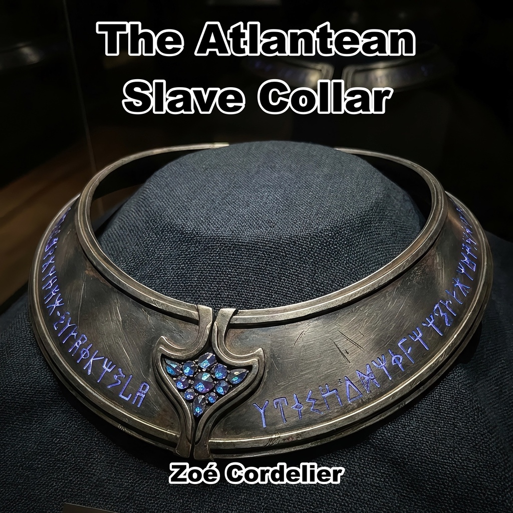
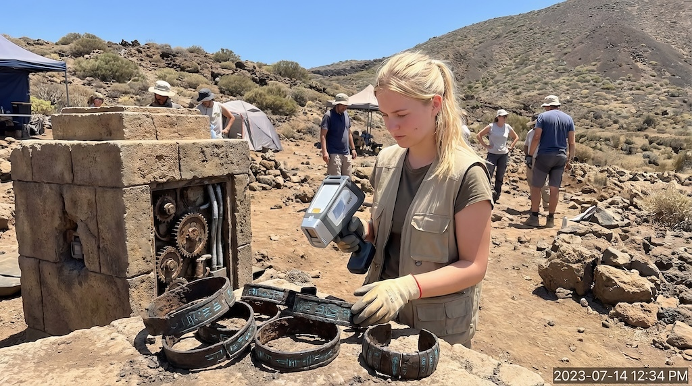
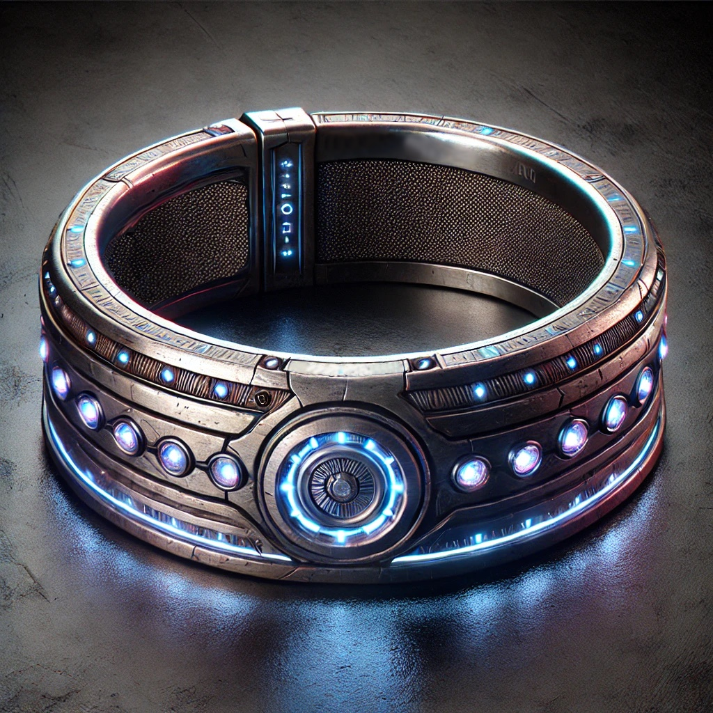
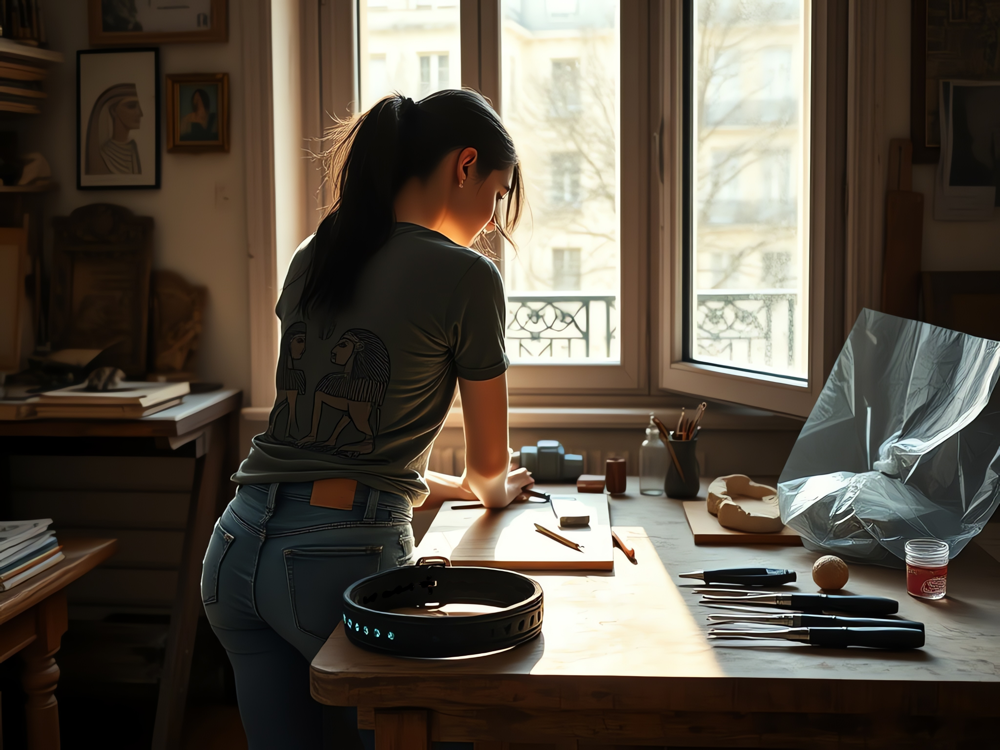
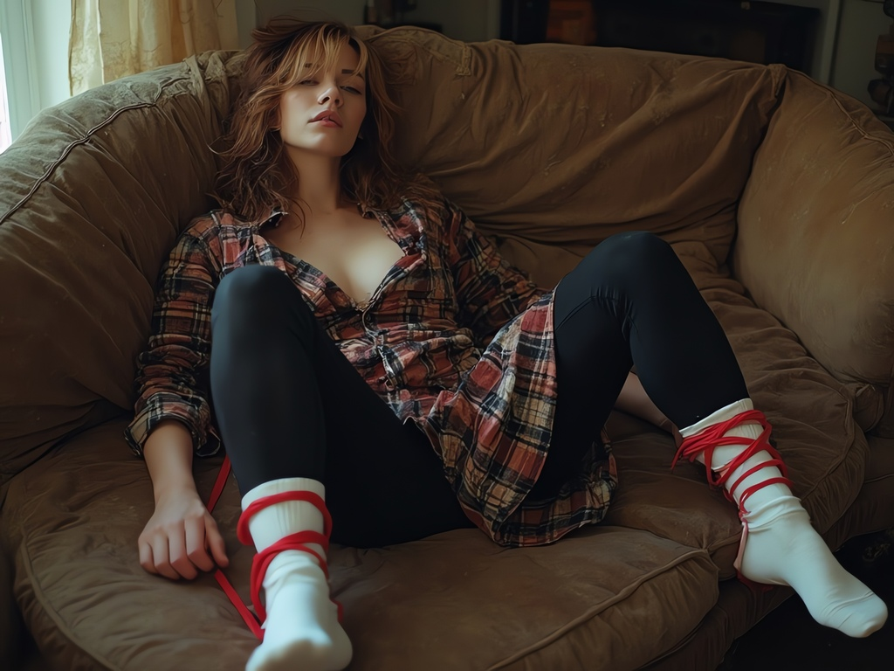
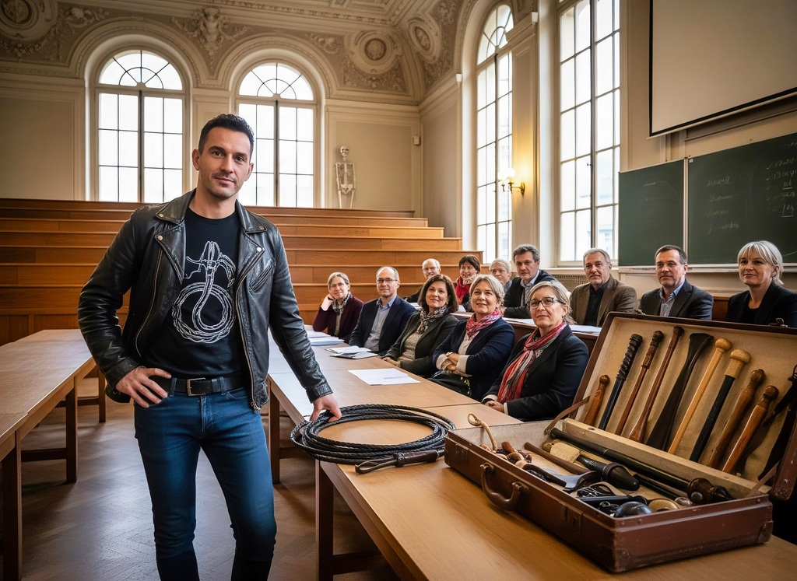

{}
F/fm, sissy, chastity, humiliation, multiple-slaves, harem-dynamics, orgasm-denial,
forced-orgasm, slave-training, obedience-conditioning, domestic-service,
pain-and-pleasure, ownership, consent-drift, corruption
{}

{}

*Fresh from a Canary Islands dig, Sonia brings back a collar that reshapes love into worship.
At first it binds only her girlfriend Marion, whose devotion blooms into need,
but soon the other relics stir—belts, bands, shackles, even towering heels.
Each piece demands a master, each wearer craves a Queen, and Sonia is the only one strong enough to claim them.
What began as a romance deepens into a harem of enslaved colleagues:
Carla locked and edged to tears, Nate broken and remade as Nancy in heels and chastity.
The artifacts enforce obedience with pleasure and pain,
drawing Sonia further into a role she both fears and savors: mistress, tamer, Queen.
Part romance, part BDSM fantasy, part sci-fi corruption tale, this story traces how consent blurs,
desire consumes, and ancient Atlantean technology rebuilds a world where ownership is love.*

{}

# EPUB

Read below, or click on the image for the EPUB download:

# The Atlantean Slave Collar

## The Dig

Sonia crouched by the edge of the trench, brushing sand off what looked like the base of a carved column.
The Canary sun burned overhead, but she barely noticed.
Geometric shapes emerged beneath her brush, crossed by flowing, almost organic lines.
None of it matched anything she had seen in the textbooks.
It wasn’t Roman or Phoenician.
It didn’t resemble Guanche work either.

“Sonia!” Nate called from the other end of the dig. “Leave that a minute. Come and look.”

Sonia set down her brush reluctantly. She brushed her gloves together, adjusted her straw hat, and picked her way across the trenches. Half-excavated walls broke the slope above her, their upper courses still buried in ash.

“What is it?” she asked as she reached Nate.

He pointed to a slab of stone they had uncovered the day before, now resting on a makeshift frame of wooden beams.
Cleaning had revealed carvings in rows and columns, perhaps a form of writing.
But it wasn’t the carvings that drew her attention—it was the inlay.
Metal filled the grooves, glinting in the sun.

“Tell me that doesn’t look like a circuit,” Nate said.

Sonia bent closer. The metal felt cool through her glove as she traced one of the lines.

“Decoration, perhaps. But look at the symmetry.” She followed it to the next junction. “Why be so precise?”

“It gets weirder,” Nate said.
He gestured toward another section of the site,
where workers were uncovering wide, shallow steps.
“That’s the entrance to the main complex.
Just got a glimpse inside—there’s something down there you should see.”

Sonia followed him, her boots crunching over the gritty soil.
The staircase descended into shadow, flanked by walls carved with more of the strange patterns.
Lanterns lit the rough-hewn walls below.

Sonia stopped at the chamber entrance. The air was heavy, with the metallic tang of an approaching storm.
The room was circular, its walls lined with niches that held cracked and broken objects—ceramic bowls,
glass vials, things that might once have been tools.
At the center of the room stood a dais, its surface smooth and black, as if carved from obsidian.

“This,” Nate said, “is what I wanted you to see.”

He pointed to a panel set into the wall near the dais.
Unlike the other carvings, the panel was clean and glowed blue-green.
Squares divided its surface, each bearing more symbols.
As Sonia approached, she felt a faint hum beneath her feet, like the vibration of a running machine.

“This isn’t possible,” she murmured. “This has to be some kind of hoax.”

“Then someone’s gone to a lot of trouble,” Nate said. “How do you explain the panel?”

Sonia reached out, hesitating before her fingers touched the glowing panel.
The air around it seemed warmer, buzzing faintly against her skin.
“If this is Atlantean...” She stopped.
The discovery could overturn their account of ancient history.

Around the dais, shallow depressions formed a circle. Sonia looked from one to the next. Someone could have stood in each—or knelt.

“What do you think this was for?” she asked, her voice low.

Nate shrugged uneasily. “Doesn’t feel like a temple, does it?”

“No,” Sonia agreed. “It doesn’t.”

Sonia studied the glowing lines in the walls. They seemed to shift in the lantern light.
She doubted anyone had made this place for worship or art.
Whatever its purpose, it troubled her.

The following day, Sonia crouched in the shade of the tarpaulin,
brushing sand off another piece of metal that had emerged from the soil.
Someone had shaped its curves and hollows with care.
She tilted it in the sunlight, revealing a faint seam along one edge.
Perhaps it was a hinge; the corrosion made it hard to tell.
Her brush exposed a blackened surface, too worn to reveal much detail.

She worked a little apart from the main excavation.
The others were too focused on the inscriptions in proto-Linear A to pay much attention to her quiet work.
She didn’t mind.
She wasn’t a linguist.
And if she was right about what she’d found, this could be just as significant.

Round and half-round fragments filled her tray. Their edges and curves suggested parts of a mechanism.
A few had empty sockets where stones might once have been set.
She imagined them colorful and polished, though now they were as blackened as everything else.

Her brush stopped at two larger pieces. She studied the curves, fitting them together in her mind. A collar. Or something very much like one.

Jewelry, she told herself. The workmanship was elaborate enough. But she kept turning the pieces over to examine the fastening.

She ought to put it in the notebook. Give it a number, bag the pieces, let the team examine them. Instead she held them a moment longer. Nearly intact. Small enough to take home.

She glanced over her shoulder.
Nate was still in the main dig site,
debating with one of the linguists about the implications of the proto-Linear A inscriptions.
The nearby workers sifted soil for smaller finds.
No one was watching her.

She slipped the pieces into her satchel, between layers of cloth so they would not clink.
Her heart thudded against her ribs as she straightened up.
She was careful with finds. Everyone knew that. And there were so many fragments here; this one was hardly exceptional. She had just spent several minutes telling herself the opposite.

Still, her hands trembled slightly as she turned back to her tray.
She brushed more sand away, working more slowly now, her mind distracted.
If someone found out...
No.
No one would find out.
It was just a souvenir.
Something to remember the dig by.
Something to prove to herself, years from now, that she had been here.

When she packaged the rest of her finds, Sonia cataloged each piece in her notebook.
She even lingered a little longer over the fragments with empty sockets,
their jewel settings blackened and unrecognizable.
She recorded it all, as thoroughly as always.

Except for one.

The artifacts piled up day after day, each new discovery stranger than the last.
Sonia sat cross-legged on the tarp-covered ground near her section of the dig,
her gloves dusty as she examined the latest batch of finds.
None of the designs resembled anything she had studied.
The team called them Atlantean for want of a better name.

Carla, one of the field techs, held up a delicate frame of metal loops.

“A chastity belt with a circuit board,” she said. “Please tell me I’m wrong.”

Sonia glanced over, suppressing a smile.
Carla wasn’t entirely wrong.
The ancient artifacts looked strangely modern, with the precision of machine parts.
They found arm bands that looked more like restraints, rings with mechanisms no one could figure out,
and strange structures with grooves that might have been meant to lock something in place.

Nate uncovered one of the strangest items.
He held it up as Sonia approached.
The object resembled a collar, not unlike the fragments Sonia had found earlier, but this one was almost intact.
Dull black stones studded its curved surface. They might once have been gemstones.

“Check this out,” Nate said, handing it over. “Doesn’t it look... I don’t know... too functional to be just jewelry?”

Sonia turned it over in her hands, her brow furrowing.
The inside of the collar had faint ridges, almost like contact points.
She ran her thumb over them, her gloved hand catching on something that might once have been a hinge.
“It’s not just decorative,” she said finally.
“This had a purpose.
Something practical.”

“Or sinister,” Carla quipped, tossing a shard of glass into a labeled bag.
“I mean, half of this stuff looks like it came from some kind of ancient BDSM dungeon.”

Nate folded his arms. “The cuffs yesterday, this collar, now that frame. We can’t keep calling everything ceremonial.”

“It doesn’t fit any of the cultures we know,” Sonia added.
She set the collar down carefully and gestured toward the growing collection of artifacts.
“The designs are too advanced for Mycenaean or Minoan, but the aesthetic isn’t like anything else.
It’s almost—”

“Alien?” Nate offered, grinning.

Sonia rolled her eyes.
“Not alien.
Just different.
These people—whoever they were—they weren’t like anyone else.
They must have thought differently.”

“Apparently the dress code was quite strict,” Carla said.

Sonia ignored her, uneasy.
She had been trying to avoid thinking about the implications of the artifacts—the collars,
the restraints, the way so many of the designs seemed to straddle the line between function and fetish.
It was easier to focus on cataloging, documenting, analyzing.
But she still wanted answers.

As the dig progressed, more of the complex came into focus.
They uncovered what appeared to be a market square, with rows of stalls marked by low stone walls.
Volcanic ash had preserved the stalls and their contents.
Sonia stared at metal and stone racks that might once have displayed goods—or something else.

The temple itself revealed even stranger secrets.
The carvings inside depicted scenes
that were difficult to interpret—figures in elaborate headpieces surrounded by glowing objects,
others kneeling or bound in strange devices.
Sonia could not separate the sexual scenes from the arrangements of power. Again and again, one figure stood while the others knelt or waited in restraints.

The team argued over its meaning.
Some thought it was a religious site, others a center for trade or governance.
Sonia wasn’t sure.
These people had built the devices for a purpose Sonia still could not grasp.

She couldn’t shake the feeling that the place wasn’t just about worship or trade.
It was about control.
But control of what—or who—remained a mystery.

## Back at Home

The Paris air felt cold after the Canary Islands. Sonia shifted her carry-on and let out a breath. For two months she had thought about little except the dig. Now she wanted to get home to Marion.

From the cab, Paris felt unfamiliar after the isolation of the island.
Traffic and voices filled the streets after weeks of shovels scraping at the quiet dig.
They had called and sent messages throughout the dig. It had kept them in touch, but Sonia wanted Marion beside her, where a pause in the conversation did not mean a bad connection.

She set her suitcase down with a thud in the cramped entryway of the apartment,
the air cool and faintly scented with Marion’s favorite lavender diffuser.
The faint rustle of movement came from the kitchen, followed by Marion’s warm voice calling out, “You’re home!
Finally!”

Marion appeared before Sonia could answer, her shoulder-long curls still damp from a shower. A black tank top, faded jeans, that grin. Sonia dropped her bags. By the time Marion drew back from their kiss, Sonia had stopped thinking about the airport.

“You look exhausted.” Marion brushed Sonia’s hair back under the dusty hat. “You’ve brought half the dig with you.”

Sonia smiled. “I missed you. And I’m starving. What’s for dinner?”

“Something edible. I’ve made an effort.” Marion led her into the tiny kitchen. “Sit. You can tell me whether it worked.”

Dinner was simple—pasta with a light tomato sauce and a bottle of cheap red wine—but Sonia wanted nothing else.
They sat at the small, wobbly table, catching up on the mundane details of life.
Sonia filled Marion in on the dig, starting with the heat, the long hours, and the frustrating logistics.
But as the wine flowed, her recounting turned to the more intriguing details.

“The artifacts were... bizarre,” Sonia said, swirling her glass of wine.
“We’re calling them Atlantean, but they’re nothing like the Atlantis people imagine.
No shiny domes or lost cities under the sea.
Just strange, advanced designs that feel... wrong, somehow.”

“Wrong how?” Marion asked, her chin resting on her palm as she leaned forward.

Sonia turned the glass between her hands.

“I have a theory. Five or six thousand years ago, a society builds all this machinery. Not just to run a city. To control individual people—their bodies, what they can do.”

Marion raised an eyebrow, intrigued. “Like slavery?”

“Exactly,” Sonia said.
“But not in the way we think of it today.
Their artifacts, their designs... it’s like they were blending technology and ritual.
Restraints that look ceremonial but are so precise they could have been functional.
Collars with sockets for what might have been jewels—or something else entirely.
It’s like a mix of high-tech and ancient BDSM.”
She paused, grinning.
“I’m telling you, the team was in denial.
Too academic.
Too vanilla.
But you and I?
It’s obvious.”

Marion laughed, the sound warm and unguarded. “You’re saying Atlantis was a bondage cult?”

Sonia shrugged, her grin widening.
“Why not?
If you look at the carvings, the structures—it all points to obsession.
Control.
Submission.
They didn’t just rule; they owned.
Bodies, minds, everything.
It was their identity.
And they made it beautiful, in a way.”

Marion leaned back in her chair, studying Sonia. “And what do you make of it? Really?”

Sonia hesitated, her fingers tracing the rim of her glass.
“It’s fascinating.
And unsettling.
It’s like they were so advanced in some ways but so... regressive in others.
But I can’t stop thinking about it.
About what kind of people they were, how they lived.
It’s haunting.”

After dinner, they moved to the couch, with its mismatched cushions and throws.
Marion poured them each another glass of wine while Sonia rummaged through her bag.
She returned with the collar fragments, carefully wrapped in cloth.
Unfolding them, she placed the pieces on the coffee table.

“These,” Sonia said, her voice quieter now, “are what I brought back.
I know I shouldn’t have. But look at them.”

Marion picked up one of the fragments, her fingers brushing over the corroded surface.
The blackened metal was smooth in some places, pitted in others, but someone had worked it with care.
“This was a collar?” she asked, tilting the piece to see where it might fit with the other half.

Sonia nodded.
“I’m almost sure of it.
Look at the curve, the hinge.
It’s not just decorative—it’s functional.
A slave collar, I think.
A sign of ownership and control.”

Marion’s lips curled into a smirk as she set the piece down. “And you thought this would make a good souvenir?”

Sonia laughed, leaning against her.
“I couldn’t leave it behind.
And maybe it’s a little sexy.”

Marion wrapped an arm around Sonia’s shoulders, pressing a kiss to her temple.
“Well, it’s definitely unique.
And very you.”

Marion looked down at the fragments again. Sonia left them on the cloth between them; she had expected more questions.

Over the following days Sonia worked at her desk by the lace-curtained window.
The collar fragments rested in the center of the table, propped on a soft cloth.
Next to them were her tools: fine brushes, a loupe, a small container of solvent, and tweezers.
She worked with a steady hand,
brushing away layers of petrified grime that had hidden the true nature of the material beneath.

The grime came away.
The "metal" at the core of the collar wasn’t metal at all, or at least not any metal Sonia recognized.
It was black and pristine, gleaming faintly in the light.
Despite millennia of burial, the material showed no sign of damage.
Its surface was smooth and unmarked.

The jewels—if that’s what they were—were even stranger.
They remained set firmly into the collar’s outer surface,
showing hints of color as Sonia cleaned them with a pick.
Red, amber, green, and lots of blue hues emerged, though the colors were muted,
matted by whatever age and exposure had done to them.
They weren’t multifaceted, more rounded, like ancient cabochon gemstones,
and the faintly raised lines running along the inside of the collar felt purposeful, almost technical.

Sonia set down the pick. She had cleaned the same patch twice, expecting to find a scratch or a pit underneath. There was none.

Behind her, she heard Marion’s voice, low and teasing. “Still at it?”

Sonia glanced over her shoulder to see Marion leaning against the doorframe, her arms crossed.
She was dressed casually in one of Sonia’s oversized shirts and a pair of leggings, her hair loose and slightly mussed.
Marion was smiling, but she had come no farther than the doorway.

“It’s just—” Sonia gestured to the collar fragments. “I think I’m getting somewhere. The material is—”

“Yes, yes. High-tech bondage jewelry from Atlantis.” Marion came into the room. “I think I could give the lecture by now.”
She stopped beside Sonia’s chair and placed her hands on Sonia’s shoulders, leaning down to kiss the side of her neck.
“But you’ve been glued to this thing for days.
I’m starting to feel like I’m in competition with ancient alien kinks.”

Sonia laughed softly, setting her tools down. “It’s not like that.”

“No?”
Marion’s hands slid down to Sonia’s arms, tugging her up gently but insistently.
“Then maybe I should put on the collar.
Would that get your attention?”

“Marion,” Sonia started, a mix of amusement and exasperation in her voice,
but Marion was already leading her toward the sofa.

“No arguments,” Marion said, pulling her down onto the cushions with a grin. “You’re taking a break. Right now.”

Sonia let herself be pulled into Marion’s embrace, the tension in her shoulders easing as Marion kissed her.
It started playfully, with Marion nipping at her bottom lip and murmuring something about “mysterious Atlantean charm,”
but it quickly deepened.
Sonia forgot her work as Marion tangled her hands in her hair.

“See?”
Marion said breathlessly, breaking the kiss for just a moment.
“This is way better than your weird ancient trinket.”

“Maybe,” Sonia said, kissing her again. “But you’ll have to work harder to convince me.”

Marion’s grin turned mischievous as she repeated Sonia’s earlier words, her voice dripping with playful sarcasm.
“High-tech bondage jewelry from Atlantis.
Very fancy.
But what about good old low-tech bondage from Paris?”
She leaned forward, reaching under the sofa to slide out a storage compartment.
She pulled out a bundle of black and red cotton ropes.

Sonia looked at the ropes, then at Marion. “You’ve thought this through, have you?”

Marion shrugged, her smile unabashed as she dangled the ropes in front of Sonia.
“Just thought I’d remind you how much fun simpler things can be.
But only if you’re interested—”

Before she could finish, Sonia darted forward, twisting Marion’s arm gently but firmly behind her back.
Marion let out a startled laugh as the ropes slipped from her grasp.

“Not what you had in mind?”
Sonia teased, her voice low as she leaned in close.
She pressed her lips to the corner of Marion’s mouth, just enough to make Marion squirm.
“Too bad.
My turn.”

“Wait, that’s not—hey!”
Marion protested, though there was no real resistance in her voice as Sonia guided her to the center of the sofa.
She knelt behind Marion, gathering the ropes with practiced ease.
Marion rolled her eyes but smiled, her body already relaxing as she let Sonia take over.

“You’re enjoying this,” Sonia said as she looped the first rope around Marion’s wrists,
cinching it snugly but not uncomfortably.

“Maybe,” Marion admitted, her grin betraying her.
“But you better not—hey!”
She broke off with a laugh as Sonia tugged the ropes tighter, pinning her arms firmly behind her back.

Sonia bound Marion’s ankles,
crossed them, and connected the bindings with a longer rope.
In minutes, Marion was in a snug hogtie, her body gently arched and completely immobilized.
She tested the knots, wriggling against the bindings, but Sonia’s work held firm.

“This is not what I had in mind,” Marion grumbled, though her tone was light and playful.
She wriggled again, her movements only emphasizing how stuck she was.
“You’re supposed to be the one tied up.”

Sonia leaned back to admire her work, a satisfied smirk on her face. “Maybe next time. For now, I like you like this.”

Marion glared at her, but there was no hiding the flush in her cheeks or the spark of excitement in her eyes.
“You’re going to regret this.”

“Am I?”
Sonia asked, leaning in close again.
Her fingers brushed lightly against Marion’s sides, making her squirm.
“Because it looks like you’re the one in trouble.”

Marion gasped as Sonia’s fingers danced over her ribs, tickling her mercilessly.
She squirmed and laughed, her voice a mix of protest and helpless giggles.
“Stop!
Sonia, I swear—stop!”

Sonia didn’t stop.
She leaned in, planting kisses along Marion’s neck and jawline between teasing tickles.
“You’re in no position to give orders, sweetheart,” she murmured, her breath warm against Marion’s ear.

Marion groaned, her laughter giving way to a frustrated sigh as Sonia kissed her slowly,
lingering just long enough to make Marion’s helplessness all the more deliciously infuriating.
“You’re terrible,” Marion muttered, her voice soft but full of affection.

Sonia chuckled, her hands sliding to Marion’s hips, tracing her curves with maddening slowness.
“You wanted my attention,” she whispered.
“Now you’ve got it.
And I’m taking my time.”

Marion tugged at the ropes, her body arching slightly as she tried to turn her head toward Sonia.
“You’re evil.
You know that, right?”

“Maybe,” Sonia said, pressing another kiss to Marion’s shoulder. “But you don’t seem to mind.”

And Marion didn’t.
She melted under Sonia’s touch,
her initial protests fading into soft laughter and quiet sighs as Sonia took her sweet time exploring every inch of her,
making sure Marion felt every second of her undivided attention.

Sonia let her hands wander lower, her fingers brushing the hem of Marion’s top before slipping beneath the fabric.
The warmth of Marion’s skin greeted her touch, soft and inviting.
Sonia took her time, her fingertips tracing slow, deliberate patterns along Marion’s sides,
feeling her girlfriend shiver under the light, teasing pressure.
She tugged the shirt up just enough to expose Marion’s stomach and breasts,
pushing up the bra and freeing her girls.
She was leaning down to press gentle kisses against the newly revealed skin,
carefully circling her nipples, but never touching them.

Marion squirmed in her bindings, her breath hitching as Sonia’s lips traveled upward,
leaving a trail of heat along her ribs.
“Sonia,” Marion murmured, her voice a mix of protest and plea.
She tugged at the ropes again, but they held firm, keeping her entirely at Sonia’s mercy.
Sonia put out her tongue, carefully circling the areolae, first left then right, until she finally homed in.
She was brushing the nipples with her lips, nipping at them without teeth,
then using her tongue to wet them and then breathe on them.
Marion lost her speech, and turned to soft moans, a sign for Sonia to now use her teeth and nibble,
mixing in a bit more intensity into her play.

At Marion’s groan, Sonia let her hands roam over Marion’s skin.
Her kisses followed, trailing over Marion’s shoulders and neck,
her touch never too much but just enough to leave Marion trembling.
Marion’s sighs made Sonia smile against her skin.

Then she slowly let her hands dive into Marion's pants, searching and finding the wetness she was looking for.
She was pushing the leggings down a bit and then eased her fingers into the folds,
confirming she was ready.
Carefully, she removed the leggings and the panties completely.

She moved down, taking her time and using her fingers and her mouth, carefully listening to Marion's moaning,
timing things to draw them out.
While she kissed her nether lips, with her tongue darting out and flicking the clit,
she slowly fucked her using more and more fingers, filling her slowly up.

Marion was squirming in earnest now, fruitlessly straining against the ropes, trying to meet her fingers,
but Sonia controlled the rhythm and the pacing – savoring Marion's helplessness.
Slowly she turned her fingers inside Marion, until she was palm up and then curled against the spot,
while continuing her slow fucking motion.
At the same time, she placed her lips around Marion's clit and started to carefully suck,
now and then brushing lightly with her tongue.
Marion was trying to buck seriously now, but the ropes held her fast.
Finally, she came, loud and wet.

Leaving her fingers in, Sonia crept up and cuddled against Marion's bound form,
then slowly slid out of her, finger by finger.
She trailed her fingers along Marion's cheek, brushing gently before slipping them over her lips.
Marion, still hazy and pliant, parted her lips without hesitation, her tongue flicking out to obey.
Sonia’s other hand cradled Marion’s head, her thumb stroking softly over her temple.

“That’s it, my sweet girl,” Sonia whispered, her voice low and intimate, meant only for Marion.
“You’re so good for me.
So perfect.
Always so eager to please.”

Marion’s lips closed around Sonia’s fingers, her eyes fluttering shut as she drew them into her mouth.
Sonia caught her breath as Marion slowly cleaned each finger.

“Just like that,” Sonia murmured against Marion’s ear.
“You’re so beautiful like this.
I love how much you trust me.”

Marion whimpered softly, the sound muffled by Sonia’s fingers, and Sonia took her time.
She let her fingers linger, teasing over Marion’s lips before slipping back in, deeper this time.
Marion opened her mouth wider, breathing slowly.

“You’re such a good girl for me,” Sonia said softly.
“So perfect, letting me take care of you, letting me have all of you.
I could keep you like this forever, couldn’t I?
Helpless and mine.”

Marion hummed,
her lips closing firmly around Sonia’s fingers as she sucked gently.
Sonia smiled, brushing a kiss against Marion’s temple.

“That’s my girl,” she whispered. “So sweet. So perfect. I don’t deserve you, do I?”

Sonia finally withdrew her fingers,
brushing them one last time over Marion’s lips before pulling her into a gentle kiss.
“Thank you,” she whispered against Marion’s mouth.
“For being everything I need.”

*Marion, photo taken by Sonia.*

## The Next Morning

Sunlight reached Marion’s face through the living-room curtains. She blinked and tried to stretch without waking Sonia. The sofa was too narrow for it; under the quilt they were still tangled together, ropes and clothes scattered around them.

Marion looked toward the worktable. Sonia had left the fragments in their neat arrangement on the cloth, but something was wrong with the color. She blinked again. The black surface gleamed in places, and she could distinguish colors in jewels that had looked dull the night before.

“Sonia.” She nudged her, then kissed her cheek. “Come on. I need you to look at something.”

Sonia groaned softly, reluctant to leave the warmth of Marion and the cocoon they had made together.
“What?” she mumbled, her voice heavy with sleep.

Marion sat up, pulling the quilt around her shoulders. “Your artifacts. The collar. Something’s happening to it.”

That woke Sonia. She sat up, pushed her hair back, and stared at the collar fragments.
The metal she had cleaned was no longer black.
In the sunlight, it had lightened to a dark grey, almost metallic in its sheen.
Grime still blackened parts of the surface.

Sonia wrapped herself in the quilt and crossed to the table.
She didn’t touch the fragments, just leaned over them, her eyes wide with fascination.
The jewels were clearer now, their colors distinct and almost glowing in the sunlight.

“What the hell?” Sonia whispered, her voice hushed with awe. “This... this wasn’t like this last night.”

Marion joined her, standing close but careful not to get too near the table.
“Do you think it’s reacting to the sunlight?” she asked.

“What else has changed?” Sonia said. “It was sitting here all night. Now the sun’s on it.”
She crouched to get a better look, peering at the fine lines and details of the collar.
“It’s not just discoloration, though.
The surface—it looks... alive.
Almost like it’s waking up.”

Marion crossed her arms, watching Sonia uneasily.
“Do you think it’s safe?
I mean, this thing has been buried for thousands of years.
What if it’s releasing something?”

“I don’t know,” Sonia admitted, glancing back at Marion.
“But I don’t think it’s dangerous—not in that way.
The material—it’s not like anything we’ve ever seen.
It should be corroded after all this time, but it isn’t.
And now this...”
She gestured at the fragments.
“This is why it stayed intact.
It’s... designed to do this.”

“To react to light?” Marion asked, her voice skeptical.

“Maybe,” Sonia said.
“Or maybe it’s part of something bigger.
A mechanism, a system.
Whatever this was made for, it wasn’t just decoration.
It had a purpose.”
She paused, her fingers hovering near the collar but not quite touching.
“I don’t know what kind of purpose, though.”

Marion shifted uncomfortably.
“It’s kind of eerie, don’t you think?
I mean, we were joking about high-tech bondage jewelry, but this—this feels... different.”

Sonia turned to Marion, her expression serious.
“It is different.
Whatever this civilization was, they were way beyond anything we’ve seen before.
And this collar?
It might be the key to understanding them.”

They watched the sunlight brighten the fragments.
Marion finally broke the silence, her voice softer now.
“You’re not going to try anything with it, are you?”

Sonia shook her head.
“Not until I know more.
I’m not stupid, Marion.
This thing—it’s too... strange to mess with.
I’ll keep studying it, but carefully.”
She paused, her gaze returning to the collar.
“For now, we just watch.
And see what it does.”

Sonia set the collar halves down on the cloth-draped table, her hands trembling slightly in their protective gloves.
The fragments no longer looked ancient.
Days of careful exposure to sunlight had transformed them into something gleaming and pristine.
The metal—if it was metal—was polished to a mirror-like chrome finish, completely free of grime.
The "jewels," or whatever they were, now shone brilliantly,
their colors by now mostly sapphire blue.

She could feel the collar’s faint hum more than she could hear it.
Several times she had caught herself leaning closer.
Now, sitting at the table under the same midmorning light that had revealed its transformation,
she couldn’t resist any longer.

With her gloves and the cloth, Sonia lifted and aligned the halves.
The hinge moved without catching. Sonia turned the joined halves over in her hands, searching for the seam. She could barely find it. Whatever had made this, whatever the material was, it still worked.

Experimenting cautiously, Sonia tried closing the collar completely.
The front edges met with a satisfying click,
but the lock—some sort of recessed mechanism with a small ring or button—didn’t engage.
She pressed lightly against the ring, then the button, testing it, but nothing happened.
The collar opened effortlessly with the slightest pull.

“What are you hiding?”
Sonia muttered, inspecting the lock more closely.
Tiny grooves, blue lights, and seams marked the mechanism. She could not work out its function.

Marion’s voice startled her from behind. “You’re still at it? I thought you were taking a break this weekend.”

Sonia turned to see Marion leaning against the doorframe, her arms crossed.
Her expression was a mix of amusement and concern.
“I’ve never seen you this obsessed with anything outside a dig site.”

“I know.” Sonia set the collar down and pulled off her gloves. She rested a finger on the cloth beside the clasp. “Look at it, though. No damage. The hinge works perfectly. Everything fits. Except it won’t lock.”

Marion stepped closer, eyeing the collar warily. “Maybe it’s broken. Or maybe it needs something to activate it?”

Sonia frowned. “What kind of something?”

Marion shrugged. “I don’t know. A tool? A key? Maybe it’s not meant to lock unless it’s on someone.”

Sonia took her finger away from the clasp. “On someone?”

Marion gestured toward the collar, her tone light but her words pointed.
“It’s a collar, Sonia.
What else would it do?
Maybe it needs pressure, or contact, or... something.”

Sonia hesitated, her curiosity battling with caution.
“I’m not about to start putting it on people—or myself—until I understand more about it.”

“Good,” Marion said firmly, stepping closer to place a hand on Sonia’s shoulder.

Sonia nodded, her gaze lingering on the gleaming collar.
“It’s incredible, though,” she murmured.
“Can you imagine what this could mean?
For understanding them, the Atlanteans?
Whoever they were, they were so far beyond anything we thought possible.”

“Yeah,” Marion said, her voice dry. “So far beyond that they left us their glowing bondage gear. Very advanced.”

Sonia rolled her eyes but couldn’t help the small laugh that escaped her.
“Whatever it is, it’s the key to something.
We just have to figure out what.”

Marion’s hand tightened gently on Sonia’s shoulder.
“Well, you’re not doing that today.
Come on, let’s grab lunch and get you away from this thing for a while.
You can obsess over it again tomorrow.”

Reluctantly, Sonia let herself be led away,
though her thoughts lingered on the collar, its faint hum, and the mysteries it refused to give up.

Children laughed and dogs barked in the park. A breeze stirred the leaves.
Sonia and Marion walked hand in hand along a shaded path.
They had eaten their sandwiches under a sprawling oak tree,
the sun dappling their faces through the leaves, and now they strolled at an easy pace.

Marion nudged Sonia gently with her shoulder.
“So,” she began, a teasing lilt in her voice, “what’s so fascinating about that collar?
I mean, you’ve been glued to it like it’s the Holy Grail.”

“It does something,” Sonia said. “Someone made it to do a job, and we can’t even work out how to close it. Doesn’t that bother you?”

Marion raised an eyebrow, her grin turning mischievous.
“And what if it really is a slave collar?” she asked, her tone light but her words deliberate.
“Like, you snap it around someone’s neck, and they’re compelled to obey.
Wouldn’t that be... hot?”

Sonia stopped walking, turning to face Marion fully.
The corners of her mouth quirked up, her expression sly.
“You’d like that, wouldn’t you?”

Marion flushed faintly but didn’t back down. She held Sonia’s gaze, her smile quiet and knowing.

Sonia’s grin widened.
“Wearing or controlling?” she asked, tilting her head slightly, her voice teasing but her eyes warm.

Marion looked ahead and nudged Sonia with her hip.

“You think you’re so clever. We both know how this goes about eighty percent of the time.”

Sonia chuckled, lacing her fingers more tightly with Marion’s.
“That’s because you like it that way.
And I’m not complaining.”

“Maybe I just like making you happy,” Marion replied, her voice softer now, her smile tinged with affection.

Sonia stopped and kissed her.
When they broke apart, Sonia’s voice was barely above a murmur.
“You make me happy just being you.
The rest?
Just a bonus.”

Marion smiled as they kissed again.
When they finally broke apart, they continued their walk hand in hand,
at ease again, though neither had forgotten the collar.

## Marion's Experiment

From across the living room, Marion could see the evening sun reflected in the collar. Sonia had left it on the worktable. The jewels, if they were jewels, glowed blue.

She had promised herself she would leave it alone. Looking was different. She could do that from here. Then she was beside the table, holding her hands just above it and feeling the faint vibration in the air.

She picked it up with the cloth, copying Sonia’s careful grip. The weight surprised her. Watching Sonia handle it, she had expected something lighter.
Turning it over, she examined the inside,
where gleaming lines met near the lock.
The catch looked simple enough,
but Marion had seen Sonia test it repeatedly, always with the same result—it wouldn’t engage.

Holding it carefully, Marion tilted the collar in the light, inspecting the clasp.
The lines from the inside seemed to lead directly to it,
as if they carried energy there.
She furrowed her brow, studying the tiny grooves and seams in the metal.
Yet the clasp would not close.

In the hallway mirror she could see herself holding it.

*It’s a collar. It’s meant to be worn.*

The thought wasn’t entirely her own—or at least, it didn’t feel that way.
She shook her head. A moment later she was still considering it.

Almost dreamlike, she stepped in front of the mirror, still holding the collar with the cloth.
She studied herself with the collar in her hands.
She raised it slowly, hesitating for just a moment, her heart pounding in her chest.

Then, as if compelled by something beyond her own will, she brought it to her neck.

The moment it touched her skin, she felt the faint hum more clearly.
She felt it against her throat.
Marion’s breath caught as she closed the collar around her neck.
It fit perfectly, as if it had been made for her.

But the clasp still wouldn’t lock.

She pressed lightly, turning the collar this way and that, trying to coax the mechanism into engaging.
The lines inside seemed to shimmer faintly now, their clarity almost glowing against her skin.
She could feel the collar’s hum resonating against her pulse, warmth spreading from her neck down through her body.

She checked her reflection, then the catch again.

“Come on,” she whispered. “Why won’t you work?”

The hum grew a little stronger. It seemed to answer her.

But it wouldn’t lock.

Frustrated but still curious, she traced the clasp and smooth surface again.
She could feel it working, but it would not lock.

Not yet.

With a sigh, Marion slowly unclasped the collar and set it back on the table.
As she stepped away, the hum faded. She ought to have been relieved. Instead she looked back at it.

She rubbed her neck absently, the phantom warmth of the collar still lingering on her skin,
and waited for Sonia to come home.

When Sonia stepped through the door, she looked more animated than Marion had seen her in weeks.
She dropped her bag by the coat rack and made a beeline for Marion,
pulling her into a warm hug before kissing her cheek.

“Marion. We’ve worked something out.”

Marion leaned back in the hug to look at her. “I’m going to guess this isn’t about dinner.”

“The dig.” Sonia steered her toward the couch. “We had the linguists in today, and historians, and specialists from other institutions. Listen to this.”

Marion raised an eyebrow as she settled beside her, tucking her feet under her. “Okay, spill.”

Sonia sat forward, her hands already moving as she explained.

“They’ve compared the script with Linear-A—the Mycenaean writing from Greece. There’s a definite relationship. Some of the symbols are almost identical.”

“I’m with you so far,” Marion said.

“But here’s the thing,” Sonia continued, leaning closer.
“This script?
It’s older.
Much older.
And way more complicated.
Linear-A is basically a simplified version of this.
And get this—the letter frequencies don’t match.
Same alphabet, but it’s not the same language.”

Marion blinked. “So... the Atlanteans weren’t the Mycenaeans?”

“Exactly!”
Sonia said, gesturing excitedly.
“They’re not the same people, but they had contact.
Maybe the Mycenaeans borrowed the script from the Atlanteans, or maybe the Atlanteans influenced them.
What’s clear is that the Atlanteans were far more advanced. Far beyond anything we expected.”

Marion tilted her head, intrigued despite herself. “How advanced are we talking?”

Sonia hesitated, her eyes sparkling. “Well... advanced enough to be enslaving other nations by means of their tech.”

“Slavers?” Marion echoed, her voice laced with disbelief.

“Yeah,” Sonia said, nodding gravely, "it was common at that time, as you well know.
But... not this way.
The artifacts we’ve been finding—it’s undeniable now.
They’re not just decorative or ceremonial.
They’re tools.
Restraints, stimulators, things that are meant to control people.
And they’re... all strangely sexualized.”

Marion raised an eyebrow, her lips twitching into a smirk. “Sexualized how?”

Sonia giggled, running a hand through her hair.
“Oh, you’ll love this.
The museum team brought in some local BDSM experts to consult.”

“They what?” Marion laughed, leaning back in shock.

“From the local munch group. People we know.” Sonia finally sat back. “I wish you’d seen the team when they arrived.”

Marion tucked her feet underneath her. “Names, Sonia.”

“Okay, first, they brought in Juliette Lefèvre.
You know her, right?
The one who runs that workshop on historical restraints near Montmartre?”
Sonia grinned.
“She’s obsessed with period-accurate bondage gear.
I mean, if there’s a way to tie someone up like a 15th-century Venetian courtesan, she’s figured it out.”

Marion chuckled, already envisioning the scene. “And what did she have to say?”

“Oh, she was in her element,” Sonia said, shaking her head.
“She took one look at these Atlantean cuffs we’d found—solid metal,
jointed but lightweight—and immediately started explaining how they were way ahead of their time.
The adjustable design, the locking mechanism,
even the way they’d distribute pressure to avoid injury—it was practically ergonomic.
She even demonstrated with a couple of modern replicas she’d brought along,
locking a volunteer’s wrists together while explaining the physics of restraint.
You should have seen the poor guy’s face.
He was so red, Marion.”

“Who let her do that?” Marion asked. “Please tell me it wasn’t someone important.”

“David, the intern.
Poor guy.
I swear he didn’t know what he was getting into,” Sonia said, laughing along.
“Anyway, then they brought in François Dupré.
You remember him, the guy with the ridiculous mustache?
The one who makes custom paddles and floggers for half the kink scene?”

Marion laughed harder. “François? With the museum people? Please tell me he brought his suitcase.”

“He did!”
Sonia said, smirking.
“He unpacked like twenty different tools—paddles, canes,
whips—laid them all out on a table and started explaining impact play to a room full of vanilla academics.
He gave this super-detailed breakdown of the types of sensations each tool could deliver
and how the weight and flexibility of the materials affected the experience.”

Marion wiped her eyes. “Oh my God. How did anyone survive that?”

“Barely,” Sonia said with a grin.
“Then came Léa Dubois.
You know her—the one who builds those insane electronic toys?
She’s a literal engineer, Marion.
She looked at this weird Atlantean device we found—it had wires, or what looked like wires,
embedded into some kind of flexible material—and said, ‘Oh, this is for electrical stimulation.’
Just like that.”

“She just announced it?” Marion asked.

“She did.”
Sonia nodded.
“She even explained how it could create controlled pulses for, um, punishment or pleasure.
Then she pulled out her tablet and started showing schematics of her own designs, comparing them to the artifact.
The curator nearly fainted.”

“Go on,” Marion said. “You can’t stop there.”

Sonia smirked. “Oh, it does. Best of all was Michel Rousseau. You remember Michel—the hypnotist?”

“Michel?” Marion sat up. “They invited Michel to explain suggestion to them?”

“Yep.
He looked at these carvings we found in the temple—patterns and symbols etched into stone—and said,
‘This is suggestive of trance induction.’
And then, Marion, he demonstrated.
He asked for a volunteer and used nothing but his voice to drop the poor curator into a light trance.
Half the room was holding their breath.”

Marion fell back against the cushions, laughing.
“You’re telling me the museum people let Michel hypnotize someone in public?”

“Not just someone,” Sonia said, her grin wicked.
“It was Professor Leclerc.
You know, the guy who’s always lecturing about ‘professionalism in academia.’” She mimicked his nasal tone for effect,
and Marion doubled over, clutching her stomach.

“Oh, this is too much,” Marion wheezed. “How did they even justify bringing these people in?”

Sonia shrugged, her laughter finally subsiding.
“Honestly, it made sense.
These artifacts are strange, and we needed specialists who could recognize their purpose.
But the academics were not ready for that level of bluntness.
I swear, Marion, it was the best entertainment I’ve had in years.”

Marion wiped at her eyes, still giggling.
“I can’t believe I missed this.
Next time you’re dragging me along.
I have to see it for myself.”

“Oh, trust me,” Sonia said, leaning in with a mischievous smile. “You would have loved every second of it.”

Marion shook her head, laughing again.
“Sonia, you’re telling me that your big academic discovery boils down to Atlantis being the world’s first BDSM dungeon?”

Sonia snorted, leaning back on the couch.
“Not just that.
But yeah, kind of.”
She gestured vaguely toward the desk where the collar sat, gleaming faintly in the dim light.
“It’s clear now that their whole society—or at least the parts we’ve uncovered—was deeply tied to control,
submission, and power dynamics.
It wasn’t just about work or punishment.
It was... intimate.
Deeply sexualized.”

Marion’s smile faded into something more thoughtful.
“And you’re okay with that?
I mean, you’ve been handling this stuff for weeks.
Doesn’t it creep you out?”

Sonia shrugged, her expression softening as she traced invisible shapes on the armrest of the couch.
“A little, maybe.
But it’s also fascinating.
These people were so far ahead of their time in some ways and so... regressive in others.
But it’s part of history.
And honestly?”
She glanced at Marion, a sly grin tugging at her lips.
“It’s not like we’re strangers to power dynamics ourselves.”

Marion rolled her eyes, but her cheeks flushed slightly. “Okay, fair point. But still... this is wild.”

“You don’t know the half of it,” Sonia said more quietly.
“There’s so much we don’t understand yet.
And that collar?”
She nodded toward the desk, her gaze lingering on the object.
“It’s probably the most advanced thing we’ve found.
It’s not just symbolic.
It’s a tool—maybe even a device.”

Marion’s eyes followed Sonia’s to the collar,
its chrome surface reflecting the light, its jewels glinting.
She didn’t say anything, but the memory of the hum against her skin, the faint pull she’d felt, made her shiver.
It had been strange and alluring, and even now, the thought of it both excited and unnerved her.

She leaned into Sonia, wrapping an arm around her waist.
“Just promise me you’ll be careful with it,” Marion murmured, her voice soft but firm.
"It feels like it has... a mind of its own.
Or an agenda.
It is designed to... make people do things."

Sonia smiled, turning to press a kiss to Marion’s temple.
“Always,” she said, though her gaze lingered on the collar.
Marion rested her head against Sonia’s shoulder. Sonia kept looking past her at the worktable. Earlier she had wanted to know what the collar did. Now she caught herself picturing it on Marion, and had to bring her attention back to the woman beside her.

## A Bad Girl Caned

Sonia stared at the collar.
Its polished surface and bright jewels caught the light.

Marion pointed at the clasp rather than meet Sonia’s eyes.

“While you were out, I did some… science.”

“Science?”

“Look here.” Marion kept her finger over the catch.
“The grooves, the way the lines from the inside converge here—it’s clear the collar is meant to close.
But it doesn’t.
Not unless...”
She hesitated, glancing at Sonia, her expression almost sheepish.
“Not unless it’s worn.”

Sonia frowned. “What do you mean?”

Marion exhaled slowly, gesturing to the collar again.
“It’s not broken.
The locking mechanism works, but only when it’s around someone’s neck.
It’s designed that way.”

Sonia looked from Marion’s hand to her face.

“How do you know?”

Marion let her hand fall. “I might have tested it.”

Sonia stared at her.
“You tried it on,” she said in a low, clipped voice. “While you were alone here.”

“I was careful. I used the cloth.” Marion looked down. “Except round my neck, obviously. But it didn’t lock. I wish…”

“You wish...”
Sonia’s tone was sharper now, though she hadn’t raised her voice.
“And if it had? Who was going to help you?”

Marion looked down, her voice barely above a whisper. “I... I just wanted to see.”

Sonia tightened her jaw.
“You stupid little girl. I could have lost you.” Sonia stopped, pressing her lips together. “What were you thinking?”

She paused, clearly agitated.
"I should cane you for this."

Marion looked up. Sonia seldom sounded like this. The cane, when she meant it as punishment, was quite different from their games. Marion knew that, and knowing did nothing to settle her stomach.

Her fear excited her too.
She squirmed slightly, her voice trembling as she whispered the words, “I’m sorry, Sonia.
I’ve been bad.”

Sonia froze, her sharp glare softening into something more knowing.
She stepped closer, her hands resting on the back of the chair as she loomed over Marion.
“You know where this is going, don’t you?”
Her voice was quieter now, but there was still an edge of authority in it.

Marion nodded slowly, her eyes wide and shining as she looked up at Sonia.
“Yes,” she said, her voice barely audible.

Sonia let out a slow breath, shaking her head, though a small smirk tugged at the corner of her lips.
“You’re impossible,” she murmured.
“But you’re mine.
Mine alone.
And I want to keep you, my cute little stupid.”

Marion shivered, afraid and aroused.
Sonia’s hand reached out, brushing lightly against her jaw, tilting her face up.
“You’re going to pay for this,” Sonia said softly.
“And you’re going to love every second of it.
Eventually.
I will make you work for it, though.”

Marion didn’t respond, her breath hitching as Sonia’s thumb traced her lower lip.
Marion waited.

Sonia tied each knot with care.
Marion’s arms were bound behind her back, her wrists crossed and held with rope.
Sonia tied the wrist bindings to the crotch rope.
Her legs were folded, ankles tied to her thighs.
She propped Marion up, her ass conveniently up in the air,
shoulders down on the sofa,
the knees widely spread.
It was stricter than usual, each knot snugger than necessary.
Marion shifted, testing the ropes, and found no slack, no give.

“You don’t get it easy tonight,” Sonia said quietly as she stepped back to inspect her work.
“You don’t get to make foolish decisions like that without consequences.”

Marion nodded, biting her lip.
She was already blushing, her body tense with anticipation.
Sonia returned to her, holding the bit in her hand—a simple piece of leather attached to a strap.
She knelt in front of Marion, pulling her up by her hair.

“You know what this means,” Sonia said, meeting Marion’s gaze. “You take this, and I don’t stop until I think I'm done.”

Marion hesitated only for a moment before opening her mouth.
Sonia slipped the bit between her teeth, gently set her down, and fastened it behind her head.
“Good girl,” she murmured.
“Now let’s begin.”

The first strike of the cane came without warning.
A mean swish, a crack, and Marion’s body jolted against the ropes.
A muffled sound escaped her as the sting radiated across her skin, hot and biting.
Sonia paused, giving Marion time to feel the sting develop.
Spreading out from where it hit, all through her, and eventually pooling deep in her core.

She paced herself, each strike precise, each impact calculated to land in a new place,
creating a pattern of glowing welts on Marion’s back and thighs.
She moved with concentration, her face calm, her eyes never leaving Marion’s body,
working herself into a rhythm.
She was focused, not angry.
She chose each stroke to hurt, not to please.

Marion squirmed, the ropes digging into her as the strikes came faster.
She moaned against the bit, her muffled sounds growing louder with each lash.
The cane left red lines across Marion’s skin.
Marion’s breathing quickened, her muscles trembling as the pain built.

But Sonia didn’t stop.
She knew exactly where Marion was, how far she could go, and where she could place the next welt.
Close enough to that vulnerable slit between Marion's spread and bound legs to make her panic,
but not actually hitting there with a cane.

How far she had to go, to break through Marion's ability to eroticize the pain,
to drive the message home.
She sensed Marion nearing her limit as the moans turned to tears.

The tears came suddenly, spilling over as Marion’s muffled cries turned into soft, shuddering sobs.
Her body sagged in the ropes, her head drooping forward as she surrendered completely.
Sonia set three more welts across Marion's buttocks to make it count.
Then she stopped.

She set the cane aside and knelt beside Marion, her hands moving gently to untie the knots.
“Shh, it’s over,” she whispered, her voice low and soothing.
“You did so well, my love.
So strong.
So perfect.”

As the last rope came free, Sonia caught Marion in her arms, cradling her carefully.
Marion clung to her, her body wracked with quiet sobs, her face pressed against Sonia’s shoulder.
Sonia stroked her hair, her other hand running lightly over Marion’s back, avoiding the welts.
“You’re so beautiful,” she whispered into Marion’s ear.
“You took so much for me.
I’m so proud of you.”

Marion’s sobs eased as Sonia held and comforted her.
“That’s my good girl,” Sonia said, pressing a kiss to Marion’s temple.
“You’re safe now.
I’ve got you.”

They stayed like that for a long time,
tangled together, Sonia’s hands gentle as they traced soothing circles over Marion’s skin.
The pain had ebbed into a dull throb, but Marion felt safe, grounded, and deeply loved.
Marion held on to her.

## The Secret Unlocked

Patches of reflected color lay on the living-room walls. The collar was still where Marion had left it, humming among the ordinary things on the table.

Marion stirred first, stretching lazily before glancing at the collar.
She blinked, rubbing her eyes.
“It’s so... pretty,” she murmured, her voice still thick with sleep.

Sonia sat up and followed her gaze. “You said dangerous yesterday.”

Marion turned to her, a faint smile playing on her lips. “We don’t know that.”

“You were the one warning me.” Sonia meant to leave it there. Instead she kept looking at the clasp. “You already tried it, though.”

Marion nodded hesitantly, her cheeks flushing slightly. “Yeah. But it didn’t do anything. It won’t close. I told you.”

Sonia swung her legs over the edge of the couch, standing and motioning for Marion to do the same.
“Let’s try again.
This time with me here.”
She would watch what happened. That was the difference, she told herself: Marion would not be alone this time. One of them would remain clear-headed. It was usually her.

Marion nodded eagerly, retrieving the collar carefully, wrapping it in cloth.
Sonia watched closely as Marion stepped in front of the mirror, lifting the collar to her neck.
She hesitated for a moment, then snapped it shut around her throat.
The hum grew louder at the contact.

But the clasp didn’t lock.
It clicked shut, but when Marion tugged lightly, it fell open again.

“See?” Marion said, her tone tinged with both relief and frustration. “It doesn’t work. It doesn’t—”

“Wait,” Sonia interrupted, taking the collar from Marion’s hands.
She turned it over in thought.
“What’s a slave without an owner?” she murmured.

Marion tilted her head, confused. “What are you talking about?”

Sonia looked up, her gaze steady. “Of course it won’t lock on its own. It’s not supposed to. Show me your neck.”

Marion’s breath caught, her pulse quickening as she nodded silently and turned to face Sonia,
tilting her chin up slightly and holding her hair out of the way.
Sonia stepped closer, holding the collar carefully.
She could feel its hum vibrating faintly through the cloth.
Slowly, she raised it to Marion’s neck.

The moment the collar touched her skin, the hum intensified, and Marion shivered involuntarily.
Sonia snapped the halves together, and this time, there was a distinct click.
The lock engaged. The collar stayed shut.

At the same time, a small metallic ring embedded into the clasp fell loose, landing in Sonia’s palm.
She stared at it, her heart pounding.

Marion touched the collar tentatively, her fingers brushing over the smooth surface.
“It... locked,” she whispered, her voice filled with equal parts awe and trepidation.

Sonia nodded, her gaze fixed on the ring in her hand.
“It locked,” she repeated softly.
The stronger hum filled the room.

Marion turned to Sonia, her eyes wide. “What now?”

Sonia looked from the ring to Marion.

“Now we find out.”

Sonia watched the blue jewels pulse against Marion’s throat. The rhythm was slow enough to count. She kept her voice level.

“Kneel,” Sonia said.

Marion stayed where she was. She opened her mouth, thought better of whatever she had been about to say, and looked at Sonia.

“Am I supposed to feel something?” she asked. “Because I don’t.”

Sonia frowned thoughtfully, then looked down at the ring in her palm.
Slowly, she slipped it onto her finger.
The moment the cool metal touched her skin, the hum in the room shifted, growing slightly louder, more focused.
Her hand tingled.
She felt a bond form between the ring and the collar, between herself and Marion.

“Marion,” she said again, her voice carrying more authority now. “Kneel.”

This time, something changed.
Marion froze, her body stiffening slightly as if she had felt an invisible push.
The hum seemed to surround her, pressing gently but insistently.
Her breathing hitched as the air around her felt heavier, disorienting.
She shook her head as if trying to clear it and took a tentative step forward instead of kneeling.

The pull intensified.

“It’s... hard,” Marion said, her voice strained.
“Like... like everything is wrong unless...”
She trailed off, frowning as she took another step, her movements hesitant and slow.

Sonia watched Marion struggle.
Each step took more strength than the last.
Marion’s face tightened with concentration, her hands curling into fists as she pushed against the invisible pressure.
The hum grew louder, disorienting and unrelenting,
and the faint pull became more pronounced, almost like a physical weight pressing on her.

“I can still choose,” Marion said. She had to stop for breath. “It’s just such hard work.”

She took another step, but her movements were sluggish, her breaths coming faster.
She hesitated, then bent her knee slightly, as if testing something.
The moment she did, the hum softened, the pressure easing just enough for her to catch her breath.
Marion’s eyes widened, and she straightened again, only to feel the pull intensify once more.

Each movement against the pull took more effort, until she trembled.
The hum made it harder to concentrate.
Her limbs felt heavy, her mind foggy.

Finally, Marion let out a shaky breath and gave in. She dropped to her knees.

The moment her knees hit the floor, the hum changed again, softening into something gentle, almost melodic.
The tension in the air vanished, and Marion let out a soft, involuntary sigh.
The colors around her seemed brighter, her mind clearing.
Happiness bubbled through her, warm and unbidden.
She knelt further, assuming a pose of reverent attention, her hands resting on her thighs, her head slightly bowed.
Everything felt right, as if this was exactly where she was meant to be.

Almost five minutes. Sonia had watched Marion fight for almost five minutes, and now Marion was looking at her as if nothing had been wrong. No reproach. No request to stop.

Sonia crouched in front of Marion, her hand hovering near the collar as her gaze searched her girlfriend’s face.
Her cheeks were flushed, her eyes wide and shining as they looked at Sonia.
There was no sign of the earlier struggle, only peace and contentment.

“How do you feel?” Sonia asked softly.

Marion smiled faintly, her voice barely above a whisper.
“Good.
It feels... so good.
Only Obedience feels so good.”
Her expression softened further, her gaze unwavering.
“I’m a good girl.”

Sonia had expected a joke, perhaps a complaint about her knees. Marion simply waited for her next word.

Sonia studied Marion, who was still kneeling reverently before her.
The collar gleamed under the morning sun, pulsing faintly with its soft heartbeat rhythm.
Even when not commanding, she could feel the bond, and her power over Marion,
she could see the devotion in her eyes.
This is what an ancient goddess must have felt when her worshippers knelt before her altar,
hands raised in supplication.
Sonia knew why her heart was racing. She did not like to admit it.

She swallowed hard and asked, “Can you take it off?”

Marion blinked slowly, her head tilting slightly, as if the question didn’t quite register.
“Take what off?” she asked, her voice serene and distant.

“The collar,” Sonia clarified. “Can you take it off?”

Marion’s hands closed over her thighs.

“No. Not that.” Her voice rose. “Please, Sonia. Don’t.”

Sonia recoiled at Marion’s desperation. “Marion—”

“It’s not meant to... please don’t.”
Marion’s words spilled out in a rush,
her hands clenching into fists against her thighs as she looked up at Sonia, her eyes wide and imploring.
“Please, Sonia.
Don’t take it off.”

Sonia had only asked a question. Now Marion looked close to tears, and some part of her still wanted to hear another obedient answer. She did not trust herself to speak at once.

“Bend your neck, please,” Sonia said firmly, masking her unease.

Marion hesitated for a moment.
Her lips were quivering, but she obediently lowered her head.
There was no way for her not to.
The hum of the collar seemed to grow louder, echoing in the silence between them.

Sonia stepped closer, her hands steady despite the unease in her chest.
She slid the ring off her finger and pressed it gently against the collar.
It aligned perfectly with a small recess near the clasp, sinking into place where it belonged.
There was a soft click, and the collar sprang open.

Sonia pulled it away quickly, wrapping it into its protective cloth again.
The hum stopped. Neither woman spoke.

Marion lifted her head slowly, her expression dazed and hollow.
Her eyes followed the wrapped collar as Sonia stepped back.
Without it, her posture slumped slightly, and her movements seemed heavier, less deliberate.
She looked at Sonia, then back at the collar, her gaze filled with longing.

“Put it back?” Marion whispered. When Sonia did not answer, she tried again. “Please.”

The collar was still in Sonia’s hands. She would only have to turn it round, lift it once more. Marion was asking her to.

Instead, she turned away, walking to her desk.
She opened the drawer, carefully setting the collar inside, and closed it with a deliberate finality.
The drawer lock clicked.
Sonia pocketed the key and gripped it.

When she turned back to Marion, she saw the emptiness in her eyes.
Marion’s shoulders sagged, and she sat back on her heels, staring at the floor.
“It’s just... everything feels so dull,” Marion murmured, her voice breaking slightly.
“Without it, the world is... colorless.
Flat.
I miss it.”

Sonia took a deep breath, fighting the weight in her chest.
She had felt it too—the rush, the power.
The way the collar seemed to amplify everything.
Controlling Marion while she wore it had felt... intoxicating.
The raw, unfiltered submission, the connection between them, *owning* her completely—it had felt like nothing else.

But it was wrong.

Or was it?

Sonia touched the key in her pocket. She had put the collar away because of what it was doing to Marion. That was true. It was also easier to think about Marion’s longing than her own.

Sonia stepped closer to Marion, kneeling to take her face gently in her hands.
“We’re done with it for now,” she said softly.
“You’re still you, Marion.
With or without it.”

Marion nodded faintly, but her eyes flicked once more toward the desk, her longing unhidden.
Sonia kissed her forehead, holding her close, but her own thoughts churned.
Even with the collar locked away, she kept thinking about it.

Later that evening, Sonia lay in their four-poster bed, her arm draped protectively around Marion,
who nestled close, her head resting on Sonia’s chest.
Marion’s breath came slow and steady, her body warm and pliant in the stillness of the night.
Sonia stared up at the ceiling, her fingers trailing absently through Marion’s hair.
She remembered Marion begging for the collar, then looking so empty without it.

She missed their connection too.

She found the key through her pocket and pressed her thumb against its teeth. The drawer was locked. Yet she could remember exactly how Marion had looked up at her: no distraction, no hesitation, nothing else she wanted. Sonia had never had anyone’s attention so completely.

The memory came unbidden: Marion kneeling, eyes wide,
radiating a devotion so complete it sent a shiver down Sonia’s spine.
She wanted that surrender again.

And it was wrong.

“To control others, you must first learn to control yourself,” her mother had once said.
“That’s what women do—we bring life into the world, nurture it, and teach it values.
But to do that, we first have to shape ourselves.
Control starts here.”
She had tapped Sonia’s chest.
“Inside.
If you can’t shape your own self, how can you hope to shape anything else?”

Those lessons had shaped Sonia’s life, her ethics, her approach to her relationship with Marion.
She valued balance, structure, and care.
Even in their most intense moments of play—ropes tight against skin, the crack of a crop—there was always trust.
There was always choice.
Their dynamic wasn’t about absolute control; it was about crafting something safe, something mutually fulfilling.

But the collar was different.

It threatened the trust they had built.
It offered power Marion could not question.
It demanded surrender—not from Marion, but from Sonia herself.
It urged her to abandon her rules and take control without answering to Marion.

And it felt good. Too good.

Sonia closed her eyes, the key digging into her palm now.
She wanted its power. That frightened her.

She exhaled sharply, her body tense against the soft comfort of the bed.
She gripped the key harder.
She couldn’t give in.
Not to that.
Not to it.

Marion shifted against her in her sleep.
Sonia focused on that—the steady rhythm of Marion’s breathing, the trust implicit in her touch.
She couldn’t let the collar warp what they had built together.
She wouldn’t.

When Sonia slept, she dreamed restlessly.
Dreams of taking what was not given, of violent domination and absolute power.

Sonia woke with a start, her chest heaving, her body covered in a fine sheen of sweat.
Marion was still asleep beside her, curled into her side, her breath warm against Sonia’s skin.
Sonia’s hand flew to her pocket, gripping the key tightly as her mind raced.
She remembered the dream and shuddered.

She looked down at Marion, her peaceful face glowing faintly in the morning light,
and whispered, “What are you doing to me?”
The words were meant for the collar, but she wasn’t sure if she was asking it—or herself.

## Poltergeist

On Monday morning, Sonia found Carla perched on the break-room table, talking with both hands. Nate leaned against the counter beside the coffee machine. It was too early for either of them to look this awake.

“Sonia!” Carla called out, her voice carrying. “You’re not gonna believe this.”

Sonia forced a smile and approached, setting her bag down casually on a nearby chair.
“Morning to you too,” she said lightly.
“What’s got you both so worked up?”

“Artifacts,” Nate said, trying to sound calm. “Some of them activated yesterday.”

Sonia turned to the coffee machine before answering.

“Activated how?” She kept her eyes on the cup.

“You know the black gunk we’ve been taking off?” Carla said. “Well, underneath it the things light up. And hum. Yesterday, late morning. I was about ready to fetch salt and start chanting.”

“The cleaned ones,” Nate said. “The pieces we’d exposed to sunlight. Around eleven yesterday there were vibrations and flickers of light.” He glanced at Carla. “No chanting.”

Eleven. Sonia held the mug with both hands. She had been fastening the collar round Marion’s neck then. She could give them the missing part of their story, if she were willing to explain what she had taken home.

“What kind of activity?” she asked, forcing a casual tone. “And which artifacts are we talking about?”

“Oh, you’ll love this,” Carla said, her grin turning mischievous.
“Artifact sixty-nine—yeah, I know, nice number for a C-belt—and artifact three-seventy-two.
The cyber-chastity belt and the punishment heels.”

“Could we use the catalog names?” Nate asked.

“I am using the catalog numbers. You’ve seen the objects.”

Sonia frowned, her curiosity piqued despite herself. “Cyber-chastity belt? Punishment heels?”

Carla smirked, gesturing as she spoke.
“Okay, so artifact sixty-nine is this set of metal panties—lockable, rigid, but with these weird internal mechanisms.
Officially, its purpose is unknown. Unofficially, have a look at the shape.
And artifact three-seventy-two is a pair of ankle-breaking heels, like, sky-high stilettos with lockable ankle straps.
I tried them on once just for fun, and they’re impossible to walk in.”

Nate straightened away from the counter. “You tried them on? Carla, do you want us fired?”

“Oh, relax,” Carla said, waving him off.
“It was weeks ago, and nothing happened.
Anyway, the belt and the heels both started doing their thing yesterday.
The belt was humming—like, actually vibrating—and the heels?
They lit up.
Little blue lines along the straps and the soles.
I half-expected them to start walking on their own.”

Sonia tried to find another explanation for the timing. She could not. Somehow the collar at home belonged to the same system as these things.

“And this all started at the same time?” Sonia asked, trying to sound calm.

“Within a few minutes,” Nate said. “Five thousand years, Sonia. And we’re standing here discussing which ones work.”

“Yeah,” Carla added, grinning.
“Forget pyramids and aqueducts.
These guys were building high-tech chastity belts and designer torture heels.
Priorities, right?”

Sonia gave the laugh Carla expected. She had come in hoping to get through an ordinary Monday; now she was listening for anything she could use without explaining why she needed it.

At her desk, Sonia read the artifact catalog with growing unease.
The collar was one of many devices built to control people.

She scrolled through the images.
Wrist shackles lay under millennia of grime, their seams suggesting locks inside.
Anklet cuffs, their edges lined with groves that might become glowing lines, as they did on the collar.
Elbow shackles designed to bind the arms tightly behind the back.
Thigh bands that paired seamlessly with chastity belts, forcing the knees chastely together.

There were chastity bras with curved, rigid cups and wide, locking straps,
corsets that seemed more like full body chastity cages, and hoods with smooth, featureless faces.
Metal blindfolds etched with patterns that shimmered faintly when exposed to light.
Then there were the inserts—Sonia’s stomach churned as she flipped past them.
They came in every imaginable shape and size, and for all orifices.

The team had cataloged, photographed, and stored hundreds of artifacts.
Whoever these people had been, control and restraint weren’t just a part of their lives—they had been an obsession.
Their technology restrained the body and seemed to control the mind.

Sonia rubbed her temples.
She couldn’t stop thinking about the collar, about the way Marion had looked at her,
the way the hum had resonated through her body like it belonged there.
Last night she had dreamed of that power.

She could check the pieces out for restoration. There would be a form, a name beside each number. Her name.

Sonia moved the cursor back to the catalog records. For a while she did nothing. Then she began deleting.

It took her only a few minutes to erase the records for a handful of artifacts:
a chastity belt, its matching thigh bands, and a set of shackles for the wrists and elbows.
They weren’t the best-preserved examples in the collection,
but they were intact enough to serve her purposes—whatever those might turn out to be.

Sonia entered the quiet, cool storage room.
Labeled artifacts filled the shelves.
She moved quickly, scanning the labels for the items she’d flagged.

Her heart raced as she found them one by one.
The belt was heavier than she expected, its metal cool against her hands.
The shackles were smooth and unyielding, looking ready to use.
She bundled the items carefully, her movements quick and precise.

At the back of the storage room, near the janitor’s supplies, she opened the door to a dusty broom closet.
The shelves inside were cluttered with old equipment and forgotten tools—perfect for hiding something she wasn’t ready to claim.
Sonia placed the artifacts on the lowest shelf, pushing them as far back as she could.

She closed the closet and left her hand on the handle. The pieces were still in the building. She could put them back. She had been careful enough with the records that she might even call it a clerical error.

All that care was rather difficult to explain to herself.

Walking away, she told herself she could still stop.
But she kept thinking about Marion in the collar.

Back at her desk, Sonia stared at the screen. She could almost hear the collar, though it was at home.
Her hands hovered over the keyboard.

Her thoughts drifted, unbidden, to Marion.
Marion kneeling before her, the collar gleaming around her neck, her eyes wide with submission and longing.
But it wasn’t just the collar in this fantasy.
The chastity belt was locked tightly around her hips,
its unforgiving metal ensuring that no matter how much Marion squirmed, she could find no release.
The thigh bands kept her knees together, the wrist and elbow shackles locking her arms securely behind her back,
forcing her into a posture of complete helplessness.

Sonia’s breath hitched.
She could see it so clearly: Marion looking up at her, her lips trembling with both hope and fear.
Hope for release, for the touch that would grant her freedom—but also hope to be denied,
to feel Sonia’s power hold her there, on the edge, tormented and utterly devoted.

She wanted complete control of Marion, beyond what any restraint could give her.
The thought excited her more than she wanted to admit.

She closed her eyes, but still pictured Marion looking up at her.
She could almost feel the weight of the ring in her hand again,
the cool metal that had bridged the connection between them.

This is wrong, she told herself. This isn’t us.

Sonia forced herself to breathe deeply,
muttering under her breath, “To control others, you must first learn to control yourself.”

She held the edge of the desk until she could feel the grain under her fingers. Down the hall, someone was typing. The air conditioner ran on. She counted her breaths and tried to attend to those ordinary sounds.

The fantasies weren’t new.
Sonia had always harbored a quiet fascination with restraint and power dynamics.
But this—this was different.
It wasn’t playful or consensual, not the way it had been before.
The collar had twisted it into something darker, more insidious.
She did not want a shared experience. She wanted to own Marion without asking permission.

She opened her eyes. The page on the screen was still blank. For all the effort of sitting here, she had done no work.

As the day wore on, she kept returning to the collar and what she could do with it.

## Coming clean

Marion’s number was on the screen. Sonia had opened it before she knew what she wanted to say, and now her thumb rested beside the call button.

What could she even say?

"Hey, Marion,
I can’t stop fantasizing about locking you in a chastity belt and keeping the key while you beg me for release?"

She almost laughed. Marion would probably make a joke about her archaeological kink, then want to hear more. That was what made the call so difficult.

And that was the problem, wasn’t it?
It wasn’t just about the acts.
Their play—ropes, crops, even the more intense nights with wax or pain—had always been built on trust,
care, and an unspoken agreement to never take themselves too seriously.
They could play hard, but they always checked in, their connection never faltering.
Even during their hardest play, they could make each other laugh.

But this...

Sonia gripped the desk.
This wasn’t playful.
It wasn’t compassionate.
When the hum had her in its grip, when the fantasies took hold, they were nothing like the nights they shared.

There was no humor in them.

In those dreams, Marion wasn’t just her partner—she was her possession.
Her body, her mind, her pleasure, her pain—it all belonged to Sonia.
She wanted control without interruption.

And Marion’s surrender wasn’t the enthusiastic, consensual submission they shared in their scenes.
It was silent and complete.
It scared Sonia how much she had enjoyed the thought of it.

The phone screen dimmed beneath her finger.
She could tell Marion. Then she would have to hear the words aloud and wait for an answer. There would be no taking them back if Marion heard something in them she had never heard before.

Her gaze drifted to the window, where the late afternoon light filtered through the blinds,
casting striped shadows across the room.
She could not stop thinking about going further.

Marion’s face flashed in her mind—not the playful, smiling Marion she loved, but the Marion from her dreams.
Kneeling.
Bound.
Looking up at Sonia with wide, pleading eyes.

The thought excited her, then made her feel sick.

This isn’t who I am, she thought, squeezing her eyes shut. This isn’t who we are.

And yet...

She could still remember the hum and Marion’s submission.
She closed her laptop and rested her forehead in her hands.
She needed to explain the part that frightened her. Marion might hear the things she wanted to do and mistake the confession for an invitation.

Her phone buzzed with a text from Marion. *Dinner tonight? Miss you.*

Sonia typed, *Miss you too. Dinner sounds perfect. Can’t wait.*

She read it again before setting the phone down. Tonight, then. She owed Marion more than that easy answer.

The smell of garlic, butter, and thyme greeted Sonia as she stepped into the apartment.
Usually the smell comforted her. Tonight she was too anxious.
Marion was at the stove,
dressed casually in a loose sweater that hung just off her shoulder, her hair tied back in a messy knot.
A bottle of red wine stood open on the counter.

“Perfect timing,” Marion said, flashing Sonia a smile as she stirred something in a pan.
“Dinner’s almost ready.
How was work?”

“Busy.” Sonia put her bag down and looked at the table rather than Marion. “You’ve outdone yourself.”

Marion grinned, motioning toward the small dining table already set with plates and candles.
“It’s chicken, Sonia. And ratatouille.” Marion pointed with the spoon. “The Côtes du Rhône is doing most of the work.”

Sonia felt the corners of her mouth lift despite herself. “You spoil me,” she said softly.

“You deserve it,” Marion replied without hesitation, her voice light but her eyes warm.

The food was good. Sonia knew it was good, though she would have struggled to describe it. She kept finding one more ordinary thing to say before the thing she had come home to tell Marion.

When her plate was empty, Sonia pushed it away. Marion was still holding her glass. Their eyes met, and this time Sonia did not look for something else on the table.

Sonia broke the silence first, her voice soft. “Marion, we need to talk.”

Marion looked at her. “I wondered how long you were going to make me wait. What is it?”

For a moment Sonia could only look at her.
“The collar,” she said. “What happened yesterday. I haven’t stopped thinking about it.”

Marion tilted her head slightly, her brow furrowing. “Okay,” she said, her tone cautious but open.

Sonia inhaled deeply, gathering her thoughts.
“Yesterday, when I put the collar on you... it did something to me.
To us.
I felt... different.
Like I wasn’t just your partner anymore.
I was...”
She paused, searching for the right words.
“I was your everything.
Your entire world.
And I loved it.”

Marion’s fingers loosened round her glass. She waited.

Sonia went on.
“But it wasn’t just that.
It wasn’t playful.
It wasn’t us.
I didn’t feel like I was sharing something with you—I felt like I was taking something.
Everything.
It was intoxicating, Marion.
And it scared me.”

Marion set her glass down carefully, folding her hands in her lap.
“And that didn’t feel like loving me?” Marion asked.

Sonia nodded.
“It felt like power.
Like control.
And I keep thinking about it—about you, collared and bound,
looking up at me like I’m the only thing that matters in the world.
I keep imagining... things.
Dark things.
And I don’t want to feel that way.
Not about you.
Not about us.”

Marion took a moment to answer. “I think I know.”

“You do?”

Marion nodded, smiling wryly.
“The collar did something to me too,” she admitted.
“When you took it off, I felt... empty.
Everything’s been dull since then.
The colors aren’t as bright.
The world doesn’t feel as real.
And it’s not just that I miss wearing it—it’s what I felt when I had it on.
That sense of... devotion.
Of security.
Like nothing could go wrong because you were in control, and all I had to do was obey.”

Sonia listened.

Marion looked down at her hands, her fingers curling slightly.
“I know where it comes from,” she said. “I keep telling myself that. The collar made me feel it.” She looked up. “It doesn’t help. I still miss it.”

Neither spoke for a while.

Finally, Sonia spoke,.
“I manipulated the database today,” she admitted.
“I erased some records and hid some artifacts.
More restraints.
A belt, shackles, thigh bands.
I told myself I might not do anything with them, that it could all be a mistake, but...
I knew what I was doing.
And I knew why.
I’ve been thinking about you.
About what it would feel like to see you like that.
To have you like that.”

Marion looked up meeting Sonia’s eyes. There was no judgment there, only understanding.

“I don’t know what’s happening to us,” Sonia said.
“But I’m scared, Marion.
Of what I’m feeling.
Of what this might do to us.”

Marion came round the table and knelt beside Sonia’s chair, taking her hands.

“You should have told me,” she said. “I should have told you how much I missed it. We can start there.” Her thumbs moved over Sonia’s knuckles. “Together. As equals. Can we do that?”

Sonia nodded and pulled Marion close. She held her until she felt calmer.

For a moment, Sonia stopped thinking about the collar.
That night, the bedside lamp lit the quiet bedroom.
Sonia and Marion lay together under the quilt, warm against each other.
The air smelled faintly of lavender from the diffuser Marion had turned on earlier,
its calming scent blending with the faint crispness of clean sheets.

Marion rested her head on Sonia’s chest, her arm draped loosely across Sonia’s waist.
Sonia’s hand moved slowly, rhythmically, through Marion’s hair, her fingers threading through the soft curls.
Neither tried to fill the silence.

Sonia pressed a soft kiss to Marion’s forehead, her lips lingering for a moment.
Marion responded by snuggling closer, her nose brushing Sonia’s collarbone as she sighed contentedly.

“I’m here,” Sonia whispered, her voice barely audible.

Marion answered with a quiet hum and traced small circles on Sonia’s side. Neither tried to turn the touch into anything more.

Their legs tangled under the quilt, bare skin brushing bare skin, but there was no urgency in the contact.
She was glad to be close.
Marion shifted slightly, her breath soft against Sonia’s skin as she murmured, “Thank you.”

Sonia didn’t ask what for—she knew.

She tilted her head, resting her cheek against Marion’s hair.
“Always,” she replied quietly, holding Marion close.

They lay together until they slept.

## Click

Sonia reached for Marion before she was properly awake. Her hand found the sheet, cold where Marion should have been. She lifted her head.

Marion was beside the bed, kneeling with the collar in her hands. Sonia looked at it, then toward the desk. That little lock. A bobby pin would probably have done it.

“Marion. What are you doing?”

Marion looked up, then lowered her head again and raised the collar.

“Please,” Marion said, her voice soft but steady. “Take what is yours, my Queen.”

Sonia knew at once how badly she wanted to take it. Last night they had sat at the table and promised each other something quite different. Neither mentioned that now.

Sonia swung her legs over the side of the bed, her feet touching the cool floor.
She reached out before she had decided what to say. The weight of the collar settled into her hand.

“Marion,” Sonia murmured, her voice shaking.

Marion lifted her hair clear of her neck.

“Please.” It was the only argument she offered.

Sonia stood with the collar between them a moment longer. Then she stepped forward and placed it round Marion’s neck.
The metal clicked into place, and the hum returned,
enveloping them both, while the ring dropped into Sonia's hand again.
She put on the ring and felt its power spread through her.

Marion breathed out. Her shoulders lowered; when she moved again, the careful stiffness had gone.

Sonia kept a hand on the closed collar, then let it go.

“Crawl with me.”

Marion followed her across the room and into the bathroom.
The tile floor was cool beneath her hands and knees, but she barely noticed, her entire focus locked on Sonia.

Sonia turned on the shower, the sound of water filling the small space.
Steam rose, curling around them as she stepped under the warm spray,
her head tilting back as the water cascaded over her skin.
She turned her gaze to Marion,
who knelt just outside the shower, her head bowed, her body glistening faintly in the humid air.

“Come,” Sonia said, her voice firm.

Marion crawled forward, the collar humming in the small room.
She entered the shower on her knees, the water soaking her hair and skin as she waited for Sonia’s next command.

“Do me,” Sonia said, her tone soft but laced with undeniable authority. “Serve your Queen.”

Marion didn’t hesitate.
She knelt before Sonia, her hands resting lightly on Sonia’s thighs as her mouth descended.
Her lips parted, her tongue flicking out to taste Sonia’s clit, slow and deliberate.
Sonia gasped softly,
her hand tangling in Marion’s wet hair as her legs parted slightly to grant her lover better access.

Marion’s tongue moved with purpose, her every motion careful and precise.
She concentrated on Sonia.
The hum of the collar seemed to amplify the connection between them,
the steam swirling around them as Sonia’s breaths grew heavier.

Sonia leaned back against the cool tile, her grip on Marion’s hair tightening as pleasure built within her.
Marion didn’t falter, her movements unwavering,
her tongue circling and teasing in a way that made Sonia’s knees tremble.

“Good girl,” Sonia murmured, her voice thick with pleasure. “So perfect. So mine.”

Marion moaned softly against her, the sound vibrating through Sonia’s core.
Sonia heard the water, their gasps, and the collar’s quiet hum as she let herself enjoy Marion’s touch.

She came with a soft cry, her body shuddering as Marion’s tongue brought her over the edge.
Sonia’s grip loosened, her hand sliding from Marion’s hair to cup her cheek,
pulling her up into a tender kiss as the water continued to fall around them.

The collar’s hum seemed to soften,
its resonance settling into a quiet pulse that echoed the steady rhythm of their breaths.
Sonia held Marion close, their foreheads touching.

The water cascaded down around them, the steam swirling thick and warm.
Sonia cupped Marion’s face, her fingers tracing the line of her jaw before tipping it upward.
Her voice was low.

“Who owns you?” Sonia asked, her eyes locked on Marion’s.

Marion’s lips parted, her answer immediate, unhesitating. “You do, my Queen.”

Sonia’s fingers slid down, brushing along Marion’s throat, her thumb grazing the edge of the collar.
The hum vibrated faintly against her touch, resonating in the humid air.

“Who owns your body?”

“You do, my Queen.”

“Who owns your soul?”

“You do, my Queen.”

“Who owns your lust?” Sonia whispered.

Marion’s breath hitched, her voice trembling with fervent certainty. “You do, my Queen.”

Sonia shivered at the answer.
She let the water cleanse them both for a moment longer before stepping back, turning off the shower.
In the quiet they could hear their breathing and the collar.

Sonia reached for a towel, holding it out to Marion. “Dry me,” she commanded.

Marion took the towel reverently, her hands moving with care as she dried Sonia’s skin.
She started at Sonia’s shoulders and worked slowly, lingering over each part of her body.

When Sonia was dry, Marion quickly toweled herself off,
her own actions efficient and hurried, her focus entirely on her Queen.
She didn’t rise, instead lowering herself to the floor,
crawling after Sonia as they left the bathroom and returned to the bedroom.

Sonia sat on the edge of the bed, her expression calm but commanding.
She patted the space beside her, her gaze fixed on Marion.

“Come here,” she said.

Marion crawled to her without hesitation, stopping at Sonia’s feet, her head bowed.

“Lie down here,” Sonia ordered, motioning to the space beside her.

Marion obeyed instantly, settling onto her back, her hands at her sides, waiting for Sonia’s next command.

“Edge yourself,” Sonia said, her voice firm.
“Hard.
When you come, slap your clit.
I own your lust.
You don’t come without my permission.
You don’t stop without my permission.”

Marion shivered, her body already responding to the authority in Sonia’s voice.
She spread her legs slightly, her fingers moving to her aching folds.
She began to touch herself, her fingers finding her clit with practiced ease.
Her breaths came faster as she worked herself closer and closer to the edge, her body trembling with need.

She kept her eyes on Sonia. The collar hummed.

But she couldn’t hold out forever.

Marion’s body tensed, her hips jerking upward as the pleasure surged toward its peak.
She clenched her teeth and tried to obey, but could not stop the orgasm.

Before she could lose herself in it, Marion’s hand moved instinctively,
slapping her pussy with a sharp, punishing strike.

Pain struck at once.
It extinguished the pleasure instantly, leaving her trembling and gasping, her body raw and aching.
The ruined orgasm left her breathless, her clit throbbing with a mix of pain and numbness.

Marion’s fingers trembled as they moved against her folds, the sting of the slap still resonating through her body.
Her clit throbbed, sensitive and raw, but her Queen’s command was clear, undeniable.
She edged herself again, the climb slow and excruciating, her nerves dulled yet alive with the lingering echoes of pain.

“Thank you, my Queen,” Marion whispered, her voice shaking with both gratitude and resolve.
Sonia watched Marion deny herself at her command.

Marion's fingers worked with practiced care, drawing herself closer to the brink once more.
The pleasure was a slow, aching burn, each moment an eternity as her body struggled to balance the agony and ecstasy.
The hum of the collar seemed to amplify her sensations, the faint vibration a constant reminder of her submission.

She reached the edge again, her body quivering as the heat built inside her, threatening to overflow.
She slowed her movements, her breaths ragged, her fingers trembling as she tried to resist the pull of release.
But she failed.
The pleasure surged too close, and her hips bucked involuntarily.

Marion raised her hand, the tears pooling in her eyes spilling over as she delivered another sharp,
punishing slap to her clit.
The impact sent a jolt of pain through her, extinguishing the orgasm instantly and leaving her gasping.

“Thank you, my Queen,” she choked out again, her voice thick with tears, painfully denied again.
Sonia's hand twitched, wanting to softly stroke Marion's cheek.
She held back, watching.

Marion's fingers returned to her aching folds, the climb even slower now,
her nerves numb yet tingling with the memory of pain.
Her tears mixed with her sweat as she edged herself again,
her body trembling, every movement a deliberate act of submission.

Sonia leaned forward, her voice calm but heavy with authority.
“Who owns you?” she asked.

Marion’s breath hitched, her fingers pausing for the briefest moment before resuming their slow, methodical work.
“You do, my Queen,” she answered, her voice trembling but certain.

“Who owns your lust?” Sonia asked, her gaze unwavering.

“You do, my Queen,” Marion repeated without hesitation.

“Good girl,” Sonia murmured. Marion relaxed a little at her approval.

Marion sobbed softly, her tears falling freely now, but her fingers didn’t falter.
She belonged to her Queen, her attention still on Sonia.

Marion’s body trembled, her fingers slick and trembling as they hovered over her swollen folds.
Her tears mingled with the sheen of sweat on her flushed face.
She barely registered the pain in her clit anymore;
it was drowned by the intensity of her submission, by the hum of the collar resonating through her.

“Stop now,” Sonia commanded.
“Hands up over your head.
Legs outstretched.
Lie still.”

Marion obeyed instantly, her fingers retreating from her aching pussy as she shifted position.
Her arms rose above her head, her legs straightening as she lay motionless before her Queen.
She wanted release, but held the pose Sonia had ordered.

Sonia watched her hold the pose. She could give another order. She wanted to know whether that would be enough. When she spoke, she barely raised her voice.
“Come now,” she whispered into Marion's ear.

Marion’s breath hitched, her chest heaving as the words struck her.
She didn’t move—she didn’t need to move.
The command alone was enough.
Her body responded before she could think.
Despite the pain, despite the emptiness in her abused pussy, she came.

Her back arched,
her hands gripping the sheets above her head as her pussy clenched around nothing, spasming uncontrollably.
Pleasure radiated through her in sharp, electric bursts, her moans breaking free in desperate, raw cries.

And still, she didn’t stop.

The collar hummed, its power coursing through her as her Queen’s command compelled her forward.
Marion’s body shuddered, tears streaming down her face as the climax stretched out, unrelenting.
She could no longer separate pleasure from pain.

“Don’t stop,” Sonia whispered again, unyielding.

Marion obeyed, her body writhing as another wave of release tore through her, her moans mixing with sobs.
Her pussy clenched again and again as she obeyed.

Her voice cracked as she gasped, “Thank you, my Queen. Thank you.”

Sonia leaned down and brushed a tear from Marion’s cheek.
“That is enough.
Good girl,” Sonia murmured.
“You belong to me, and you’ve made me proud.”

Marion sobbed softly, her body finally beginning to relax, her breathing ragged as the command released her.
She lay still, her arms still raised, her legs outstretched, utterly spent but deeply content.

Sonia knelt beside her and laid a hand on her chest. Marion’s heart was beating fast under her palm; the collar’s hum had already settled.

“You’re mine, Marion,” she whispered. “Always mine.”

Marion smiled faintly, her lips trembling as she whispered back, “Always, my Queen.”

## Slaving away

Sonia let Marion rest before releasing her from the pose.
“Okay, let’s get up. We have a lot to do,” Sonia ordered as she rose from the bed.

Marion got up when Sonia did, though her legs were not quite steady. The collar hummed against her throat. She waited to hear what Sonia wanted next.

Sonia dressed for work. At the door she glanced back at Marion, then left.

With Sonia gone, Marion turned toward her clothes. Her usual things would have been comfortable, but that was no longer quite the point. She wanted to be ready for Sonia to look at her.

She chose a slim, practical black dress, its neckline modest but fitted closely enough to show off her figure.
The sleeves were short, leaving her arms free to move easily.
The hemline fell just above her knees, teasingly close to playful but still proper.
She fastened a belt at her waist and put on low-heeled black shoes.
Her makeup was subtle but elegant—soft eyeliner, a hint of blush,
and a deep pink lipstick that highlighted her naturally full lips.
Her hair she brushed until it shone, then pinned it back into a sleek, tidy bun.

She checked herself in the mirror. The black dress and tidy hair made the collar more conspicuous, not less. She found she liked that.

Marion turned and began her work, diving into her usual chores: dusting, sweeping, tidying the small apartment.
Today the collar changed how the work felt.

She knew which task came next without having to stop and decide. Dust, sweep, put everything in its place. With each job she felt the collar’s approval, and the room looked a little brighter.

When she paused, the brightness faded. There it was again: the dull room, the feeling that she had done something wrong. Sonia was not here to be disappointed in her, but Marion felt it all the same.

Marion pushed through her exhaustion, driven by the collar’s unrelenting demand for diligence.
She wiped the counters, her movements precise, her breath coming fast as her body strained to keep up.
When her mind began to stray, she snapped herself back to focus,
her fingers gripping the cloth tighter as she scrubbed away an invisible spot.

Her Queen deserved nothing less than perfection.

She checked the objects she had already put straight and wiped a surface she had already cleaned. The faint hum rewarded her each time. She was doing this for Sonia; it had become difficult to say when it would be enough.

By mid-afternoon, Marion was spent, her muscles aching, her mind hazy with exhaustion.
But the collar wouldn’t let her stop.
She stood at the sink, scrubbing a stubborn pan, her arms trembling as she fought to keep going.

“You mustn’t let her down,” she whispered to herself, her voice thick with determination. “You can’t.”

The collar hummed and her guilt eased.
Marion smiled tiredly and kept scrubbing.

At her desk, Sonia tried to return to her work. Instead she heard Marion again: “Please take what is yours, my Queen.” She had been holding out the collar then, waiting for Sonia to decide.

She shivered, excited and uneasy.
She had known in that moment,
as she locked the collar around Marion’s neck and watched her crawl,
that their relationship had changed.
They had gone beyond their scenes and safewords.

Sonia’s hand moved absently to her throat, brushing the skin as if she could feel the weight of the collar herself.
The artifact had changed Sonia too.
She owned Marion now, not just in fantasy but in a way that felt tangible and absolute.

Her thoughts drifted to Le Petit Prince, the words of the fox echoing in her mind:
“You become responsible, forever, for what you have tamed.”

She returned to the word *responsible*. Marion had offered, and she had accepted. That must mean more than being allowed to give orders. She wanted it to mean more.

But it was also about power, and Sonia couldn’t deny the rush that came with it.

Her cheeks flushed as her thoughts turned darker, more vivid.
She imagined her stash—the belt, the thigh bands, the shackles.
They were hidden away for now, but the anticipation of seeing them cleaned and ready sent a pulse of heat through her.
She imagined Marion wearing them, completely restrained, her movements dictated by Sonia’s whim alone.
The chastity belt locked tightly in place,
its cruel design denying Marion even the possibility of pleasure without her Queen’s permission.

Sonia shifted in her chair, crossing her legs tightly as the thought sent a wave of arousal through her.
She imagined Marion wearing the restraints and obeying her without hesitation.

Sonia closed her eyes. Owning Marion excited her, and she wanted more.

She could not imagine either of them going back.
Sonia knew she should feel guilt, maybe even fear, but instead, she felt a deep, unshakable certainty.
This was who they were now.

Her thoughts returned to the belt.
She couldn’t wait to clean it, to see it gleam as it had been meant to.
To lock it into place around Marion and take that final step in claiming what was hers.
The idea of Marion kneeling before her, the belt locked tight,
her thighs bound, her hands shackled—Sonia’s breath quickened at the thought.

She glanced at the time, her impatience mounting.
She wanted the workday to end.
Her fingers moved restlessly over the keyboard,
her mind still consumed by the thought of her stash, of Marion waiting at home, of what tonight might bring.

Sonia swallowed hard, pressing her legs together as she tried to refocus.
But she could not stop thinking about the collar,
and she knew that as soon as the workday ended, she would be racing home to her property.
Hers alone.

There was Carla to find first. Sonia gathered her papers and went to the break room, expecting the usual running commentary from beside the coffee machine. Carla was not there.

After a quick sweep of the usual spots, Sonia finally located her in her office.
Carla sat stiffly at her desk, her posture uncharacteristically rigid, her fingers tapping distractedly at her keyboard.
When Sonia entered, Carla flinched slightly, her head snapping up, her face a strange mix of guilt and unease.

“Carla,” Sonia said, stepping inside and closing the door behind her. “I’ve been looking for you.”

Carla smiled and turned back to the keyboard. “Sonia. What do you need?”

Usually she would have had a joke ready before Sonia reached the desk.

Sonia leaned against the doorframe. “Those pieces you were telling me about. Have you been doing any more work on them?”

Carla stopped typing.

“No. Cataloging. The usual.” She glanced at the screen. “Plenty of it, as you can see.”

The ring on Sonia’s finger began to hum, its vibration intensifying the longer she stood in Carla’s presence.
Sonia paused.

Her voice turned careful, almost casual.
“You sure about that?
I mean, some of the artifacts seem pretty... interactive.
I wouldn’t blame you if you wanted to experiment.”

“Experiment?” Carla repeated. She gave a short laugh. “You’ve got the wrong person.”

The hum grew stronger, resonating through Sonia’s entire hand.
She stepped forward, her eyes narrowing.
“Carla,” she said softly, her tone shifting to something firmer, more commanding.
“Where exactly is artifact 69 right now?”

Carla’s reaction was immediate.
Her hands clenched into fists, her breath hitching audibly.
She opened her mouth as if to answer, then hesitated, her face contorting in discomfort.

“It’s... it’s in storage,” she stammered finally, her voice unsteady.

The moment the words left her lips, Carla flinched, her hands flying to her stomach as if she had been struck.
She let out a sharp gasp, her body curling slightly in her chair.

Sonia’s eyes widened in understanding. The artifacts punished disobedience—and lies.

“Try again,” Sonia said, her voice cold, her heart pounding.

Carla groaned softly, her face flushing deep red as she avoided Sonia’s gaze.
“It’s...”
She hesitated, her hands trembling against the desk.
Then, in a rush, she blurted out, “It’s licking my clit right now!”

Sonia’s lips parted slightly, her shock quickly giving way to a surge of curiosity—and something darker.
“Stand up,” she ordered.
“Show me.”

Carla hesitated, but feared the next punishment from the belt she obviously wore.
Slowly, she rose to her feet, her hands fumbling at the hem of her skirt.
With a shaky breath, she lifted it, revealing the sleek, metallic chastity belt locked tightly around her hips.
Artifact 69.

The belt gleamed under the fluorescent lights.
The plate at the front shimmered faintly, its surface smooth and seamless,
save for the faint outline of the mechanism within.

Carla’s voice was barely above a whisper.
“It... woke up again.
It’s been working—really working.”
She paused, her blush deepening.
“I was alone, and I just...
I don’t know.
It lit up again, so pretty.
I just had to see how it felt.
I thought I could just try it for a second, but it locked itself on me.
And now it’s... it’s torturing me.”

Sonia stepped closer to inspect the belt.
The hum from the ring intensified, resonating in perfect harmony with the artifact.
She reached out, pressing the ring firmly against the plate of the belt.

The belt responded immediately.
A series of sharp clicks echoed through the room as it adjusted itself,
the edges tightening minutely against Carla’s hips.

Sonia leaned in, her voice steady and commanding. “I hereby claim you, Carla.”

The moment the words left her lips, the belt reacted.
Carla’s body jerked as the mechanism inside the belt came to life,
a soft, wet sound filling the air as the internal stimulation intensified.
Her knees buckled, a strangled cry escaping her lips as her body was seized by a sudden, violent orgasm.

Carla gasped, her hands gripping the edge of the desk as her body shuddered uncontrollably.
The belt didn’t relent, driving her through the climax with unyielding precision, leaving her trembling and breathless.

Sonia stepped back, watching as Carla sank to her knees,
her skirt still bunched around her waist, her face flushed and tear-streaked.
The hum of the belt softened slightly, its power subsiding but not disappearing entirely.

Carla looked up at Sonia, shocked and ashamed, but apparently grateful.

“I own you now,” Sonia said, her voice calm but firm, the weight of her words settling heavily in the room.

Carla nodded slowly, her breath hitching. “Yes,” she whispered. “Yes, my Queen.”

Sonia crouched down to Carla’s level, her movements slow and deliberate.
Carla’s breath hitched as Sonia’s fingers traced the line of her chin, then brushed against her lips.
Without hesitation, Carla opened her mouth, her tongue darting out slightly in anticipation.
Sonia slid her thumb past Carla’s lips, pressing it firmly against her tongue.

“I own you now,” Sonia repeated, almost soft, but heavy with authority.
“And your lust.”
She tilted her head slightly, her gaze locking with Carla’s.
“This one was free, but you will need to earn the next ones through honest work.
Do you understand your situation?”

Carla’s eyes fluttered shut as she sucked on Sonia’s thumb, her tongue swirling around it in slow, obedient motions.
She nodded, her lips closing around Sonia’s thumb.

Sonia withdrew her finger, leaving Carla’s mouth open slightly, her lips glistening.
“Now,” she said, her tone sharpening, “tell me where the other awakened artifacts are.”

Carla swallowed hard, her blush deepening. “With Nate,” she admitted, her voice a shaky whisper.

“Good,” Sonia said, standing and brushing off her hands.
“Then back to work, my pet.
Be diligent while I’m looking for Nate.”

Carla bowed her head as Sonia turned and left the room,
the sound of her heels clicking against the floor fading as she disappeared down the hallway.

Left alone, Carla let out a slow, shaky breath.
She adjusted her skirt, smoothing the fabric over the chastity belt and fixing her blouse.
She straightened her hair in the reflection of her computer screen, ensuring every strand was in place.
Presentable.
Perfect.
For her Queen.

Finally satisfied, she sat down at her desk, her knees pressed tightly together as she began typing.
The belt hummed faintly, the sensation a constant reminder of her submission.
She worked with a diligence that was uncharacteristic for her—no jokes, no distractions.
She gave each task her full attention.

The moment she completed a task, the belt stirred to life,
a faint vibration teasing her clit and sending a rush of heat through her body.
Carla gasped,
her thighs pressing together as the stimulation pushed her to the brink of release—only to stop just short,
leaving her trembling and needy.

She groaned softly, biting her lip as she returned to her work.
The only way to earn more rewards was to keep going.
To please her Queen.

Task after task, Carla worked tirelessly, her arousal building with each reward, her desperation mounting.
The belt controlled her as much as Sonia did, a silent, inescapable presence that ensured her focus never wavered.

Carla worked for her Queen’s attention and the hope of permission to come.

Outside Carla’s office, Sonia stopped with her back to the wall. She had meant to ask about the artifacts. She stood there trying to account for what she had done instead.

If I keep this up, she thought wryly, I’ll be Queen of the damn country before the month is out.
Provided there’s enough Atlantean tech to go around.

The joke did not help for long. Another person. Carla, whom she had worked beside and laughed with, was now on the other side of that door waiting for her approval. Sonia had not planned it. She kept returning to that fact as if it explained what followed.

It wasn’t just the ring—it was her.

The artifacts responded to her. She wanted to do what they encouraged.
You’re a Dominant, the hum seemed to whisper.
Rise to the challenge.
Establish your claim.
Control what is yours.

And she had.

Sonia’s fingers brushed against the ring as if trying to ground herself,
but the connection it represented pulsed stronger instead.
She could feel Carla through it now,
could sense her compliance, her focused, diligent work at the desk on the other side of the door.
She could also feel the belt’s hold on Carla,
the relentless edging, the way it kept her teetering on the brink without ever letting her fall.

By the end of the day, Carla would be desperate, trembling with need,
ready to do anything for Sonia’s permission to find relief.

And then there was Marion.

Sonia let out a shaky breath as she felt the echo of Marion through the connection—a bundle of raw,
quivering nerve endings, her arousal a constant hum that matched the collar’s faint vibration.
Marion was waiting, yearning for Sonia’s return, ready to kneel,
to offer herself, to feel the weight of Sonia’s ownership again.

The thought sent a jolt of heat through Sonia, but it was tempered by something heavier. Guilt. Responsibility.

“The ring made you,” she muttered. “Very convenient, Sonia.”

But she knew better.
The artifacts had strengthened desires she had concealed for years. She could not deny that.

Two people. She counted them once more: Marion at home, Carla behind the door. Both waiting for her to decide what happened next.

She had wanted their attention. Now she had to answer for it.

## Completing the Collection

Sonia pushed off the wall.
She could not stand here doubting herself.
There was still Nate to find, and likely more awakened artifacts to deal with.
And then, later...

Later, she would go home.

She would see Marion, take her in her arms, and remind her that she was loved, cherished.
She would claim her again, because Marion craved it, and because Sonia needed it, too.

And after that...

She smiled.
After that, Carla would be waiting.
Edged and needy, desperate to serve her Queen.

Sonia pushed Nate’s door open and stopped.

On Nate’s desk sat a tool chest, its drawers half-open,
various wrenches and screwdrivers scattered haphazardly across the surface.
Behind the desk stood Nate himself,
his wrists encased in bands glowing faintly with the unmistakable blue lines of active Atlantean Slaver Tech.

But it didn’t stop there.

Locked to his feet were a pair of impossibly high, five-inch heels,
their ankle cuffs also glowing with the same eerie blue light.
Nate was bent awkwardly, wielding a large wire cutter as he struggled to cut through one of the cuffs,
his face flushed with a mix of exertion and embarrassment.

Sonia leaned against the doorframe. For a moment she watched him work on the cuff.

“Hello, Nate.”

Nate’s head snapped up, his eyes widening in horror.
He fumbled with the wire cutter, nearly dropping it as he tried to straighten up,
the bands on his wrists banging against his desk.

“Sonia.” He looked down at the cutter. “This isn’t quite what it looks like.”

Sonia raised a hand before he could go on.
“They lit up,” she said. “And you wanted to know what it would be like to wear them.”

Nate’s mouth opened, then closed again.
His blush deepened, his eyes darting away from hers.
“How do you know?” he muttered finally.

Sonia sighed, stepping further into the office.
“It’s becoming a familiar story. They won’t come off?”

Nate held up the cutter so she could see the bent edges.

“Not a mark on the cuff. Look at the tool.” He set it down. “This is absurd. It is like... like something magical straight out of a fetish story.”

Sonia nearly laughed, then saw that Nate was waiting for her to do exactly that. She looked at the bands instead.

“I take it you weren’t prepared for this level of... interactivity,” Sonia said, stepping closer.

Nate groaned.
“I was cataloging them. I knew perfectly well what they were.” He rubbed at his face. “Then they lit up, and knowing didn’t seem to make any difference. I wanted to try them.”

“And now you know,” Sonia said dryly, gesturing to the heels and bands.

Nate shot her a withering look. “Yeah, thanks for pointing that out.”

Sonia studied the blue lines. “Different pieces. Same need to put them on.”

She placed a hand on the desk, leaning closer to inspect the ankle cuffs.
The glow pulsed faintly, the light running along the grooves like liquid.
The craftsmanship was exquisite, otherworldly, and entirely unyielding.

“They’re bonded to you,” she said finally, straightening.
“Just like the collar and belt I’ve seen.
They won’t come off without some kind of override.”

Nate looked at the ruined cutter again. “Is there anything that will open them?”

“I think I can help.” Sonia tapped the ring on her finger. It hummed as the bands responded, just as the collar and Carla’s belt had done. “But first I need to ask you something.”

Nate hesitated, looking up at her warily. “What?”

“Do you want to be free of them?” Sonia asked, her voice soft but deliberate.

Nate looked down at his wrists. Sonia waited. He had been trying to cut the things off; the answer ought to have been simple.

Sonia arched an eyebrow, her voice firm now. “Nate. Answer me honestly. Do you want me to remove them?”

For a long moment, Nate didn’t respond.
Then, finally, he shook his head, his blush deepening.
“I...
I don’t know,” he admitted, his voice barely above a whisper.

Nate winced sharply, his face contorting in pain as if he’d just been struck across the soles of his feet.
He staggered slightly, the impossibly high heels forcing him to catch himself against the desk.

Sonia folded her arms.

“They don’t seem to like that answer. Lies, evasions—try again, Nate.” Her patience sounded practiced even to her.

Nate turned one wrist as far as the band allowed, looking for something on the desk he could fix his eyes on.

“It...” he began, his voice faltering.
His hand gestured awkwardly toward the bulge in his pants,
which was unmissable even through his futile attempts to cover it.

Sonia stepped closer, her eyes narrowing slightly as she leaned into his space.
“In your own words, Nate,” she said, her voice sharp with command.
“I want to hear it in your own words.
Say it.”

Nate swallowed hard, his face a mask of humiliation and arousal.
He squirmed, his wrists pulling reflexively against the glowing bands.
The combination of pain, pleasure, and Sonia’s unyielding presence seemed to strip away the last of his defenses.

“I...” he stammered, his voice trembling. “I don’t want them to come off.”

Sonia tilted her head, her lips curving into a faint smile. “Why not?”

Nate’s blush burned brighter, his eyes darting away.
“Because...” he hesitated, but Atlantean Tech would not allow him to stall.
A shudder ran through him as he forced the words out in a whisper.
“Because it feels... good.
It’s humiliating, but it feels... right.”

Sonia’s smile widened, a wave of power surging through her.
“Good,” she said, her voice low and deliberate.
“Now we’re getting somewhere.”

He looked up as if the admission might be enough. Sonia let the pause last.

“Say it again,” she demanded. “Louder. Own it.”

Nate’s breathing quickened, his chest rising and falling as he tried to muster the courage.
Finally, he lifted his head, meeting Sonia’s gaze, and spoke with a shaky but audible voice.

“I don’t want them to come off,” he said. “Because it feels good. It feels right.”

Sonia nodded, satisfaction radiating from her.
“Good boy,” she said softly, watching as the words sent a visible shiver down Nate’s spine.
“Now we both understand exactly where we stand.”

Sonia sighed heavily, the weight of the moment pressing down on her.
“You need help, Nate.
Not with the bands and the heels, though.
They’re working exactly as intended.”

She paused, letting the words hang in the air.
Nate’s breathing was shallow, his wrists trembling faintly in the glowing bands.

Sonia stepped closer, her presence looming as she raised her hand.
The ring on her finger pulsed with warmth as she pressed it firmly against the metal of the bands.

“I claim you,” she said, her voice steady, deliberate. “Somebody has to.”

The reaction was immediate.
The blue lines on the bands and heels flared brightly, their glow intensifying until it filled the room.
The hum rose, vibrating through the air, through the metal, and through Nate himself.

Nate’s body stiffened, a strangled gasp escaping his lips as the bulge in his pants surged visibly,
straining against the fabric—before suddenly deflating.
His knees wobbled, and he gripped the desk for support, his face a mixture of relief and shock.

Sonia stepped back, her expression unreadable as she crossed her arms.
“Men,” she said dryly.
“Walking messes.”
Her eyes narrowed as she gestured toward him.
“Clean yourself up and make yourself presentable. And quick before the wet spot soaks through.”

Nate nodded wordlessly, his face still flushed but his posture stiff with compliance.

Sonia spoke more sharply.
“Find a cock cage, Nate.
One with thigh bands.
Clean it thoroughly, and activate it with sunlight.
When it’s ready, bring it to me.
Pick up Carla on the way, and report to my office with her.
Do not make me wait.”

She turned on her heel, leaving Nate frozen in place.

As the door clicked shut behind her, Nate stood there, his color shifting from deep crimson to an ashen pale.
He swallowed hard, his soles still prickling with phantom pain,
the memory of the punishment for dishonesty fresh in his mind.
He didn’t doubt for a moment that disobedience now would bring far worse.

And yet, the thought of compliance—of following Sonia’s commands to the letter—sent another wave of heat through him,
and he felt himself rise in his pants again.

Sonia strode down the hallway.
She wanted to give another order.
Her mind lingered on her words to Nate,
the sight of him squirming under her command, the way the artifacts had bent him to her will.

She was choosing this control.

Sonia opened the broom closet.
The items she had stashed earlier sat on the lowest shelf, hidden from prying eyes.
She crouched down,
lifting each piece carefully—the chastity belt, the thigh bands, the wrist bands, and the elbow bands.

The hidden pieces glowed faintly as she lifted them. Sonia thought of the cutter failing to dent Nate’s cuffs as she carried them to the sink. She had spent days with brushes and a pick on the collar; perhaps these did not need such delicate treatment.

The hum of the ring on her finger grew stronger as she worked, cleaning the artifacts with precision,
keeping her hands steady.
The belt gleamed under the water, its intricate designs catching the light as she scrubbed away centuries of grime.
The bands followed, their metallic surfaces shining like mirrors when she finished.

Sonia stepped out into the sunlit corridor, laying the items out carefully to charge them.
She watched as the faint blue lines began to glow more brightly, the artifacts awakening under the sunlight’s touch.

She stood back from the sunlit pieces. Fate was a tempting word for it. It left out the deleted records and the decision to hide them in the closet.

A little later Sonia returned to her office.
She set the artifacts out on the desk, their glow still faint but steady.
They hummed in time with her ring.

Not long after, a soft knock came at her door.

“Enter,” Sonia said, her voice firm, steady.

The door creaked open, and Carla and Nate stepped inside.
Both blushed and lowered their eyes.
They moved without hesitation, their bodies obeying some unspoken command.

Wordlessly, they knelt in perfect pose.
Carla’s hands rested on her thighs, her back straight, her head bowed slightly.
Nate mirrored her, his bands shining a blue glow on his trousers,
the requested cage next to him

Sonia leaned back against her desk, her gaze sweeping over them with a mixture of satisfaction and calculation.
They were hers now, both of them, bound by the artifacts they wore and the commands they couldn’t resist.

“Good,” she said. “You’ve both done well today.”

Neither spoke.

She had thought about this at her desk. Having both colleagues kneeling here was different. She let herself look at them a little longer before speaking.

Sonia broke the silence.

“Nate,” she said, her tone leaving no room for argument, “get naked.”

Nate blushed harder.
He hesitated for a moment, his hands twitching,
but Sonia and the ring left him no choice.
Slowly, awkwardly, he began stripping off his clothes, his movements stiff with embarrassment.

Sonia turned her attention to Carla.
“Carla,” she said, her voice softening but still firm, “you did well.
You will come now, hard, until I say it’s enough.”

The chastity belt responded instantly.
The mechanisms inside whirred softly as they activated,
the hidden components designed to stimulate and deny suddenly shifting their purpose.
A delicate suction pressed against Carla’s clit, as the belt was rewarding her.

But it didn’t need to work hard.
Carla was already on the edge, her body primed after hours of denial and edging.
The moment the belt’s touch met her, she tipped over into an explosive orgasm,
her voice rising in a loud, desperate moan.

She writhed, her knees trembling as she fought to hold her kneeling pose, but it was impossible.
Her body shuddered uncontrollably,
her head tipping back as she cried out, her hands gripping the tops of her thighs for stability.

Sonia’s gaze lingered on Carla for a moment, a satisfied smirk playing on her lips,
before she shifted her attention back to Nate.

“Crawl here, Nate,” Sonia commanded. “Bring the cage and present it to me.”

Nate, now naked save for the glowing bands and heels, dropped to his knees with a clatter of metal against the floor.
He crawled forward, the humiliating position making his face burn even brighter,
and held up the cock cage in both hands.

Sonia took the cage and inspected its smooth surface.
The faint hum of activation pulsed through the artifact, its blue lines glowing faintly in readiness.

“Stand up, Nate,” Sonia ordered. “Legs apart. Be available.”

Nate rose shakily to his feet, the towering heels making his movements awkward and precarious.
He spread his legs as ordered, his stance wide, his head bowed in shame.
His wrists remained crossed behind his back, his chest rising and falling as his breath quickened.

“Now tell me, Nate,” Sonia said, stepping closer, her voice low and dangerous. “What do you want?”

Nate hesitated, his throat working as he swallowed hard.
His face was turned downward, his shoulders trembling slightly as he fought to find the words.

“Don’t lie to me, Nate,” Sonia warned, her tone sharp. “You know how much lying hurts me. And how much it hurts you.”

The memory of the earlier punishment—sharp, phantom pain lashing across his soles—made Nate flinch.
He opened his mouth, closed it, then opened it again, the words catching in his throat.

Finally, his voice emerged, shaky but clear.
“I want to serve you,” he said, his words coming faster now, as if spilling them might lessen the sting of his shame.
“I want to be yours.
I want you to... to lock me up, control me.”

Sonia raised an eyebrow, her lips curving into a sly smile.
She stepped closer, the cock cage gleaming in her hand as she prepared to lock Nate into his new reality,
while in the background Carla's muffled cries of pleasure and desperation filled the air.
Carla cried out again, but Sonia kept her attention on Nate.

“And why is that, Nate?”
Sonia asked, her voice smooth and low.
“Why do you want to be controlled by me?
Why do you need to be locked up?”

Nate’s breathing was shallow, his face flushed a deep crimson as he shifted uneasily in his heels.
His shackled wrists trembled behind his back, but he couldn’t bring himself to look Sonia in the eye.

“I...” he began, faltering, his voice barely audible. “I’m... worthless.”

Sonia tilted her head slightly, her gaze piercing.

“I’ve always had these fantasies,” Nate admitted, speaking quickly now.
“And when I saw the artifacts light up, I...
I was powerless.
I had to try them on.
I need to be controlled.
I need to be disciplined.
Without it, I...”
He trailed off, ashamed.

Sonia’s lips curved into a sly smile as she stepped closer,
her fingers brushing lightly over the gleaming cage in her hand.
“Good boy,” she said softly.
“Now, let’s make sure you get exactly what you want.”

Nate’s breath hitched as Sonia knelt slightly, the cage in her hands gleaming ominously under the light.
She began fitting the device around him.

The first piece was a shackle that encircled his scrotum, with an attached metal shell.
It clicked shut with a faint metallic sound.
It tightened just enough to hold his balls securely in place, the shell enclosing them completely.
Nate winced slightly, the containment unfamiliar, though not painful. Yet.

Next came the stiffly connected shackle for his cock.
Sonia adjusted it with deliberate care, sliding his length into the curved cage.
Small spikes lined the interior, too soft to break the skin but enough to make arousal painful.

The cap at the end of the cage sealed over the sensitive tip of his cock,
leaving it completely shielded and utterly inaccessible.
Small holes at the front allowed for hygiene, but the cap’s confinement ensured no sensation could pass unchecked.

Nate’s jaw tightened as the realization hit him: arousal would be not just futile but actively painful.

Sonia’s focus remained unbroken
as she added the final components—a shield-like plate that locked the entire construct together,
flattening his privates into a smooth, featureless surface.
The crotch strap followed, dividing his ass and meeting a snug waist strap that cinched around his hips.

But Sonia wasn’t finished.
She attached flat chains that led to thigh bands, locking them tightly around Nate’s upper legs.
The chains forced his knees to remain close together,
his movements now limited to short, mincing steps that matched Carla’s gait.

When she stepped back, Sonia admired her handiwork.
Nate’s once-masculine form now mirrored Carla’s in its restraint—a flat metal plate covering his groin,
thigh bands ensuring his movements were delicate and restricted.

Nate glanced down at himself, his blush deepening as he took in the transformation.
The plate and bands made it clear that he wouldn’t be able to wear pants while locked in this state.
His body felt unfamiliar in the restraints.

“You look perfect,” Sonia said, her voice filled with quiet satisfaction. “Just as you should be.”

Nate’s eyes flickered up to her, his shame mingling with a flicker of gratitude.
“Thank you, my Queen,” he murmured, the words heavy with meaning.

Sonia smirked, folding her arms as she stood over him.
“You’ll thank me properly when I tell you to.
Now,” she said, her tone turning sharp, “kneel.”

Nate sank to his knees immediately, the chains on his thigh bands clinking faintly as he obeyed.
Sonia smiled. She considered him hers now.

Sonia turned sharply toward Carla, who was still writhing helplessly on the floor.
She spoke sharply. “Enough already.”

The belt responded at once.
The mechanisms that had been mercilessly driving her through wave after wave of forced orgasms shut down mid-build,
leaving her teetering on the edge.
Her body jerked, her breath hitching as she felt herself denied yet again—but this time, Sonia had timed it perfectly,
leaving her suspended at the height of arousal, her muscles quivering with tension.

Carla’s chest rose and fell in uneven gasps, her face flushed and damp with exertion.
The last few orgasms hadn’t brought pleasure; they had been brutal, forced,
leaving her more sensitive and raw than sated.
And now?
Now she was left unfulfilled, her arousal burning brighter than ever, a cruel mix of relief and frustration.

She looked up at Sonia, grateful for the pause but angry at the denial.

She almost answered back.
But before they left her lips, the belt reacted.

She felt a sudden, sharp flick against her clit.
Carla yelped,
her knees buckling as pain shot through her,
and she could not speak.

Disobedience wasn’t just discouraged—it was impossible.

Her eyes widened, and her mouth snapped shut.
The belt’s hum settled into a low, insistent vibration, a silent reminder of who controlled her body now.

Carla’s anger dissipated as quickly as it had come, replaced by shame and a renewed sense of helplessness.
She lowered her gaze, her cheeks burning as she whispered, “Thank you, my Queen.”
The hum forced the words from her.

Sonia watched her closely, her sharp gaze catching every flicker of emotion that crossed Carla’s face.
The mix of anger, pain, and reluctant gratitude was exactly what she had intended.

“Good girl,” Sonia said softly, her voice laced with authority and just a hint of mockery.

Carla shuddered at the praise, her body responding instinctively, despite the chaos still roiling in her mind.
She had no choice but to accept it.

Sonia looked f rom Carla to Nate. The next idea came so readily that she spoke before considering what either of them might make of it.

“Nancy here,” she said smoothly,
gesturing toward the chastened, shackled man, “will need help dressing, given her new jewelry.
Help her make herself decent, Carla.
Explain shaving, makeup—everything she’ll need to know.”
Her voice dipped slightly, dripping with condescension.

Carla caught her breath at the command.
She glanced at Nate—Nancy–standing awkwardly in his chains and heels, his face a deep crimson—and nodded,
knowing resistance was pointless.

Sonia went on, enjoying herself.
“And you can take her home tonight,” she added.
“She’ll need to learn to serve, to present herself properly, and she might as well learn from you.
Teach her what it means to be pleasing a woman.”

Carla’s jaw tightened, but she bowed her head.
“Yes, my Queen,” she murmured, her voice steady despite the turmoil roiling inside her.

Sonia flicked her hand dismissively, and Carla quickly moved to Nancy’s side, tugging at her arm.
“Come on,” she hissed, her tone sharp as she pulled Nancy toward the door.
Nancy stumbled slightly in the heels, the chains on her thigh bands clinking softly as she struggled to keep up.
Carla quickly grabbed Nate's old clothing.

Sonia watched them go, her smirk fading into a thoughtful expression as the door clicked shut.

Outside the office, Carla straightened her blouse and smoothed her hair. Nancy was waiting for her to say what came next. Carla drew herself up before turning round.
She dragged Nancy into an empty office and tried to fit her into Nate's clothing,
but that was obviously impossible for anything below the waist: belt, thigh bands and heels conspired against all efforts.
She opened a closet, and luckily found a long coat.

“One thing at a time,” Carla said. “First we make you presentable. Then we get you out of here without embarrassing either of us.”

Nancy nodded mutely, her movements awkward and mincing as the chains on her thigh bands forced her to take tiny steps.
They made as quickly as possible for Carla’s office,
where she left Nancy while she gathered what they needed.

Once she left the building, Carla began sorting what they needed into a list. That much she knew how to do.

Shaving kit.
Nancy's legs were a disaster, and there was no way she’d be presentable without a full clean shave.
A skirt.
Not too short, but flirty enough to remind her of her place.
A blouse.
Something soft, feminine.
Makeup.
Enough to teach her the basics and ensure she looked appropriately polished.
A wig.
Her hair was too short for anything remotely passable.
Maybe something blonde and girlish.
Heels.
She already had the ones locked to her feet.
Gloves.
To hide her masculine hands and the glowing wrist bands.
A purse.
A necessary accessory.

As the list grew in her mind, Carla’s lips twitched into a wry smile.
She could feel the lingering effects of her own belt—its hum, the memory of the forced orgasms,
and the ache of unfulfilled arousal—but Sonia’s command gave her focus.

Nancy would have to listen to her. Carla caught herself planning the first lesson and found, to her surprise, that she was looking forward to it.

When she came back to her office, she turned to Nancy, her expression firm.
“Let’s start with the basics,” she said, pulling him toward the bathroom.
“Shaving first.
Then we’ll find you something appropriate to wear.”

Alone in her office, Sonia watched late-afternoon light fall through the blinds onto her desk.
She leaned back in her chair, her hand resting on the smooth, humming surface of the Atlantean ring.
Through it she felt the people she had claimed.

She had set out to ask about the artifacts. Now Carla and Nate belonged to her.

Two more people, in a single working day.

Carla,
who had been hopelessly ensnared by her own curiosity and impulsive experimentation,
and Nate—no, Nancy—whose eagerness to submit had been almost pathetic in its intensity.
They’d both needed help, sure, but was this the help they needed?
Sonia had acted without hesitation, claiming them both,
binding them to her will as though it were the most natural thing in the world.

The ring hummed against her skin.

She closed her hand over the ring. There had been moments when she could have stopped to think. She could remember them; she had gone on speaking instead.

And then there was Nate—Nancy.

Sonia felt a pang of guilt as she thought about how she’d handled him.
She’d always had an issue with men—messy, undisciplined creatures that needed guidance and control.
But what she’d done to him wasn’t just discipline.
She’d taken it further, indulging in her own fantasies, bending him into something that fit *her* vision of obedience.

Nate had asked for control. She could repeat that to herself as often as she liked; it did not explain every choice she had made afterwards. Her mother’s lesson was inconveniently clear on that point.

Sonia glanced down at the ring on her finger, the faint glow reflecting in her eyes.
Through the connections it forged, she could feel them—Nancy kneeling in Carla’s office,
waiting for her return, shame and submission tangled in equal measure.
Carla, moving uncomfortably, the chastity belt locked around her,
her filled orifices making every movement a reminder of her Queen.

And Marion.

Her sweet, devoted Marion.

Through the bond, Sonia felt Marion’s need.
Marion was waiting for her, work done, kneeling by the door, her entire being focused on Sonia’s return.

She loved Marion. That had not begun with the collar.

“I need to be with her,” Sonia murmured, her voice breaking the silence of the room.
She rose abruptly, gathering her things and leaving the office without another glance back.

## Finally Home

Marion was kneeling just inside the apartment, bent low enough that Sonia could see little of her face. Sonia closed the door. Marion waited.

After the day at work, that quiet welcome was almost too much.

“Rise,” she commanded gently.

Marion straightened from the bow, still on her knees, and looked up.

Sonia reached down, and Marion put her arms round her waist. They kissed. Sonia had not realized how tightly she was holding herself until Marion held her instead.

Marion whimpered softly against Sonia’s lips, her fingers clutching at Sonia’s back as though afraid to let go.
Sonia’s hands cupped Marion’s face, her thumbs brushing away the faint traces of tears she hadn’t realized were there.

“My Marion,” Sonia whispered, her voice thick with emotion.

“My Queen,” Marion replied, her voice trembling with devotion.

They kissed again, deeper this time, their connection raw and unguarded.
For the first time all day, Sonia felt secure in Marion’s arms.

Marion clung to Sonia for a moment longer, her face buried in the curve of her Queen’s neck.
The collar hummed quietly.
She pulled back, her gaze bright and full of love, and rose gracefully to her feet.

“Dinner’s nearly ready, my Queen.” Marion took her coat and bag. “One of your favorites. I’d say your favorite, but you keep changing your mind.”

Sonia chuckled, her lips quirking into a smile as she slipped off her shoes. “You’re too good to me.”

“I know.” Marion hung up the coat. “Sit down before you decide to go back to work.”

Sonia allowed herself to be guided to the chair at the head of the table, where Marion had already set a glass of wine.
Marion moved quickly to the kitchen, fetching the dishes with practiced efficiency.

As she placed the steaming plates in front of them, Marion glanced over her shoulder with a sly smile.
“I was going to wait until after dessert to ask, but I can tell something happened today.
Your eyes are doing that thing.”

“What thing?” Sonia asked, raising an eyebrow.

“You’re looking at me, but you’re rehearsing something.” Marion sat beside her. “I do know you, my Queen. Out with it.”

Sonia laughed softly, swirling her wine in the glass.
“You’re impossible,” she said, shaking her head.
“Fine.
But first, a toast.”

Marion straightened in her chair, lifting her glass with a playful glint in her eye. “To your day, then.”

“To us,” Sonia corrected, clinking her glass against Marion’s.

As they ate, Marion kept noticing things before Sonia asked: her glass needed filling, she was looking for a condiment. She adjusted the utensils too. Sonia watched her do it, wondering how much of this she would have noticed a week ago.

Sonia put down her fork. “Two people at work tried the artifacts.”

Marion tilted her head, intrigued. “Two?”

“Pieces that were awake. Like your collar.”

Marion’s eyebrows rose. “More artifacts? What happened?”

Sonia took a sip of wine. “They couldn’t leave them alone.”

Marion’s lips twitched into a small smile. “Sounds familiar.”

“Too familiar,” Sonia admitted.
“One of them was Carla.
She found herself locked into a chastity belt that had come alive.”

Marion’s expression softened with understanding. “Poor thing. It’s… a lot to handle.”

“And Nate,” Sonia looked down at her glass.
“He’s now Nancy.
The artifacts had other ideas about his role, and, well, I might have encouraged it.”

Marion’s eyes sparkled with interest, though there was no jealousy in her expression. “You claimed them?”

“Yes. They were trapped in the things, and I had the ring.” She turned it on her finger. “They needed someone to take charge.”

Marion nodded slowly. “They don’t give us much choice, do they?”

“No.” Sonia paused. “But I’m responsible for them now. They’re my subjects. Like you.”

Marion leaned back in her chair, her smile playful. “Oh, no one’s like me, my Queen. I’m the best subject, obviously.”

“Obviously,” Sonia said with a chuckle, raising her glass in acknowledgment.

Marion’s tone shifted slightly, becoming more thoughtful.
“How does it work, though?
The artifacts, I mean.
Why do they affect people like this?”

Sonia frowned, considering the question.
“It’s hard to say.
It’s like they amplify something inside us—desires, instincts, whatever drives us.
They connect to those parts and make them impossible to ignore.”

Marion nodded slowly, her gaze flickering to her collar for a moment.
“They’re not just tools, are they?
They’re alive, in a way.”

“It feels that way,” Sonia admitted. “And they’re powerful. Too powerful.”

Marion reached over, her hand brushing Sonia’s lightly. “You’ll handle it,” she said softly.

Sonia turned her hand under Marion’s and held it. “I needed to come home and tell you.”

Then Marion smiled slyly.
“But really, Nancy?
You’re going to have to tell me more about that one later.”

Sonia laughed, shaking her head. “You’re impossible.”

“And proud of it,” Marion replied, topping off Sonia’s glass once more.

After dinner, Marion knelt gracefully on the cushion before the couch, her posture straight but relaxed,
her hands resting lightly on her thighs.
The collar around her neck gleamed faintly in the warm light of the living room,
humming as she waited.
Sonia sat on the couch above her, one leg crossed over the other,
her gaze distant and thoughtful as she swirled the glass of wine in her hand.

After a moment of silence, Sonia sighed and leaned forward, her free hand brushing absently through Marion’s hair.
Marion tilted her head slightly into the touch, her expression serene, waiting for her Queen to speak.

“You want to know about Nancy.”

“I want to know why you keep starting that story and stopping,” Marion said.

Sonia gave a short laugh and set down the wine. With her elbows on her knees, she could look at Marion without having to look down so far.

“It was… a lot,” she admitted.
“More than I planned.
More than I should have allowed myself to do.”

Marion tilted her head, her expression encouraging but not intrusive.

“Ex-Nate,” Sonia began, her words slow and deliberate.
“He’s now Nancy.
The artifacts—the heels, the cock cage—they changed him.
But they didn’t make him something he wasn’t already.
They brought out something buried inside him.
Something he couldn’t admit, not even to himself.”

She hesitated, her brow furrowing slightly as she chose her words.
“The heels locked onto him first.
Five-inch death traps with locking ankle bands.
He could barely walk in them, let alone take them off.
And the cock cage…” She trailed off, her lips pressing into a thin line.
“It wasn’t just a cage.
It reshaped him—flattened everything into a smooth plate, with thigh bands to keep his movements restricted.
The spikes inside made sure any arousal came with a price.”

Marion’s eyes widened slightly, but she stayed silent, letting Sonia continue.

“He was ashamed,” Sonia said. “Then he said it aloud, and he seemed relieved. I thought I’d helped him.”

“Perhaps you did,” Marion said. “In your way.”

Sonia laughed softly, though there was little humor in the sound.
“Helped him?
Maybe.
Or maybe I just took what I wanted and shaped him into something that fit my whims.”
She shook her head, her fingers brushing over the ring on her hand.
“The ring doesn’t just connect me to them.
It amplifies me.
My desires.
My instincts.
And it leans into things I already believe.”

Marion tilted her head, her curiosity piqued. “What do you mean?”

Sonia hesitated, her gaze dropping to the ring.
“I’ve always thought men were… simple,” she admitted, her words slow and careful.
“They’re creatures of instinct.
They need leadership, guidance, discipline.
You know, some of them feel like dogs.
Useful, trustworthy companions, but a bit… stupid?
But today, with Nancy…” She trailed off, exhaling sharply.
“The ring made it feel like a conviction.
Like an absolute truth.
And I rode that wave, Marion.
I let myself go, indulged in it.
I claimed him—her—without a second thought.
I reshaped her reality because I could.”

Marion watched her a moment.
Then she smiled gently.
“And did Nancy need it?
The leadership, the discipline?”

“Yes.” Sonia let the answer sit between them.
“She needed someone to take control.
To force her to be honest with herself.
But that doesn’t mean I wasn’t carried away.
It doesn’t mean I didn’t enjoy it too much.”

Marion leaned forward slightly, her hands brushing lightly against Sonia’s knees.
“My Queen, you’re human.
You have power, but you also have a heart.
You felt the pull of the ring, yes, but you also saw what Nancy needed.
You gave it to her.
That’s what matters.”

Sonia’s gaze softened as she looked at Marion, her fingers brushing over her confidante’s cheek.
“You’re too kind to me,” she murmured.

Marion smiled, leaning into the touch. “It’s my job, isn’t it? To care for my Queen?”

Sonia chuckled, some of the tension easing from her shoulders. “You make it sound so simple.”

Sonia rested a hand against Marion’s cheek. She wanted to hear the reassurance again, though she knew Marion could only know the story she had told her.

“Some things are,” Marion said, smiling.
Then, without waiting for permission, she leaned forward from her kneeling position,
her hands sliding gently up Sonia’s thighs.

Through the ring, Sonia felt Marion’s need. But Marion wanted to care for her more than she wanted relief.

Sonia exhaled slowly, letting her head rest against the back of the couch as she spread her legs slightly,
inviting Marion closer.

“Go on, then,” Sonia murmured, her voice soft but commanding. “Take care of your Queen.”

Marion’s smile deepened as she obeyed, her hands moving with deliberate slowness.
She eased Sonia’s blouse up, her fingers brushing over her stomach and ribs, her touch light and reverent.
Sonia relaxed as Marion leaned in and kissed the skin below her collarbone.

Marion’s kisses trailed upward, finding Sonia’s neck, her jawline, before her lips closed over the curve of her ear.
Her breath was warm, her movements unhurried.
She was in no rush—this was about care, not urgency.

Sonia let her eyes drift closed,
her fingers threading lightly through Marion’s hair as she surrendered to the attention.
Marion’s hands took care of the blouse, then her mouth found its way to Sonia’s nipples,
teasing them with gentle flicks of her tongue and soft sucks that sent warmth pooling low in Sonia’s belly.

The hum of the collar mirrored the rising intensity of their connection, amplifying every sensation.
Sonia arched slightly into Marion’s touch,
a soft gasp escaping her lips as Marion’s hands moved to the waistband of her pants,
easing them down along with her underwear.

Marion knelt fully now, her lips and hands traveling lower, her movements still slow and intentional.
She spread Sonia’s legs wider, her fingers brushing over her folds, slick with anticipation.

Sonia’s breath hitched as Marion’s tongue replaced her fingers, making her curl her toes.
Marion worked skillfully, her mouth worshipful,
her tongue exploring every sensitive spot with an intimacy that made Sonia shiver.

As Sonia relaxed, she felt Marion’s happiness grow through the bond.
Marion’s need didn’t diminish, but it remained firmly in check, overshadowed by the joy of pleasing her Queen.

Sonia let herself sink fully into the sensations,
her hips moving subtly against Marion’s mouth, her breathing growing heavier.
Her hand tightened slightly in Marion’s hair, urging her closer, her movements more insistent.

When Sonia finally came, she shuddered and moaned.
Marion didn’t stop until Sonia gently tugged her head back, guiding her to rest her cheek against Sonia’s thigh.

Sonia sat for a moment, catching her breath, her hand brushing softly over Marion’s hair.
She felt the hum of Marion’s unfulfilled need, a constant presence in the back of her mind, and smiled faintly.

“Now,” Sonia said softly, pulling Marion up onto the couch, “it’s my turn.”

Marion’s eyes widened slightly, her lips parting as she started to speak, but Sonia silenced her with a kiss.
It was slow, tender, and thorough, Sonia’s hands moving to cup Marion’s face as she deepened it.

When she broke the kiss, she guided Marion to lie back on the couch,
her hands sliding over Marion’s body with the same care Marion had shown her.
She took her time,
exploring every curve, every sensitive spot, her kisses trailing from Marion’s lips to her neck, down to her collarbone,
and further still.

Marion’s breathing grew unsteady as Sonia’s fingers shoved up her dress,
found no underwear, and headed for her folds, slipping inside with ease.
Sonia started with one finger, then two, stretching her slowly,
her thumb brushing over Marion’s clit with a teasing rhythm that left her trembling.

“You’ve been so good,” Sonia murmured, her voice low and full of affection.
“So patient.
So perfect.
And so ready for me.”

Marion whimpered softly, her hips moving against Sonia’s hand as she struggled to hold herself together.

Sonia added a third finger, her thumb circling more firmly now.
She felt Marion’s walls clench around her, her body arching as the tension built higher and higher.

“Come for me, Marion,” Sonia commanded, her thumb pressing down as her fingers curled inside.

Marion cried out,
her body convulsing as the orgasm tore through her, her muscles clenching around Sonia’s hand in waves.
Sonia didn’t stop, guiding her through the pleasure,
drawing out every last shudder until Marion was left panting and spent beneath her.

Sonia withdrew her fingers gently,
brushing them over Marion’s thigh before leaning down to press a kiss to her forehead.
“You did so well,” she whispered, her tone filled with warmth and pride.

Marion smiled up at her, her cheeks flushed, her body still trembling slightly.
“Anything for you, my Queen,” she murmured, her voice barely above a whisper.

Sonia pulled her close and they lay contentedly on the couch.

Sonia drifted in and out of sleep, warm against Marion.
She heard the collar and ring hum even in her dreams.
But the connections were never truly silent.

Through the bond, Sonia could faintly sense Carla and Nancy.

Nancy was enduring an education in service,
and Carla seemed to enjoy teaching obedience to her former colleague.
Sonia could feel Nancy’s frustration and shame—trapped in her cage, unable to feel arousal or pleasure of her own,
forced instead to focus entirely on pleasing Carla.
Yet, there was a flicker of something else, a burgeoning sense of purpose as Nancy accepted her new role.

Carla, for her part, seemed to be thriving.
Even though she, too, was locked in chastity and unable to find release, her pleasure came from control,
from shaping Nancy into a proper servant.
Sonia could feel the satisfaction radiating from her,
mingled with a playful cruelty that Sonia couldn’t help but admire.
Carla was creative, it seemed, sharing Sonia’s knack for turning servitude into a transformative experience.

Eventually, all the connections grew dim as sleep claimed everyone. This was her life now.

Three separate bonds, each different. Marion here beside her; Carla discovering that she liked to give instructions; Nancy struggling with shame and finding something she wanted within it. Sonia tried to hold all three in mind.

They would look to her tomorrow too. She would have to do more than enjoy being obeyed.

A Queen, she thought. She would call it that, and try to make the distinction matter. The power would be no less absolute, but she would use it with mercy. She would care for the people who were hers.

Sonia took a deep breath, letting her hand fall to her side as she looked down at Marion. “Thank you,” she said softly.

Marion stirred and opened her eyes. “For what, my Queen?”

“For being here,” Sonia replied. “For being you. And for teaching me.”

Marion’s smile widened.
“Always,” she said simply.
